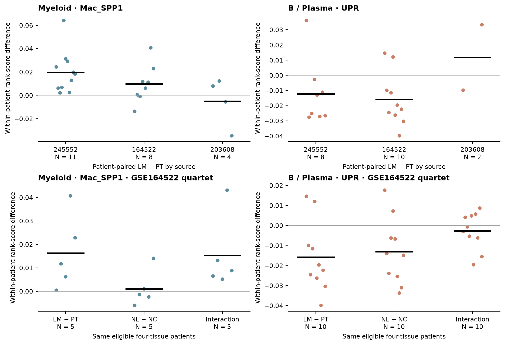
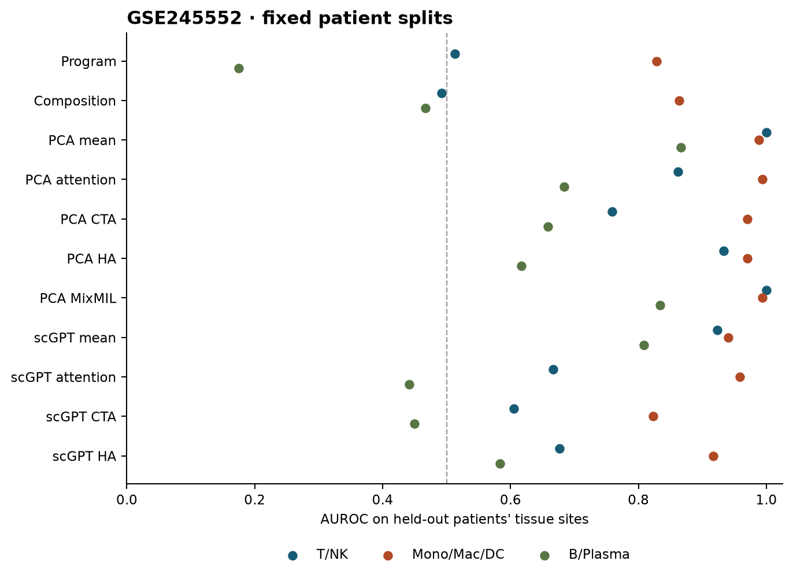
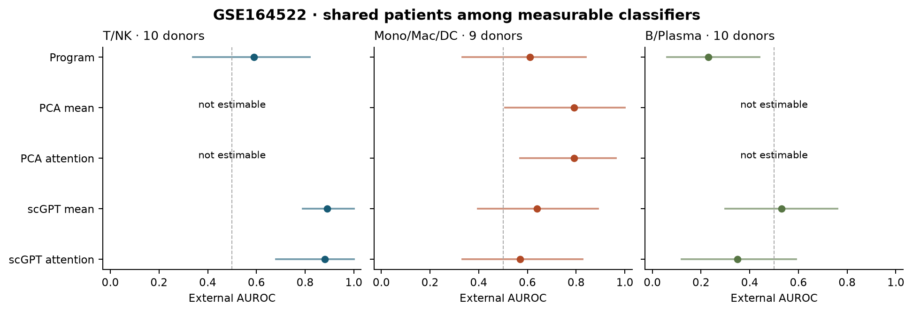
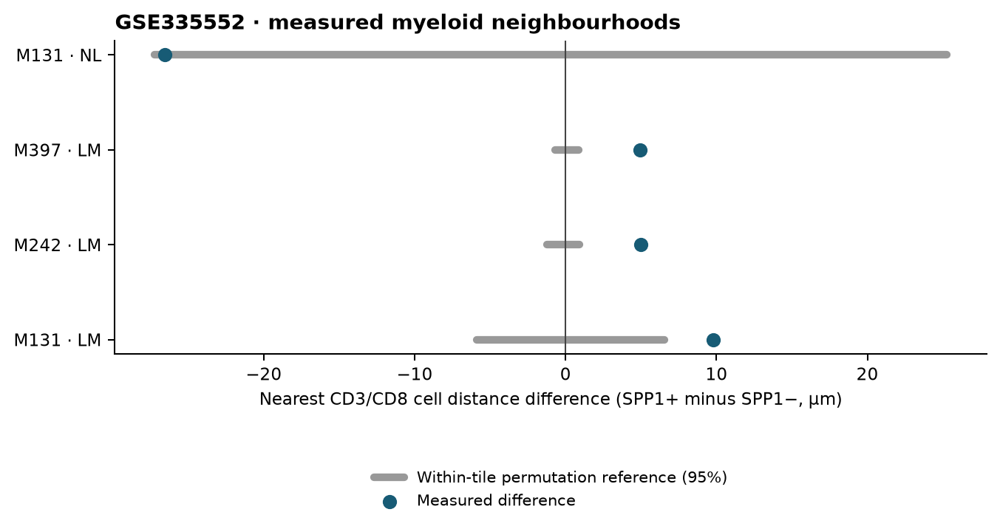

# 结直肠癌原发灶与肝转移灶的患者配对免疫程序与器官背景

**结论。** 髓系 Mac_SPP1 在发现队列的 11/11 位患者中升高，在主要外部队列的 6/8 位中升高。B/Plasma 未折叠蛋白应答（UPR）在两队列分别有 7/8 和 8/10 位患者降低。两个程序都在主要外部来源观察到了预期方向，都未通过预登记的多重校正。四组织配对揭示，UPR 的正常肝与正常结直肠差异接近其肿瘤差。UPenn 独立次要来源的患者方向不一致。目前证据支持描述这两个程序的队列内关联和适用范围。

## 患者内的程序效应

| 患者与比较 | 髓系 Mac_SPP1，预期上升 | B/Plasma UPR，预期下降 |
|---|---|---|
| 发现 GSE245552，LM−PT | +0.01974，11/11 上升 | −0.01219，7/8 下降 |
| 主要外部 GSE164522，LM−PT | +0.00981，6/8 上升，Holm p=0.289 | −0.01577，8/10 下降，Holm p=0.219 |
| 同一批外部四组织患者的 LM−PT、NL−NC 和交互 | N=5，+0.01637、+0.00104、+0.01533，交互 Holm p=0.125 | N=10，−0.01577、−0.01308、−0.00269，交互 Holm p=0.754 |
| 次要来源 GSE203608，LM−PT | −0.00499，2/4 上升 | +0.01173，1/2 下降 |

各项数值为按患者等权的平均程序分数差。GSE164522 中 UPR 的平均肿瘤差 bootstrap 95% 区间为 −0.02544 至 −0.00541；预登记的双侧精确符号检验基于 8 负、2 正，原始 p=0.1094。方向检验与均值区间评估不同的量。髓系四组织交互的五个患者差全部为正，双侧精确检验的原始 p 为 0.0625。当前人数限制了对背景交互的精度。全部八项登记、逐患者差、缺失及未登记的描述对比分开保存。[患者数据](source_data/candidate_patient_effects.csv) · [登记结果](../m6/registered_tests/registered_test_results.csv) · [完整效应与区间](../m6/effects_summary.csv)

**组成和状态。** 发现集髓系 SPP1 单基因的配对计数模型给出 log₂ 倍数差 +4.56，BH 调整 p=8.15×10⁻⁸；按患者只保留第一合格病灶仍为 +4.55。这个开发结果与完整 Mac_SPP1 程序分别报告。UPR 在发现集中按同患者共同检测深度标准化后由 7/8 降至 5/8 同向。主要外部队列将 B 和 Plasma 分开后，平均组成项为 −0.0111、组内状态项为 −0.0047，两者共同构成观察到的 −0.0158。UPenn 的 B/Plasma 仅两对通过细胞门槛。现有证据不足以把 UPR 下降解释为跨患者统一的细胞内功能改变。[配对计数结果](../m3/paired_counts/reference_readouts.csv) · [开发敏感性](../m3/stage_report.md) · [外部组成与背景](../m6/stage_report.md)

## 组织分类与迁移

同一患者的组织与病灶始终在同一折。GSE245552 的 89 个谱系袋、18,610 个固定抽取细胞用于程序、组成、技术对照、PCA/scGPT 均值和 attention，以及 HA、CTA、MixMIL 的有界比较。T/NK、髓系、B/Plasma 的 PCA 均值模型折外 AUROC 分别为 1.000、0.988、0.867；按亚型平衡细胞后分别为 0.521、0.881、0.866，支持变化和亚型构成均会影响结果。髓系 PCA32 MixMIL 的 AUROC 为 0.994，相对均值头的增量为 +0.006（患者 bootstrap 95% 区间 0.000 至 +0.031）。在其他谱系该优势没有持续。[开发比较](../m4/stage_report.md) · [直接前作及适配](../m4/direct_prior/stage_report.md) · [各消融的 N](../m4/patient_metrics.csv)

GSE164522 的 21 个肿瘤标本共形成 58 个合格谱系袋；15 个迁移头中 11 个满足覆盖门槛。T/NK 的 scGPT 均值模型外部 AUROC 为 0.890（10 名患者，95% 区间 0.790 至 1.000）。髓系 PCA 均值及 attention 均为 0.792（9 名有合格标本的患者，其中 8 人有完整配对）；B/Plasma 的 scGPT 均值模型为 0.530。T/NK 与 B/Plasma 的 PCA 基因覆盖低于 95%，保留四个模型的拒判。模型分数反映已取得标本的来源。注意力的细胞排序也存在种子差异，尤其是 scGPT。[外部预测与全部区间](source_data/external_classifier_metrics.csv) · [覆盖](../m6/GSE164522/model_predictions/prediction_coverage.csv) · [归因稳定性](../m4/attribution_stability.csv)

## 组织空间与功能

GSE335552 的三张肝转移切片分别来自三位患者。控制 200 µm 局部方格后，SPP1 阳性髓系细胞至最近 CD3/CD8 细胞的距离比阴性髓系细胞大 4.97、9.76、4.94 µm。实测面板只覆盖 Mac_SPP1 的 9–10/160 个成员，UPR 的 3/107 个成员；唯一一张邻近肝仅五个方格满足对照条件。空间证据限于所测标记与局部几何关系。针对 SPP1 与同供者 CD8 迁移的功能设计已备妥，优先等待独立临床支持与合适的人体材料。[逐切片结果](../m7/spatial_measurement_audit/results.md) · [功能实验准备](../m7/candidate_validation_design.md)

## 数据、方法与证据范围

发现集 GSE245552 的 39 个公开文库来自 16 位患者、13 个解剖 PT–LM 对。采用作者筛选后的稀疏整数 counts 和库内 QC，190,190 个细胞中保留 190,031 个。按固定标记分粗谱系和支持性亚型；组织缺失的基因记录为未测。主要外部 GSE164522 使用原作者连续表达、身份与分类注释，163,347 个细胞、42 个标本、10 位患者。UPenn GSE203608 使用原版矩阵及配套注释，59,661 个体内细胞来自 24 个标本、15 位患者，其中四人提供 PT–LM。三个来源的独立单位均为真实患者，同一人的多灶等权汇入同一患者组织。[发现集 QC](../m2/stage_report.md) · [主要外部身份](../m6/GSE164522/input_scope.md) · [UPenn 原件与身份](../m6/GSE203608/stage_report.md)

四个完整文献程序参与开发筛选，Mac_SPP1 采用 Bill 等正式补表，UPR 采用固定人 Hallmark 版本。单细胞在来源内共同实测基因轴上作正表达降序秩，零表达贡献为零，按可测成员等权评分。主门槛为至少 80% 冻结成员且至少五个实测基因、每标本每谱系至少 50 个细胞。2026-11-21 12:44:41 UTC 冻结两个候选、符号和四个检验家族后才计算新增外部效应。各家族单独作双侧精确符号检验与 Holm 校正。GSE164522 既往发表的亚群比例已有暴露；GSE178318 的使用条件仍待落实，两条预定记录的原始 p 均缺失。[程序来源](../m3/program_definitions_draft/development_rules.md) · [冻结与暴露](../m5/freeze_record.md) · [局限与未测项](limitations_and_deviations.md)

重建入口包括真实数据导入、评分、患者统计、模型运行、外部复现和制图。科研结论基于真实患者与组织结果；起步包的 106 项合成检查在 M0 单独归档。[复算顺序](reproduce.md) · [阶段索引](reproducibility_manifest.csv)
