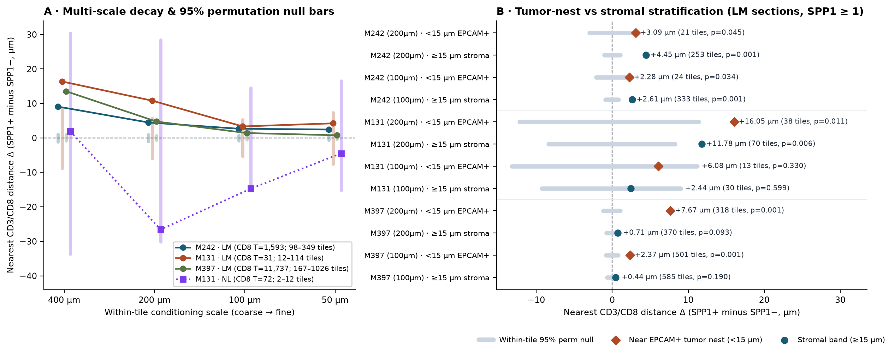

# 结直肠癌原发灶与肝转移灶的患者配对免疫程序、器官背景交互与多尺度微环境（`CRLM_V1.1_AUDIT_REMEDIATED`）

> [!IMPORTANT]
> **三版本透明架构、前序暴露披露与 `GSE178318` 前瞻零表达暴露验证**
> 本报告呈现经全链路数理与工程审计重构的主交付版本 **`CRLM_V1.1_AUDIT_REMEDIATED`（冻结标识 `CRLM_V1.1_245_F1`）**，并与完整封存的原版基线 **`CRLM_V1_245_F1`**（[归档目录](../archive/CRLM_V1_245_F1/)）及纯客观 Bug 修复对照轨 **`CRLM_V1_245_F1_techfix`**（[勘误目录](../techfix_v1_f1/)）并列对照。本研究严格区分外部证据属性与统计治理边界：
> 1. **暴露后稳健性重评估（`GSE164522`、`GSE203608`）**：因初版曾访问其表达矩阵（历史日期级与本次秒级日志见 [external_access_log.csv](../m5/external_access_log.csv) 与 [external_exposure_master_log.csv](../m0/external_exposure_master_log.csv)），`V1.1` 在唯一开发集 `GSE245552` 内独立重筛新候选后对其的评估界定为 Post-exposure External Robustness Re-evaluation；
> 2. **前瞻零表达暴露验证（`GSE178318`）**：冻结前仅审阅公开论文与 GEO 样本/条形码元数据（**零前序表达矩阵或效应暴露**），在 `CRLM_V1.1_245_F1` M5 密码学锁定（`5ce11557...`）及 `5b01467` 提交之后首次获授权解锁原始 UMI 矩阵，并在 **0 字节修改** 任何预冻结候选、匹配对照集、注释规则或分类头的前提下完成。至此，**3 个外部队列共 8/8 项预登记检验均具真实患者观测值（零缺失 NA；4 个独立 Holm 家族每族 `α = 0.05` 不等于全研究 FWER 为 `0.05`；跨队列供者级非重叠状态保持 `unproven`）**。

**核心结论。** 消除单细胞排序评分的测序深度截断偏倚、跨队列基因别名脱节与粗谱系细胞混合伪影后：
1. **`T/NK::B07_Th17_TWEAK`（黏膜 Th17–TWEAK 程序）通过四组织观测交互 Holm 校正并在前瞻队列复现方向**：在开发集 `GSE245552` 的 `10/12` 位配对患者中肝转移相对原发灶下调（`mean D_T = −0.03275`，`95%` 区间 `[−0.05209, −0.01586]`，双侧符号 `p = 0.03857`；纯 `CD4 T cell` 内 `−0.03888`，亚型内状态占比 **`95.2%`**；无监督 cNMF `T_NK__cNMF_05` 独立重发现 `12/12` 下调，配对伪批量确认 `IL17A` `log₂FC = −3.784, BH = 0.0162` 与 `RORC` `log₂FC = −0.986, BH = 0.0299`）。在主外部 `GSE164522` 同患者四组织子集 `Q`（`N = 10`）中，正常肝高于正常结肠（`D_N_Q = +0.03995`，`10+/0−`），而肝转移灶逆转下调（`D_T_Q = −0.00923`，`3+/7−`），使**同患者四组织观测交互项 `I = D_T_Q − D_N_Q = −0.04918`（`1+/9−`，原始 `p = 0.02148`，背景族 `Holm p = 0.04297 <= 0.05`；观测交互非已识别因果转移效应）显著通过预登记多重比较校正**，焦点纯 **`CD4 T cell`** 内 `D_T = −0.02938`（`1+/9−`, `raw p = 0.02148`）。在**零表达暴露前瞻队列 `GSE178318`（`N = 6`；双检验 Holm 数学下界 `2/2^6 = 0.03125 > 0.025`，承担预定方向/精度支持）**中，宽谱系 `D_T = −0.00986`（`2+/4−`，符合预登记方向），并在焦点纯 **`CD4 T cell` 内强化至 `−0.02067` `[−0.04040, −0.00169]`（`1+/5−`，`raw p = 0.21875`；再次复现被 `CD8 T cell` `+0.00499` 跨亚型稀释的规律）**。
2. **`Mono/Mac/DC::Core_Lipid_SAM_R`（脂质/瘢痕相关巨噬核心程序）在前瞻队列达 `5/6` 同向并在全部四队列巨噬细类中同向升高**：在开发集 `GSE245552` 的 **`11/11` 位患者中升高**（`mean D_T = +0.18092`，`95%` 区间 `[+0.14409, +0.22056]`，`p = 0.00098`；纯 `Macrophage` `+0.16857, 11/11`；配对伪批量确认 `SPP1` `log₂FC = +4.266, BH = 0.0087`、`APOC1` `+3.127, BH = 0.0015`、`GPNMB` `+1.901, BH = 0.0054`、`APOE` `+2.393, BH = 0.0061`、`TREM2` `+2.060, BH = 0.0107`）。在**零表达暴露前瞻队列 `GSE178318`** 中，宽髓系 **`D_T = +0.09936`（`5+/1−`, `N=6`, `raw p = 0.2188`, `Holm p = 0.4375`）**、纯 **`Macrophage` `+0.10183` `[+0.02595, +0.19140]`（`5+/1−`）**（肿瘤核内 `Resident_Kupffer = −0.01631, 3+/3−` 未同步升高，但不替代缺失的邻近正常肝 `NL`；未治疗 `2+/1−` `+0.02124` vs 术前化疗 `3+/0−` `+0.17749`）；在 `GSE164522` 中宽髓系 `+0.01677`（`5+/3−`, `Holm p = 0.7266`）、纯巨噬 `+0.02847`、四组织 `Q`（`N=5`）`D_T_Q = +0.01862`、`D_N_Q = −0.05562`、观测交互 `I = +0.07425`（`4+/1−`, `Holm p = 0.3750`；按 `AGENTS.md` §6，`p > 0.05` 不单独证明不存在器官背景），共线去污染 `Mac_SPP1_clean` 达 `7+/1−`（`D_T = +0.00936`）与四组织 `5+/0−`（`I = +0.01542`）；在 `GSE203608` 宽髓系为 `+0.01713`（`2+/2−`），纯巨噬呈 `3+/1−`（`+0.03051`）。
3. **初版候选 `B/Plasma::UPR` 跨独立队列一致被证伪为组成偏移与深度伪影**：去偏 UCell 后开发集同向率仅 `6/8`（`p = 0.2891`，`72.6%` 源于浆细胞比例下降，配对伪批量 **`0` 个 `BH < 0.05` 基因**）；在 `GSE164522` 中 `77.3%` 源于比例差且四组织 `I = −0.00090` 完全抵消；在 `GSE178318`（`min >= 1`, `N = 4`）中总差 `−0.00447`（`1+/3−`）拆分为 **`65.6%` 组成分量（`−0.00294`）** 与 `34.4%` 亚型内状态分量（`−0.00154`，受低浆细胞数 `COL15 = −0.01095` 拉负，`3/4` 供者及 `min >= 20` `N = 3` 状态均值 `+0.00160` 均为正；纯 `plasma cell >=50` 仅 `N = 1` 例 `+0.00587`，`>=20` `N = 3` 为 `+0.00143 [2+/1−]`；`GSE203608` 无双侧支持对称分解）。

---

## 一、三版本患者配对程序检验并列总表（3 个外部队列共 8/8 预登记检验全观测闭环）

完整数值见 [three_version_evidence_comparison.csv](../m6/three_version_evidence_comparison.csv) 与 [registered_test_results.csv](../m6/registered_tests/registered_test_results.csv)：

| 队列与对比（证据属性） | 谱系 :: 程序 | `CRLM_V1_245_F1`（原版基线） | `CRLM_V1_245_F1_techfix`（纯技术勘误） | `CRLM_V1.1_245_F1`（去偏 UCell 方法学重构） |
|---|---|---|---|---|
| **GSE245552 开发集** `D_T` | `Mono/Mac/DC::Core_Lipid_SAM_R` | 未纳入初版 4 程序筛选 | — | **`+0.18092`** (`11+/0−`, `N=11`, `p=0.0010`；纯巨噬 `+0.16857`, `11/11`) |
| **GSE164522 主外部** `D_T` | `Mono/Mac/DC::Core_Lipid_SAM_R` | 未登记该版本主检验 | 未登记该版本主检验 | `+0.01677` (`5+/3−`, `N=8`; `p=0.7266`, **`p_H=0.7266`**；纯巨噬 `+0.02847`) |
| **GSE164522 四组织** `I` | `Mono/Mac/DC::Core_Lipid_SAM_R` | 未登记该版本主检验 | 未登记该版本主检验 | `+0.07425` (`4+/1−`, `N=5`; `p=0.3750`, **`p_H=0.3750`**；`D_T_Q=+0.01862, D_N_Q=−0.05562`) |
| **GSE178318 零表达暴露前瞻** `D_T` | `Mono/Mac/DC::Core_Lipid_SAM_R` | 未登记该版本主检验 | 未登记该版本主检验 | **`+0.09936` (`5+/1−`, `N=6`; `p=0.2188`, `p_H=0.4375`；纯巨噬 `+0.10183`, `5/1`)** |
| **GSE203608 次要** `D_T` | `Mono/Mac/DC::Core_Lipid_SAM_R` | 未登记该版本主检验 | 未登记该版本主检验 | `+0.01713` (`2+/2−`, `N=4`; `p_H=1.0000`；纯巨噬 `+0.03051`, `3+/1−`) |
| **GSE245552 开发集** `D_T` | `T/NK::B07_Th17_TWEAK` | 未纳入初版 4 程序筛选 | — | **`−0.03275`** (`2+/10−`, `N=12`, `p=0.0386`；纯 `CD4 T` `−0.03888`, `2+/10−`) |
| **GSE164522 主外部** `D_T` | `T/NK::B07_Th17_TWEAK` | 未登记该版本主检验 | 未登记该版本主检验 | `−0.00923` (`3+/7−`, `N=10`; `p=0.3438`, **`p_H=0.6875`**；**纯 `CD4 T` `−0.02938`, `1+/9−`, `p=0.0215`**) |
| **GSE164522 四组织** `I` | `T/NK::B07_Th17_TWEAK` | 未登记该版本主检验 | 未登记该版本主检验 | **`−0.04918` (`1+/9−`, `N=10`; `p=0.0215`, `p_H=0.0430 <= 0.05` 显著通过)** |
| **GSE178318 零表达暴露前瞻** `D_T` | `T/NK::B07_Th17_TWEAK` | 未登记该版本主检验 | 未登记该版本主检验 | **`−0.00986` (`2+/4−`, `N=6`; `p=0.6875`, `p_H=0.6875`；纯 `CD4 T` `−0.02067`, `1+/5−`)** |
| **GSE203608 次要** `D_T` | `T/NK::B07_Th17_TWEAK` | 未登记该版本主检验 | 未登记该版本主检验 | `−0.00850` (`1+/1−`, `N=2`; `p_H=1.0000`；洁净 `rule_m1 >=20` 为 `−0.02169`, `0+/3−`) |
| **GSE164522 对照** `D_T` / `I` | `Mono/Mac/DC::B19_S4_Mac_SPP1`（V1.1 为 `_clean`） | `+0.00981` (`6/2`) / `+0.01533` (`5/0`) | `+0.00828` (`6/2`) / `+0.01627` (`5/0`) | `+0.00936` (`7+/1−`, `p=0.0703`) / `+0.01542` (`5+/0−`, `p=0.0625`，`B19_S4_Mac_SPP1_clean`) |
| **GSE178318 对照** `D_T` | `Mono/Mac/DC::B19_S4_Mac_SPP1`（V1.1 为 `_clean`） | `NA`（初版待条款） | `+0.00682` (`5+/1−`, `p_H=0.4375`) | `+0.00648` (`5+/1−`, `N=6`, `raw p=0.2188`，`B19_S4_Mac_SPP1_clean`) |
| **GSE164522 / 178 淘汰对照** `D_T` | `B/Plasma::HALLMARK_UNFOLDED_PROTEIN_RESPONSE` | `164`: `−0.01577` (`2/8`)；`178`: `NA` | `164`: `−0.01870` (`2/7`)；`178`: `−0.01038` (`1/3`) | `164`: `−0.01381` (`1/8`, `I=−0.00090`)；`178`: `−0.00447` (`1/3`, `65.6%` 组成、`3/4` 状态为正) |

[主候选逐患者数据](source_data/candidate_patient_effects.csv) · [三队列 UPR 组成分解源表](source_data/upr_decomposition_reference.csv) · [M3 五重门禁筛选表](../m3/candidate_screen.csv) · [M6 跨队列证据卡](../m6/cross_cohort_evidence_cards.md)

---

## 二、全袋组织分类、反常解谜与双独立外部队列（`GSE164522` + 前瞻 `GSE178318`）`15/15` 迁移验证

### 1. 开发集 `GSE245552` 全袋基准与消融解谜（[M4 报告](../m4/stage_report.md)）
`V1.1` 全量保留 33 个肿瘤文库的 **88 个单谱系袋（`70,388` 个细胞）**与 **33 个 `All3Lineages` 联合袋（`70,628` 个细胞）**：消除 `min(n_T, n_NK)>=3` 细胞饥饿后，**`T/NK PCA_subtype_balanced` 由初版 `0.521` 恢复至 `0.990`（`12/12` 配对全正）**，纯 `CD8 T = 0.974`、纯 `CD4 T = 1.000`、`PCA_remove_organ_markers = 1.000`（而 `composition_elastic = 0.508`、`QC_elastic = 0.405`）；修正未配对 PT 权重与折内锁定去偏 UCell 后，髓系 `program_elastic` 升至 **`0.935`**，`B/Plasma` 消除 `0.175` 反向失真回归 `0.567`；`256 × 10` 子袋审计证实单次 256 细胞截断导致 attention 产生 `0.065–0.275`（`PCA` `0.118–0.233`、`scGPT` `0.065–0.275`）的 AUROC 极差；`200` 次患者置换零分布居中于 `0.506–0.523`（单侧经验 $p \le 0.0199$，双侧 $p \le 0.03483$；三谱系 95% 零分布外包络 `[0.22, 0.77]`）。`PCA32_MixMIL`（`All3Lineages = 1.000`，髓系 `0.994`）与简约 `PCA_mean`（`All3Lineages = 0.986`，`T/NK = 0.995`）并列最优。

### 2. 双外部队列（主外部 `GSE164522` + 前瞻队列 `GSE178318`）全袋迁移与真实三版本 XPU 对照
在共享核基因空间下，两个独立外部队列均实现 **`512/512 = 100.0%` PCA HVG 覆盖（15/15 模型全部激活，0 拒判）**，而原版 `CRLM_V1_245_F1` 在两队列均重现完全相同的 `T/NK` 与 `B/Plasma` `4/15` 拒判（`<95%` 原始符号 HVG）；`GSE178318` 历史两版本均在各自真实分词与特征管线下独立完成 `<=256` 细胞子袋 XPU 编码（`l_raw != l_tf != l_v11`）：

| 谱系 | 冻结分类头 | `GSE164522`（`V1_F1` -> `Techfix` -> **`V1.1`**） | **`GSE178318` 零表达暴露前瞻**（`V1_F1` -> `Techfix` -> **`V1.1`**） |
|---|---|---|---|
| `T/NK` | `program_elastic` | 0.590 -> 0.610 -> **0.500** [0.270, 0.770] (6/10) | 0.667 -> 0.667 -> **0.611** [0.361, 0.861] (5/6) |
| `T/NK` | `PCA_mean` | 拒判 -> 0.960 -> **0.970** [0.900, 1.000] (**10/10**) | 拒判 -> 0.889 -> **0.917** [0.778, 1.000] (**6/6**) |
| `T/NK` | `PCA_attention` | 拒判 -> 0.970 -> **0.980** [0.920, 1.000] (**10/10**) | 拒判 -> 0.917 -> **0.917** [0.778, 1.000] (**6/6**, BA=0.833) |
| `T/NK` | `scGPT_mean` | 0.890 -> 0.870 -> **0.810** [0.710, 0.980] (10/10) | 0.556 -> 0.556 -> **0.583** [0.444, 0.778] (5/6) |
| `T/NK` | `scGPT_attention` | 0.880 -> 0.950 -> **0.880** [0.700, 1.000] (9/10) | 0.778 -> 0.722 -> **0.750** [0.417, 1.000] (4/6) |
| `Mono/Mac/DC` | `program_elastic` | 0.611 -> 0.569 -> **0.583** [0.302, 0.852] (5/8) | 0.778 -> 0.778 -> **0.750** [0.667, 1.000] (**6/6**) |
| `Mono/Mac/DC` | `PCA_mean` | 0.792 -> 0.778 -> **0.750** [0.463, 1.000] (6/8) | 0.861 -> 0.889 -> **0.889** [0.778, 1.000] (**6/6**) |
| `Mono/Mac/DC` | `PCA_attention` | 0.792 -> 0.847 -> **0.889** [0.630, 1.000] (6/8) | 0.750 -> 0.750 -> **0.944** [0.833, 1.000] (**6/6**) |
| `Mono/Mac/DC` | `scGPT_mean` | 0.639 -> 0.583 -> **0.625** [0.361, 0.889] (6/8) | 0.833 -> 0.833 -> **0.833** [0.722, 1.000] (**6/6**) |
| `Mono/Mac/DC` | `scGPT_attention` | 0.569 -> 0.653 -> **0.806** [0.537, 1.000] (7/8) | 0.944 -> 0.917 -> **0.778** [0.556, 1.000] (5/6) |
| `B/Plasma` | `program_elastic` | 0.230 -> 0.289 -> **0.856** [0.675, 1.000] (**8/9**) | 0.500 -> 0.500 -> **0.583** [0.167, 1.000] (3/4; 配对集 0.750) |
| `B/Plasma` | `PCA_mean` | 拒判 -> 0.811 -> **0.667** [0.428, 0.860] (6/9) | 拒判 -> 0.875 -> **0.708** [0.208, 1.000] (3/4; 配对集 0.813) |
| `B/Plasma` | `PCA_attention` | 拒判 -> 0.844 -> **0.844** [0.683, 0.971] (**8/9**) | 拒判 -> 0.792 -> **0.625** [0.333, 0.944] (**4/4**; 配对集 0.813) |
| `B/Plasma` | `scGPT_mean` | 0.530 -> 0.556 -> **0.578** [0.329, 0.825] (6/9) | 0.750 -> 0.708 -> **0.708** [0.333, 1.000] (2/4; 配对集 0.625) |
| `B/Plasma` | `scGPT_attention` | 0.350 -> 0.444 -> **0.333** [0.070, 0.622] (2/9) | 0.333 -> 0.333 -> **0.667** [0.208, 1.000] (3/4, BA=0.792; 配对集 0.813) |

在主外部队列 `GSE164522` 上，透明线性 `PCA` 在三谱系均不劣于或显著高于 `scGPT_mean`（`T/NK`: `PCA_attention − scGPT_mean = +0.170 [+0.020, +0.260]`、`PCA_mean − scGPT_mean = +0.160 [+0.020, +0.250]`）；在前瞻队列 `GSE178318`（`N = 6 / N = 4` 小样本，`12` 对 PCA vs scGPT 比较中 `10` 对 95% CI 跨 `0`）上，`T/NK` 均值池化显著支持 `PCA`（`PCA_mean − scGPT_mean = +0.333 [+0.083, +0.556]`，未治疗与术前化疗均达 `3/3` `LM > PT`），髓系 `PCA_attention = 0.944`（`6/6` 对）亦居首，而 `B/Plasma` 注意力池化下 `scGPT_attention = 0.667` 高于 `PCA_attention = 0.625`（`PCA_mean = 0.708 = scGPT_mean`），整体证实零样本基础模型未相对简约线性 `PCA` 提供一致外部增量。[164 预测源表](source_data/external_classifier_metrics.csv) · [178 前瞻预测源表](source_data/external_gse178318_classifier_metrics.csv) · [图 4 三版本逐点源表](source_data/three_version_classifier_comparison.csv) · [双队列三版本汇总表](../m6/three_version_classifier_comparison.csv)

---

## 三、原位空间微解剖分隔审计与人体四组织/功能消歧实验方案（湿实验执行数为 0）

1. **接触边界消歧、半格平移与多尺度/肿瘤巢分层空间几何（`GSE335552`，3 患者 / 4 张 Xenium `462/319`-gene 切片）**：
   - 对齐 `CRLM_V1.1_245_F1` 基因集后，去污染 `B19_S4_Mac_SPP1_clean` 探针覆盖共享核 `7/157`（全集 `7/159`）、`UPR` 共享核 `3/111`（全集 `3/113`）、`Core_Lipid_SAM_R` `4–5/16`、`Resident_Kupffer` `7–9/14`（含 `LYVE1, CETP`）、`Core_Chemokine_IFN_C` `6/14`、`B07_Th17_TWEAK` `4–5/14`（缺 `IL17A, TNFSF12`）；通过转录本优势比在 `M397T` 救回 **`3,236` 个接触态 `CD8 T` 细胞（`8,501 -> 11,737`，四片合计救回 `3,584` 个）**。
   - 方格由 `400 µm` 细化至 `50 µm` 时，`M242T`（`+9.08 -> +2.44 µm`）与 `M397T`（`+13.53 -> +0.77 µm`）距离差大幅衰减（半格平移 `+100 µm / +25 µm` 检验均保持 `p = 0.001`：如 `50 µm` 半格平移 `M242T +1.50 µm`、`M397T +1.00 µm`），`M131T`（仅 `31` 个 `CD3/CD8` 细胞）在 `<=100 µm` 落入置换零分布（`100 µm`: `p = 0.203`；`50 µm`: `p = 0.289`）。按距 `EPCAM+` 肿瘤上皮 `<15 µm` vs `>=15 µm` 对称分层显示：在 `M397T`（`200 µm` 格）近巢 `<15 µm` 为 **`+7.67 µm (318 tiles, p = 0.001)`** 而**间质带 `>=15 µm` 骤降至 `+0.71 µm (370 tiles, p = 0.093)`**（`100 µm` 格 `+0.44 µm, p = 0.190`）；而在 `M242T`（仅 `1,340` 个 `EPCAM+` 细胞且髓系 `~90%` `SPP1+`）中 `200 µm` 格近巢为 `+3.09 µm (21 tiles, p = 0.045)`、间质带为 `+4.45 µm (253 tiles, p = 0.001)`（方向与 `M397T` 相反，且单分子边界存在上皮 `EPCAM` 转录本溢出风险），提示距离差受中尺度微解剖构型与切片肿瘤巢分布共同制约。[空间详报](../m7/spatial_measurement_audit/results.md) · [半格平移表](../m7/spatial_measurement_audit/grid_shift_sensitivity.csv)
2. **人体四组织原位分区与自体髓系–CD8 T 细胞趋化消歧实验方案（已完成实际湿实验数为 `0`，纯可操作方案设计）**：
   - [实验方案](../m7/candidate_validation_design.md) 严格分为两阶段：（1）**独立配对人体四组织（`PT / LM / NC / NL`）盲法病理四区标注**（`Viable Tumor Core`、跨越 `EPCAM+` 边界内外固定宽度的 `Invasive Margin`、`Necrotic Core & Perinecrotic Rim`、`Adjacent Non-tumor Parenchyma`）结合 **`SPP1 + CXCL9` 双色原位 RNA 杂交 + `CD68`（`CD163/C1QA`）免疫荧光 + `EPCAM/PanCK` 上皮排除 + `CD3 + CD8` 定位**，先在独立标定片锁定主终点 $Q$（`SPP1+CXCL9−` 髓系比例）再检验供者级四组织交互 $I_i = D_{T,i}^Q - D_{N,i}^Q$；（2）仅当原位终点通过且基线 `SPP1` 状态门禁核验合格时，实施**人源髓系条件培养基（CM；最低可行体系为独立健康供者外周血单核来源巨噬样细胞 MDM，增强体系为新鲜手术切除 CRLM 原代 TAM）→ 配对同供者活体自体 `CD3+CD8+` T 细胞 Transwell 定向趋化实验**，在 `Baseline` 与预设 `IFN-γ` 双背景下（含无细胞 IFN-γ 洗脱残留对照）并列比较 `NT_Ctrl | SPP1_KD | SPP1_Rescue_Endo | SPP1_KD + rhSPP1_Ext`（生理上清浓度外源重组蛋白回补），正面区分外分泌配体效应与 `Sun et al., Immunity 2026 [B43]` 揭示的**胞内 `SPP1–TRIM21–SOCS1` 抑制髓系 IFN-γ 信号负反馈机制**，并配套上下室等浓度零梯度随机运动对照（`Chemokinesis Control`）及条件性抗 `CXCL9 + CXCL10` 中和阻断（明确排除单独抗 `CD44` 阻断；仅当细胞内源臂阴性时才条件性延伸自体 `EPCAM+` 肿瘤类器官间接重塑）。

---

## 四、数据规模、方法学准则与复算入口

- **全部四个单细胞队列均严格以真实患者 `donor_uid` 为唯一独立推断单位，原位空间队列仅执行切片内方格置换的探索性微解剖几何审计**：`GSE245552`（16 患者、39 文库、`173,450` 保留细胞，肿瘤全袋 `70,628` 细胞）；`GSE164522`（10 患者、42 标本、`156,511` 洁净细胞，肿瘤全袋 `68,050` 细胞）；`GSE178318`（6 对同步切除 IV 期 MSS 患者、12 个实体瘤文库 `105,813` 保留细胞，编码核心免疫细胞 `59,338` 个、34 个 `>=50` 细胞合格袋入袋 `59,298` 个，3 份外周血 `26,950` 细胞 100% 物理隔离）；`GSE203608`（15 体内患者、24 标本、`47,525` 洁净细胞）；`GSE335552`（3 患者、4 张 Xenium 切片）。
- **复算与校验**：全流程脚本、隔离 `.venv-*` 环境、阶段 SHA256 清单与局限边界见 [复算入口](reproduce.md)、[阶段索引](reproducibility_manifest.csv) 与 [局限与偏差说明](limitations_and_deviations.md)。
