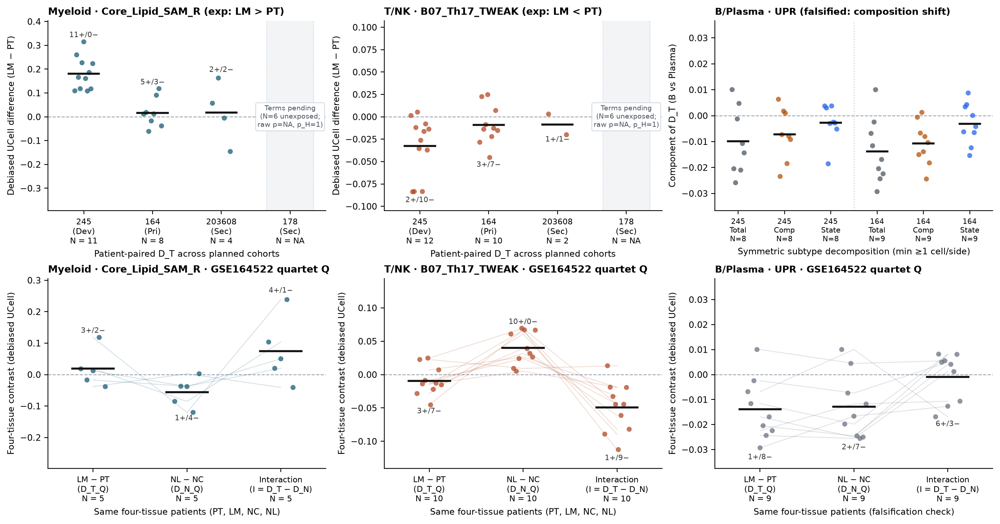
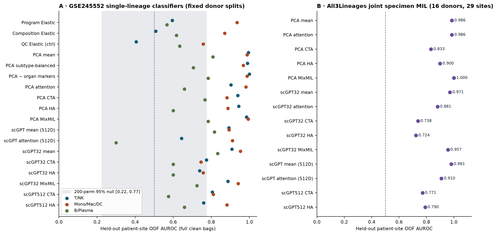
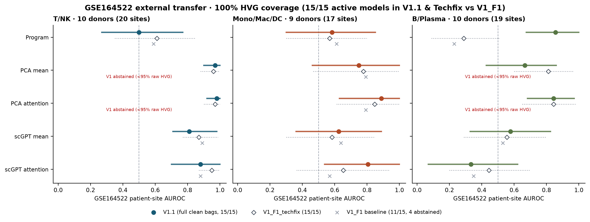

# 结直肠癌原发灶与肝转移灶的患者配对免疫程序、器官背景交互与多尺度微环境（`CRLM_V1.1_AUDIT_REMEDIATED`）

> [!IMPORTANT]
> **三版本透明架构与历史暴露声明**
> 本报告呈现经全链路数理与工程审计重构后的主交付版本 **`CRLM_V1.1_AUDIT_REMEDIATED`（冻结标识 `CRLM_V1.1_245_F1`）**，并与完整封存的原版基线 **`CRLM_V1_245_F1`**（[归档目录](../archive/CRLM_V1_245_F1/)）及纯客观 Bug 修复对照轨 **`CRLM_V1_245_F1_techfix`**（[勘误目录](../techfix_v1_f1/)）并列对照。鉴于初版已在外部队列 `GSE164522` 与 `GSE203608` 执行过评估（历史暴露主日志见 [external_exposure_master_log.csv](../m0/external_exposure_master_log.csv) 与冻结披露 [external_access_log.csv](../m5/external_access_log.csv)），`V1.1` 的候选重筛、20 桶检测率匹配去偏背景及模型训练供者虽严格限定在开发集 `GSE245552` 内完成（仅使用公开核基因符号交集对齐外部特征可用范围，未使用任何外部表达值或表型），其外部评估在科学推断上明确定位为**已披露前序暴露的外部独立队列稳健性重评估（Post-exposure External Robustness Re-evaluation）**；`GSE178318`（6 对患者）保持零表达矩阵暴露（`terms_pending`，仅核查公开 GEO 元数据），保留为获取作者条款后的真正未暴露表达验证源。

**核心结论。** 消除单细胞排序评分的测序深度截断偏倚、跨队列基因别名脱节与粗谱系细胞混合伪影后：
1. **`T/NK::B07_Th17_TWEAK`（黏膜 Th17–TWEAK 程序）展现显著的四组织肿瘤–器官背景负向观测交互**：在开发集 `GSE245552` 的 `10/12` 位配对患者中肝转移相对原发灶下调（`mean D_T = −0.03275`，`95%` 区间 `[−0.05209, −0.01586]`，双侧符号 `p = 0.03857`；纯 `CD4 T cell` 内 `−0.03888`，亚型内状态占比 **`95.2%`**；无监督供者共识 cNMF `T_NK__cNMF_05` 独立重发现 `12/12` 下调，`T/NK` 配对伪批量确认 `IL17A` `log₂FC = −3.784, BH = 0.0162` 与 `RORC` `log₂FC = −0.986, BH = 0.0299`）。在主外部队列 `GSE164522` 同患者四组织合格子集 `Q`（`N = 10`）中，正常肝相对正常结肠一致偏高（`D_N_Q = +0.03995`，`10+/0−`），而肝转移灶相对原发灶反向偏低（`D_T_Q = −0.00923`，`3+/7−`；等价地 `PT − NC = +0.03404`、`LM − NL = −0.01514`），使**四组织观测交互项 `I = D_T_Q − D_N_Q = −0.04918`（`1+/9−`，原始 `p = 0.02148`，背景族 `Holm p = 0.04297 <= 0.05`）通过预登记多重比较校正**；在生物学对应的纯 **`CD4 T cell`** 内，`GSE164522` 肿瘤差达 **`−0.02938`（`1+/9−`，`raw p = 0.02148`）**（宽 `T/NK` 的 `D_T` `Holm p = 0.6875` 系被肝内富集的 `CD8 T cell` `+0.02003` 跨亚型稀释所致）。该观测交互表明原发结直肠与肝转移肿瘤对各自身处器官正常基线的偏离方向相反且超出正常结肠–肝脏本底差异（具体因果机制待功能验证）。
2. **`Mono/Mac/DC::Core_Lipid_SAM_R`（脂质/瘢痕相关巨噬核心程序）在焦点巨噬细类同向但宽谱系小样本符号检验未达主族显著**：在开发集 `GSE245552` 的 **`11/11` 位患者中升高**（`mean D_T = +0.18092`，`95%` 区间 `[+0.14409, +0.22056]`，`p = 0.00098`；纯 `Macrophage` 内 `11/11` 升高 `+0.16857`；宽髓系配对伪批量确认 `SPP1` `log₂FC = +4.266, BH = 0.0087`、`APOC1` `+3.127, BH = 0.0015`、`GPNMB` `+1.901, BH = 0.0054`、`APOE` `+2.393, BH = 0.0061`、`TREM2` `+2.060, BH = 0.0107`）。在 `GSE164522` 中，宽髓系 `D_T = +0.01677`（`5+/3−`, `N=8`, `Holm p = 0.7266`）、洁净作者标注纯 `Macrophage` `D_T = +0.02847`（`5+/3−`）、四组织交互 `I = +0.07425`（`4+/1−`, `N=5`, `Holm p = 0.3750`；正常肝相对结肠 `D_N_Q = −0.05562`，同期 `Resident_Kupffer` `I = +0.06798, 4+/1−`，小样本下驻留巨噬背景尚待更大四组织样本解析）；同机制去污染次要集 `B19_S4_Mac_SPP1_clean` 达 **`7+/1−`（`D_T = +0.00936`, `raw p = 0.0703`）** 及四组织 **`5+/0−`（`I = +0.01542`, `raw p = 0.0625`，触及 `N=5` 双侧符号检验离散下界）**；在独立体内队列 `GSE203608` 中宽髓系为 `2+/2−`（`+0.01713`），而在纯 **`Macrophage`** 内呈 **`3+/1−` 升高（`+0.03051`）**。
3. **初版候选 `B/Plasma::UPR` 被确证为测序深度截断与浆细胞/B 细胞组成偏移伪影**：经 20 桶检测率匹配去偏 UCell 校正后，其细胞级基因检出数相关性由 `+0.6115` 降至 `+0.2708`、配对深度差相关性由 `+0.8810` 降至 `+0.3095`；开发集同向率降至 `6/8`（`p = 0.2891`），其中 **`72.6%`**（`−0.00716 / −0.00986`）源于 `B` vs `Plasma` 亚型比例变化（已解析免疫分母下 `B/Plasma` 总比例在 `13/13` 患者下降 `−22.5` 个百分点、浆细胞占已解析免疫比例在 `12/13` 患者下降），纯 `plasma cell` 内仅 `5/8`（`−0.00308`），且 `B/Plasma` 与纯 `plasma cell` 配对伪批量在有限样本 $t$ 检验与精确符号翻转下均呈 **`0` 个 `BH < 0.05` 差异基因**（对比同输入渐近正态 Wald 的 `42` 与 `39` 个显著呼叫及原版归档 `B/Plasma` 的 `47` 个呼叫）。在 `GSE164522` 中其 `V1.1` 总差同样有 **`77.3%`**（`techfix` 旧公式下为 `80.7%`）由 `B` vs `Plasma` 比例差贡献，且四组织 `D_T_Q`（`−0.01381`）与 `D_N_Q`（`−0.01291`）近似抵消（`I = −0.00090`, `95% CI [−0.00721, +0.00473]`, `6+/3−`），独立印证淘汰门禁的科学性。

---

## 一、三版本患者配对程序检验并列总表（`V1_F1` vs `V1_F1_techfix` vs `V1.1`）

以下并列展示原版归档、纯技术勘误（不改动初版候选与 `positive_midrank_1500` 公式，仅修复 HGNC 符号、共享核背景与跨谱系双细胞/死细胞污染）及 `V1.1` 方法学重构（去偏 UCell + 五重门禁重筛）的完整轨迹（完整数值见 [three_version_evidence_comparison.csv](../m6/three_version_evidence_comparison.csv) 与 [registered_test_results.csv](../m6/registered_tests/registered_test_results.csv)）：

| 队列与对比 | 谱系 :: 程序 | `CRLM_V1_245_F1`（原版基线） | `CRLM_V1_245_F1_techfix`（纯技术勘误） | `CRLM_V1.1_245_F1`（去偏 UCell 方法学重构） |
|---|---|---|---|---|
| **GSE245552 开发集** `D_T` | `Mono/Mac/DC::Core_Lipid_SAM_R` | 未纳入初版 4 程序筛选 | — | **`+0.18092`** (`11+/0−`, `N=11`, `p=0.0010`；纯巨噬 `+0.16857`, `11/11`) |
| **GSE164522 主外部** `D_T` | `Mono/Mac/DC::Core_Lipid_SAM_R` | 未登记该版本主检验 | 未登记该版本主检验 | `+0.01677` (`5+/3−`, `N=8`; `p=0.7266`, **`p_H=0.7266`**；作者纯巨噬 `+0.02847`) |
| **GSE164522 四组织** `I` | `Mono/Mac/DC::Core_Lipid_SAM_R` | 未登记该版本主检验 | 未登记该版本主检验 | `+0.07425` (`4+/1−`, `N=5`; `p=0.3750`, **`p_H=0.3750`**；`D_N_Q=−0.05562`) |
| **GSE203608 次要** `D_T` | `Mono/Mac/DC::Core_Lipid_SAM_R` | 未登记该版本主检验 | 未登记该版本主检验 | `+0.01713` (`2+/2−`, `N=4`; `p_H=1.0000`；纯巨噬 `+0.03051`, `3+/1−`) |
| **GSE178318 次要** `D_T` | `Mono/Mac/DC::Core_Lipid_SAM_R` | 未登记该版本主检验 | 未登记该版本主检验 | `NA`（条款待核零表达暴露，Holm 输入置 `1.0`） |
| **GSE245552 开发集** `D_T` | `T/NK::B07_Th17_TWEAK` | 未纳入初版 4 程序筛选 | — | **`−0.03275`** (`2+/10−`, `N=12`, `p=0.0386`；纯 `CD4 T` `−0.03888`, `2+/10−`) |
| **GSE164522 主外部** `D_T` | `T/NK::B07_Th17_TWEAK` | 未登记该版本主检验 | 未登记该版本主检验 | `−0.00923` (`3+/7−`, `N=10`; `p=0.3438`, **`p_H=0.6875`**；**纯 `CD4 T` `−0.02938`, `1+/9−`, `p=0.0215`**) |
| **GSE164522 四组织** `I` | `T/NK::B07_Th17_TWEAK` | 未登记该版本主检验 | 未登记该版本主检验 | **`−0.04918` (`1+/9−`, `N=10`; `p=0.0215`, `p_H=0.0430 <= 0.05` 显著通过)** |
| **GSE203608 次要** `D_T` | `T/NK::B07_Th17_TWEAK` | 未登记该版本主检验 | 未登记该版本主检验 | `−0.00850` (`1+/1−`, `N=2`; `p_H=1.0000`；`rule_m1 >=20` 为 `−0.02169`, `0+/3−`) |
| **GSE178318 次要** `D_T` | `T/NK::B07_Th17_TWEAK` | 未登记该版本主检验 | 未登记该版本主检验 | `NA`（条款待核零表达暴露，Holm 输入置 `1.0`） |
| **GSE164522 对照** `D_T` | `Mono/Mac/DC::B19_S4_Mac_SPP1` (`V1.1` 为 `_clean` 157 基因) | `+0.00981` (`6+/2−`, `p_H=0.2891`) | `+0.00828` (`6+/2−`, `p_H=0.3594`) | `+0.00936` (`7+/1−`, `N=8`, `raw p=0.0703`，共线探索性对照) |
| **GSE164522 对照** `I` | `Mono/Mac/DC::B19_S4_Mac_SPP1` (`V1.1` 为 `_clean` 157 基因) | `+0.01533` (`5+/0−`, `p_H=0.1250`) | `+0.01627` (`5+/0−`, `p_H=0.1250`) | `+0.01542` (`5+/0−`, `N=5`, `raw p=0.0625`，共线探索性对照) |
| **GSE164522 淘汰对照** `D_T` | `B/Plasma::HALLMARK_UNFOLDED_PROTEIN_RESPONSE` | `−0.01577` (`2+/8−`, `p_H=0.2188`) | `−0.01870` (`2+/7−`, `p_H=0.3594`) | `−0.01381` (`1+/8−`, `N=9`；`77.3%` 源于 `B/Plasma` 比例差，已淘汰) |
| **GSE164522 淘汰对照** `I` | `B/Plasma::HALLMARK_UNFOLDED_PROTEIN_RESPONSE` | `−0.00269` (`4+/6−`, `p_H=0.7539`) | `−0.00309` (`5+/4−`, `p_H=1.0000`) | `−0.00090` (`6+/3−`, `N=9`, `raw p=0.5078`，与器官背景近似抵消) |

[主候选逐患者数据](source_data/candidate_patient_effects.csv) · [UPR 组成分解源表](source_data/upr_decomposition_reference.csv) · [M3 五重门禁筛选表](../m3/candidate_screen.csv) · [M6 跨队列证据卡](../m6/cross_cohort_evidence_cards.md)

---

## 二、全袋组织分类、初审反常解谜与 `15/15` 零拒判外部迁移

### 1. 开发集 `GSE245552` 全袋基准与消融机制解谜（[M4 报告](../m4/stage_report.md)）
在同一患者跨组织严格同折的 **5 折供者分层交叉验证（`fold 0–4`）**下，`V1.1` 全量保留 33 个肿瘤文库的 **88 个单谱系袋（`70,388` 个细胞）**与 **33 个 `All3Lineages` 跨谱系联合袋（`70,628` 个细胞）**，澄清了初版两项核心反常：
- **`T/NK` 亚型平衡骤降（初版 `1.000 -> 0.521`）解谜**：初版以粗糙 `T cell` vs 稀有 `NK` 做 `min(n_T, n_NK) >= 3` 截断导致评估池萎缩至 `12 供者 / 14 部位 / 2 对`（每袋中位仅 6 个细胞，`0.521`）。在 `V1.1` 零 `unresolved` 层级细类下，采用全部 `CD8 T` 与 `CD4 T` 质心 `50/50` 等权的 **`PCA_subtype_balanced` 在完整 `16 供者 / 28 部位 / 12 对` 上 AUROC 达 `0.990`（`12/12` 配对全正）**；纯 `CD8 T`（`PCA_pure_primary`）为 **`0.974`**、纯 `CD4 T`（`PCA_pure_secondary`）为 **`1.000`**，折内剔除 `NL/NC` 非免疫实质高表达基因的 `PCA_remove_organ_markers` 仍达 **`1.000`**，而纯比例 `composition_elastic = 0.508`、纯深度 `QC_elastic = 0.405`，确证可分性源自内生于 T 细胞亚型内的器官微环境转录状态。
- **`program_elastic` 符号反转修复与子袋/置换审计**：修正未配对 PT 患者权重失真并引入配对损失与折内锁定去偏 UCell 后，髓系 `program_elastic` 升至 **`0.935`**，`B/Plasma` 消除 `0.175` 反向失真回归 `0.567`；`256 × 10` 独立子袋抽样证实单次 256 细胞截断导致 6 个 attention 模型产生 **`0.065–0.275`** 的 AUROC 极差（`PCA_attention` `0.118–0.217`，`scGPT_attention` `0.065–0.275`）；`200` 次独立患者级 Rademacher 置换零分布均值严格居中于 `0.506–0.523`（`T/NK` 与髓系单侧经验 $p = 0.00498$，`B/Plasma` $p = 0.0199$）。修复 `/sqrt(Q)` 缩放与初始化截断后的 `PCA32_MixMIL`（`All3Lineages = 1.000`，髓系 `0.994`）与简约 `PCA_mean`（`All3Lineages = 0.986`，`T/NK = 0.995`，髓系 `0.988`）表现最优，内层 3 折调参 `HA/CTA` 未提供跨谱系增量。

### 2. 主外部队列 `GSE164522` 全袋迁移三版本对照（`15/15` 模型全部激活，6 个 PCA 头 `512/512 = 100%` HVG 覆盖）
通过官方 HGNC 规范化并在 `245_164_shared_nuclear`（`18,815` 个共享核编码基因）上训练 PCA 与重标定 `expm1 -> CP10k -> log1p`，初版因基因别名与 `RP11-` 特征脱节导致的 `T/NK`、`B/Plasma` 共 **4 个 PCA 模型拒判彻底清零**（`57` 个 `>=50` 细胞洁净肿瘤袋、`68,050` 个编码免疫细胞；注：原版 `V1_F1` 未剥离 `hC75_B-CD3E` 双细胞时 `B/Plasma` 为 `10/20/10`，剥离双细胞后 `Techfix` 与 `V1.1` 为 `10/19/9`）：

| 谱系（`V1.1` 供者/部位/配对） | 冻结分类头 | `CRLM_V1_245_F1`（11/15 激活） | `CRLM_V1_245_F1_techfix`（15/15 激活） | `CRLM_V1.1_245_F1`（全袋洁净，15/15 激活） |
|---|---|---|---|---|
| `T/NK` (10/20/10) | `program_elastic` | 0.590 [0.340, 0.820] (6/10) | 0.610 [0.350, 0.850] (6/10) | 0.500 [0.270, 0.770] (6/10) |
| `T/NK` (10/20/10) | `PCA_mean` | **拒判 (<95% HVG)** | 0.960 [0.880, 1.000] (10/10) | **0.970** [0.900, 1.000] (**10/10**) |
| `T/NK` (10/20/10) | `PCA_attention` | **拒判 (<95% HVG)** | **0.970** [0.900, 1.000] (10/10) | **0.980** [0.920, 1.000] (**10/10**) |
| `T/NK` (10/20/10) | `scGPT_mean` | 0.890 [0.790, 1.000] (10/10) | 0.870 [0.770, 0.990] (10/10) | 0.810 [0.710, 0.980] (10/10) |
| `T/NK` (10/20/10) | `scGPT_attention` | 0.880 [0.680, 1.000] (9/10) | 0.950 [0.870, 1.000] (10/10) | 0.880 [0.700, 1.000] (9/10) |
| `Mono/Mac/DC` (9/17/8) | `program_elastic` | 0.611 [0.333, 0.840] (5/8) | 0.569 [0.302, 0.802] (5/8) | 0.583 [0.302, 0.852] (5/8) |
| `Mono/Mac/DC` (9/17/8) | `PCA_mean` | 0.792 [0.508, 1.000] (6/8) | 0.778 [0.467, 1.000] (6/8) | 0.750 [0.463, 1.000] (6/8) |
| `Mono/Mac/DC` (9/17/8) | `PCA_attention` | 0.792 [0.569, 0.963] (7/8) | **0.847** [0.611, 1.000] (7/8) | **0.889** [0.630, 1.000] (6/8) |
| `Mono/Mac/DC` (9/17/8) | `scGPT_mean` | 0.639 [0.397, 0.889] (6/8) | 0.583 [0.302, 0.847] (4/8) | 0.625 [0.361, 0.889] (6/8) |
| `Mono/Mac/DC` (9/17/8) | `scGPT_attention` | 0.569 [0.333, 0.827] (7/8) | 0.653 [0.365, 0.938] (7/8) | 0.806 [0.537, 1.000] (7/8) |
| `B/Plasma` (10/19/9; `V1` 为 10/20/10) | `program_elastic` | 0.230 [0.060, 0.440] (2/10) | 0.289 [0.089, 0.514] (2/9) | **0.856** [0.675, 1.000] (**8/9**) |
| `B/Plasma` (10/19/9) | `PCA_mean` | **拒判 (<95% HVG)** | 0.811 [0.600, 0.970] (8/9) | 0.667 [0.428, 0.860] (6/9) |
| `B/Plasma` (10/19/9) | `PCA_attention` | **拒判 (<95% HVG)** | **0.844** [0.650, 0.980] (8/9) | **0.844** [0.683, 0.971] (**8/9**) |
| `B/Plasma` (10/19/9; `V1` 为 10/20/10) | `scGPT_mean` | 0.530 [0.300, 0.760] (5/10) | 0.556 [0.289, 0.800] (5/9) | 0.578 [0.329, 0.825] (6/9) |
| `B/Plasma` (10/19/9; `V1` 为 10/20/10) | `scGPT_attention` | 0.350 [0.120, 0.590] (3/10) | 0.444 [0.200, 0.700] (5/9) | 0.333 [0.070, 0.622] (2/9) |

恢复同构核基因空间后，**透明线性 `PCA` 表示在三个谱系的点估计上均高于对应零样本冻结 `scGPT`**（`T/NK`: `PCA_mean − scGPT_mean = +0.160 [+0.020, +0.250]`，`PCA_attention − scGPT_attention = +0.100 [0.000, +0.270]`；髓系: `PCA_attention − scGPT_mean = +0.264 [+0.049, +0.444]`；`B/Plasma`: `PCA_attention − scGPT_mean = +0.267 [+0.040, +0.517]`），印证了单细胞基础模型零样本表示不能自动替代透明基线的项目立项假设。[外部预测源表](source_data/external_classifier_metrics.csv) · [三版本分类器对照](../m6/three_version_classifier_comparison.csv)

---

## 三、原位空间微解剖分层审计与条件性人源验证设计

1. **接触边界消歧与多尺度/近上皮分层空间几何（`GSE335552`，3 患者 / 4 切片内局部置换检验）**：
   - 剔除 `B19_S4_Mac_SPP1` 混入的 `GZMB/GNLY/LAT/IL2RG` 后，Xenium 面板覆盖去污染 `Mac_SPP1` `7–8/156`、`Core_Lipid_SAM_R` `4–5/16`、`Resident_Kupffer` `7–9/14`（含 `LYVE1, CETP`）、`B07_Th17_TWEAK` `4–5/14`（缺 `IL17A, TNFSF12`）。四张切片合计通过转录本优势比救回 **`3,584` 个接触态 `CD8 T` 细胞**；其中在 `CD8 T` 密集的 `M397T` 中，初版盲删的 `5,943` 个接触边界溢出细胞仅 **`14.6%`** 为 `SPP1+`（低于全髓系 **`29.3%`**），救回了 **`3,236` 个接触态 `CD8 T`（`8,501 -> 11,737`）**。
   - 在切片内 1,000 次方格标签置换下，当局部控制方格由 `400 µm` 细化至 `50 µm` 时，`M242T`（`+9.08 -> +4.49 -> +2.67 -> +2.44 µm`）与 `M397T`（`+13.53 -> +4.75 -> +1.42 -> +0.77 µm`）的距离差显著收窄（`50 µm` 间质带残余差分别收缩至 `+2.42 µm` 与 `+0.65 µm`），仅含 `31` 个 `CD3/CD8` 细胞的 `M131T` 在 `<=100 µm` 落入置换零分布（`100 µm` `+3.34 µm, p = 0.203`；邻近肝 `M131N` 仅 `72` 个 `CD8 T`、`2–12` 个合格格）。在细胞量最充沛的 `M397T` 中按距 `EPCAM+` 肿瘤上皮距离分层显示：`200 µm` 格内近肿瘤上皮 `<15 µm` 髓系距离差为 **`+7.67 µm (318 格, p = 0.001)`**，而**远上皮间质带 `>=15 µm` 骤降至 `+0.71 µm (370 格, p = 0.093)`（`100 µm` 格 `+0.44 µm, p = 0.190`；`M242T` `200 µm` 近巢 `+3.09 µm` vs 间质 `+4.45 µm`）**，提示 `200–400 µm` 粗尺度距离差很大程度上受近 `EPCAM+` 肿瘤巢微解剖分布异质性放大；现有公开数据不含缺氧/坏死病理标注，严格限定为切片内实测几何关联。[空间详报](../m7/spatial_measurement_audit/results.md)
2. **对齐 `Sun Immunity 2026 [B43]` 的人源组织与定向趋化操作预案**：[实验方案](../m7/candidate_validation_design.md) 与 [材料读数清单](../m7/material_and_readout_requirements.csv) 规划两部分条件性验证——**（一）独立四组织手术切片盲法病理四分区（含坏死周边缘）双色原位杂交（`SPP1 + CXCL9` 联合髓系/`EPCAM`/`CD3+CD8` 标记）**，以及**（二）经基线 `SPP1` 门禁核验的同供者人源髓系条件培养液–活 `CD3+CD8+ T` 细胞 Transwell 定向趋化实验（基础/IFN-γ 背景 × `NT_Ctrl | SPP1_KD | SPP1_Rescue_Endo | SPP1_KD + 生理浓度 rhSPP1_Ext` 区分胞外分泌配体与 `Sun 2026` 胞内 IFN 负反馈，配套零梯度随机运动对照与第二阶段条件性抗 `CXCL9/10` 中和判别）**，明确限定为待执行的湿实验预案（已完成湿实验数为 0）。

---

## 四、数据规模、方法学准则与复算入口

- **队列与独立单位**：全部跨患者程序与分类推断严格以核实后的真实患者 `donor_uid` 为唯一独立样本单位（`GSE335552` 仅作 4 张切片内探索性空间几何审计）。`GSE245552`（16 患者、39 文库、`190,190` 输入细胞 -> **`173,450` 保留细胞**，已解析谱系 `unresolved = 0.00%`）；`GSE164522`（10 患者、42 标本、`163,347` 细胞 -> 剥离 `6,836` 个跨谱系 `CD3E+` 双细胞后 **`156,511` 洁净细胞**，含统一 `annotation_m1` 同规则重注释对照分支）；`GSE203608`（15 体内患者、24 标本、`59,661` 细胞 -> 剔除 `12,136` 个 `Cell_type=='NA'` / `MitoFraction > 20%` 死细胞后 **`47,525` 洁净细胞**）；`GSE335552`（3 患者、4 张原位 Xenium 切片）。
- **复算与校验**：全流程脚本、仓内锁定的 `.venv-m1 / .venv-m2 / .venv-m4 / .venv-scgpt` 环境、阶段 SHA256 清单与局限性边界见 [复算入口](reproduce.md)、[阶段索引](reproducibility_manifest.csv) 与 [局限与偏差说明](limitations_and_deviations.md)。
