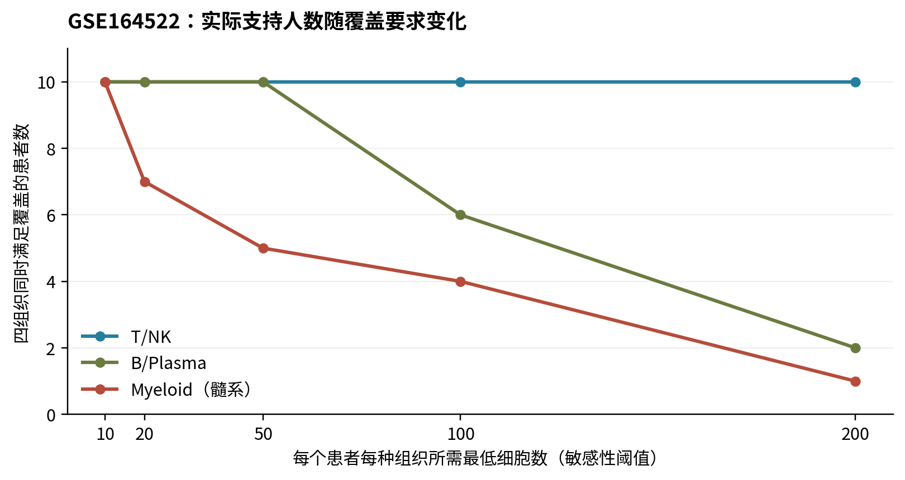
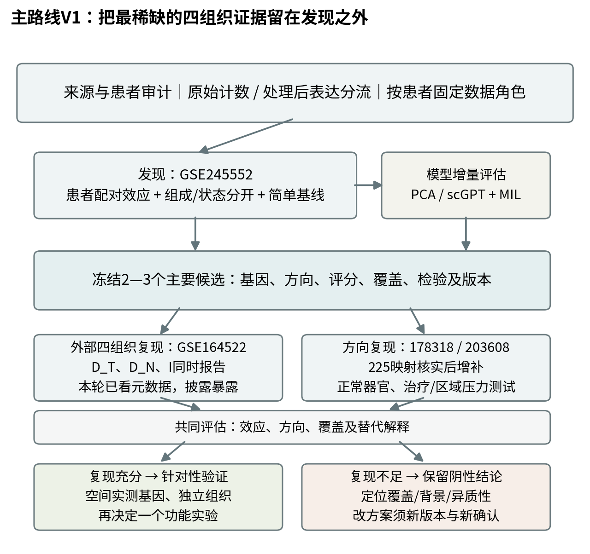
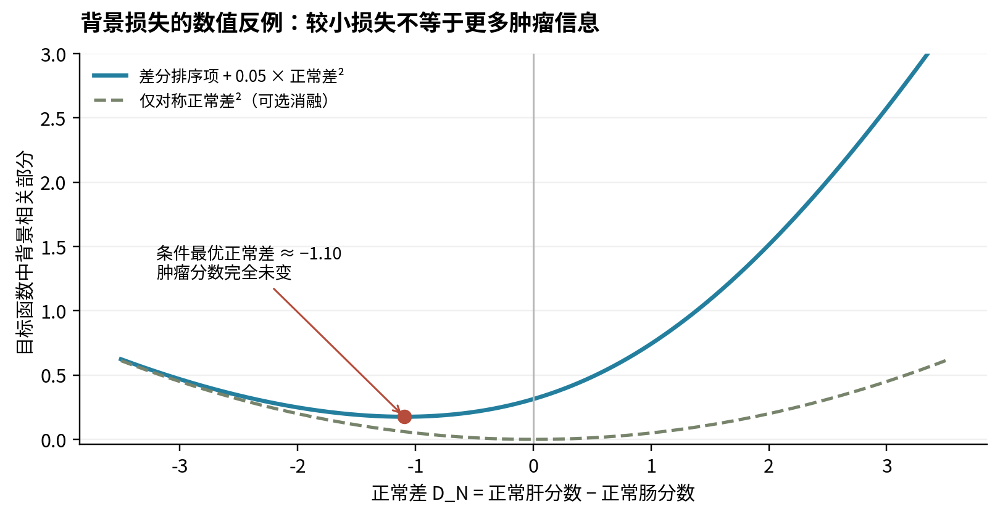

# 结直肠癌肝转移免疫程序研究：完整实施方案与证据审计

> **Markdown 完整版 · 2026-11-21。** 本文由此前 68 页报告的同一组定稿正文及参考文献合并，保留研究设计、证据边界、实施附录和阅读记录。图像位于同级 `report_assets/`；完整工程 ZIP 已包含图像。新增的 Codex 交接、论文准备和本地/云端算力说明另见工程中的 `docs/` 与 `prompts/`，不改变原报告的完成状态。原报告提到的 `CRLM_starter` 起步包，在新工程中位于 `starter/`。
>
> **执行状态：** 已完成资料核验、输入审计、部分方法数值验证和起步代码；真实细胞 QC、统一注释、程序评分、scGPT 编码、真实模型比较及新增实验尚未开展。85 条文献记录不等于 85 篇全文精读；实际阅读深度逐条列于文末。

## 目录
- [阅读导航与研究边界](#阅读导航与研究边界)
- [1. 决策摘要：保留分类主干，以独立生物学复现为核心](#1-决策摘要保留分类主干以独立生物学复现为核心)
- [2. 前人成果：哪些已做过，哪些仍有空间](#2-前人成果哪些已做过哪些仍有空间)
- [3. 数据真实性审计与推荐分工](#3-数据真实性审计与推荐分工)
- [4. 数据角色冻结与研究版本管理](#4-数据角色冻结与研究版本管理)
- [5. 可检验假设与创新边界](#5-可检验假设与创新边界)
- [6. 数据工程与细胞处理：先保证样本真实，再提高模型复杂度](#6-数据工程与细胞处理先保证样本真实再提高模型复杂度)
- [7. 统计核心：明确比较对象、尺度与独立单位](#7-统计核心明确比较对象尺度与独立单位)
- [8. 分类与MIL：用于检验信息增量](#8-分类与mil用于检验信息增量)
- [9. scGPT的具体实现与工程风险](#9-scgpt的具体实现与工程风险)
- [10. 分割、模型选择与归因的可复核操作](#10-分割模型选择与归因的可复核操作)
- [11. 候选冻结、外部复现与证据等级](#11-候选冻结外部复现与证据等级)
- [12. 功能通路与细胞通讯：减少候选，不扩张故事](#12-功能通路与细胞通讯减少候选不扩张故事)
- [13. 空间验证：以实际测量面板和患者为边界](#13-空间验证以实际测量面板和患者为边界)
- [14. 最小新增实验：一条优先路线，两个可选分支](#14-最小新增实验一条优先路线两个可选分支)
- [15. 主要实现者的操作顺序与交付物](#15-主要实现者的操作顺序与交付物)
- [16. 方案评估、停止规则与替代路线](#16-方案评估停止规则与替代路线)
- [17. 学习与资源安排](#17-学习与资源安排)
- [18. 最终应交付的研究产品与本轮完成范围](#18-最终应交付的研究产品与本轮完成范围)
- [附录A. 新增实验的操作设计与记录模板](#附录a-新增实验的操作设计与记录模板)
- [附录B. 实现接口、人工核算例与交付范围](#附录b-实现接口人工核算例与交付范围)
- [附录C. 对比方法的接入、复现顺序与结果登记](#附录c-对比方法的接入复现顺序与结果登记)
- [参考文献、官方来源与阅读记录](#参考文献官方来源与阅读记录)

---

## 阅读导航与研究边界

本方案以用户最后给出的《说明.md》为最高优先级：寻找原发灶与肝转移灶之间，能跨患者、跨独立队列重复出现的免疫细胞状态和分子程序，并检验器官背景的解释程度。原《CRLM实验方案.md》作为待评估的技术草案，《预学习内容.txt》作为学习范围，所附2020年论文作为历史比较对象。检索与核验截至2026年11月21日。

这里把材料分成三类。第一类是原始论文、官方GEO/代码和补充材料中的已发表事实；第二类是本轮实际下载的元数据、条形码、矩阵头及空间面板的可复核审计；第三类是尚待执行的设计、阈值和假设。全文的“建议”“初版默认”“若……则……”属于第三类，不代表真实队列训练结果或新机制已经证实。参考文献采用B（生物学）、M（方法）和D（数据/审计）编号；文末说明哪些文献取得全文、哪些只核实摘要或官方记录。

建议先读第1—5章决定项目定位和数据分工，再按第6—12章实施；第13—16章用于外部复现、空间及新增实验；最后的阶段计划、失败路线和附件说明可直接用于课题组讨论和项目管理。

## 1. 决策摘要：保留分类主干，以独立生物学复现为核心

### 1.1 推荐的项目题目与主要问题

建议工作题目为：**结直肠癌原发灶与肝转移灶免疫程序的患者配对解析、跨队列复现及器官背景评估**。若后续功能证据充分，再将具体程序或机制写入题目。原草案已正确区分当前组织状态与未来转移风险，本方案保持这一任务边界，并按《说明.md》落实以生物学复现为核心的成功标准。

主要问题是：在明确的免疫细胞层级中，哪些变化在不同患者中方向与效应相对稳定，能够在独立来源数据中复现；这些变化由细胞比例改变、类型内表达状态改变还是两者共同造成；其幅度是否超出所测邻近肝和邻近结直肠的背景差异。分类器帮助定位信息，并检验它是否携带可迁移的样本判别能力。分类表现不代替以上生物学问题。

现有研究采集的是已存在的原发肿瘤和肝转移组织。很多患者同时提供两类组织，且已经发生转移。因此模型回答“这份已取得的组织更像哪类样本”，不能据此回答“这个患者未来是否会发生肝转移”。后一个问题需要只使用转移发生前的信息，设置随访、结局及独立时间验证，是另一项研究。[B01—B07]

### 1.2 三项生物学任务与一项模型支撑任务

| 层级 | 主任务 | 可交付结果 | 成功的含义 |
|---|---|---|---|
| 主任务A | 患者配对差异与组成/状态分开 | 每个候选的患者效应、覆盖人数、方向一致率、区间 | 差异不是少数细胞或一个患者造成 |
| 主任务B | 冻结候选后跨队列复现 | 固定定义的程序在独立数据中的效应表 | 候选不依赖某个数据集的聚类和处理方式 |
| 主任务C | 四组织背景与空间/组织验证 | 肿瘤差、邻近器官差、交互差及替代解释 | 明确哪些证据支持超出所测背景，哪些仍不确定 |
| 支撑任务D | 分类与MIL筛选、检验信息 | 强基线、公平消融、稳定候选定位 | 保留分类主干，量化模型对候选发现和复现的增量 |

研究目标是得到少量证据充分的程序或状态及其适用条件。预先冻结2—3个主要候选不等于保证最终确认2—3个；只确认一个或没有候选达到标准，也必须完整报告。若只复现已知SPP1、CXCL13、TWEAK等现象，应如实定位为严格复现和资源整合；新机制的资格取决于新增患者、条件差异及功能证据，不能在立项阶段保证。[B02,B05—B10,B19,B36;M24]

### 1.3 相对原草案的关键修改

| 原设想 | 推荐修改 | 直接原因 |
|---|---|---|
| 多个队列先合并开发 | GSE245552主发现；GSE164522保留四组织外部复现 | 有价值的四组织数据不应全部消耗在选候选和调模型中 |
| 外部AUROC是核心终点 | 生物学复现、患者效应、背景可解释性为主 | 对齐《说明.md》；器官差也可能获得高AUROC |
| 背景差分排序损失作为主创新 | 主线先只训练分类和配对排序，背景独立检验 | 原型损失可通过反转正常组织分数降低目标函数 |
| 默认所有公开矩阵可做counts伪批量 | 原始计数与作者处理后表达分支运行 | GSE164522公开表达为连续值，不能直接套负二项counts模型 |
| 只用注意力选细胞/基因 | 注意力、带符号贡献、患者表达效应分别报告 | 预测归因与生物学状态不是同一个估计对象 |
| 按论文总样本数评估功效 | 按真实患者及每个候选可用配对数评估 | 论文总体招募、文库、病灶、细胞与独立患者不是同一分母 |

## 2. 前人成果：哪些已做过，哪些仍有空间

### 2.1 最直接的前作，而非泛泛的单细胞背景

**Liu等，Cancer Cell 2022。** 原研究已把宿主器官环境与恶性肿瘤背景作为核心问题，提出PhenoAligner，并给出与malignancy或niche相关的免疫表型。它是本项目的概念前作和GSE164522来源。不能把“考虑器官背景”写为本项目首次提出。此次取得的是原始摘要、官方数据和作者机构说明，未取得可完整阅读的正式全文；对算法细节不作超出这些材料的断言。[B02]

**Huang等，scPAFA，Communications Biology 2024。** 这是最直接的方法前作：已经在GSE164522中使用10位患者、40份四组织材料、163,347个细胞，将通路分数按样本和细胞类型汇总，再用MOFA寻找多细胞通路模块。涉及SPP1巨噬细胞、B细胞及肿瘤/部位相关因子。其四组织比较主要使用Kruskal–Wallis及Mann–Whitney检验，而非本方案的患者配对交互作为主终点。因此本项目可以补充患者依赖结构、组成与状态拆分和冻结后的跨队列验证；不能声称首次发现四组织多细胞程序。原文的MMR分类外部验证也不能被复述为本项目所需的独立四组织复现。[M24]

**Do与Lähdesmäki，HA/CTA，Bioinformatics 2025。** 已使用冻结scGPT细胞表示与细胞类型层级MIL。只把scGPT、attention、三谱系袋拼起来，方法新颖性不足。应把HA/CTA作为直接结构对照，而不是绕开它，只与Logistic Regression比较。[M02,M07]

**SPP1相关研究已非常密集。** Sathe等2023描述CRLM中SPP1巨噬细胞与成纤维细胞空间网络；Trehan等2025加入功能和动物证据；Bellomo等2026强调肝转移核心、边缘与非受累肝的区域差异；Wang等2026直接研究髓系SPP1与CXCL9/10、CD8募集的机制。Ding等2025已研究SPP1与T细胞应激，Czabala等2026预印本还拆分了肿瘤/宿主SPP1及IFN生态，后者尚未同行评审。单独提出“SPP1髓系细胞导致免疫抑制”或“SPP1与CXCL9相联系”不再是新主张。[B06,B08,B09,B36—B38]

**Sun等，Immunity 2026**进一步报道胞内SPP1通过TRIM21/SOCS1影响IFN-γ–STAT1–ISG负反馈。此次核实其原始摘要和Highlights，未将摘要当作完整实验SOP。它对本方案有直接约束：SPP1与IFN背景的关系本身也不是新问题，胞外重组蛋白补回不能等同胞内机制恢复；后续价值必须来自明确的人CRLM条件与可复现适用范围。[B43]

**Wang等，Advanced Science 2026**又报道PABPC4–SPP1轴及干预/恢复实验，但正文同时说明Pabpc4缺失在所测肝转移模型中未见明显效应，主要阳性结果来自皮下/腹腔模型。其人空间分析复用GSE225857，不增加独立验证来源。这一结果要求保留器官与模型条件，不能把一般CRC抑瘤效应直接外推为CRLM效果，也不能把未显著当作已证明无作用。[B47]

**两项近期直接前作进一步限定范围。** Chen等2026研究BHLHE40/LGALS3中性粒细胞的血管–髓系生态，提示SPP1等标记并非巨噬细胞专属；其富集测序也不能直接给天然细胞组成。Cai等2026已讨论APOC1/IFI30与脂质、溶酶体/呈递相关状态，故R与A共存本身也不足以成为新发现。后者的“46患者”来自五个既有来源的46个代码，含本项目164/178/225/245及Sathe数据，并非新增独立队列；其补表组织列与正文/原GEO有需澄清的不一致。本方案重新建立原始manifest，不把二次整合补表当身份金标准。[B44,B45]

### 2.2 生物学文献的相互支持与冲突

| 主题 | 支持性前作 | 反例/解释边界 | 对本项目的具体影响 |
|---|---|---|---|
| SPP1与基质重塑 | CRLM空间网络、T细胞功能研究 | Wang2023中Mac_SPP1主要在原发；原发CRC、肝纤维化也可出现相关程序 | 检验患者与空间条件，不预设每队列LM均升高 |
| CXCL9/抗原呈递 | 跨癌种CXCL9:SPP1极性、部分CRLM研究 | 两基因比值受稀疏性影响；与SPP1互调已有机制前作 | 用固定多基因程序，研究共存、替代及适用条件 |
| CXCL13相关T细胞 | 活化、肿瘤反应及部分耗竭表型 | Wang2023中CXCL13相关T细胞与较好预后相联系 | 同时检查细胞毒、祖细胞样及终末功能障碍程序 |
| B/浆细胞与TLS | CCL19成纤维细胞、IgG抗肿瘤研究 | B/T聚集并不等于成熟TLS；IgA/IgG背景不同 | 需要空间结构与细胞身份，不能只靠一个B细胞分数 |
| Th17–TWEAK–Fn14 | GSE245552原论文含功能干预 | 机制已发表，且重点在原发灶Th17及肿瘤EMT | 作为可解释阳性对照，除非有明确新增条件差异 |
| 肝驻留/纤维化背景 | 正常肝图谱、TREM2/CD9纤维化生态 | 相似程序不是CRLM专属，也不自动说明没有价值 | 增加非肿瘤背景反证，降低“特异”用语 |

以上冲突不能简单归结为“一个队列化疗、另一个没化疗”。治疗、测序平台、取材区域、病例组成和实验中心往往同时变化。没有可识别设计时，不能从研究间方向不同推断治疗导致状态转换。[B03,B05,B17—B20,B26,B27]

### 2.3 所附2020年论文的正确用法

Han Shuwen等的研究是bulk微阵列表达的分类后特征解释。它能提供历史上的任务形式和候选来源，但不能直接作为当前免疫单细胞项目的方法标准。主要有四点需要重新审视。[B01]

第一，分类对象是已经取得的原发与转移组织，不是未发生转移患者的前瞻风险。第二，ALB、APOB、APOC3、凝血相关基因等可能反映肝组织组成或来源；这是需检验的替代解释，不能仅凭基因名字断言污染。第三，文中叙述的筛基因与训练/测试切分顺序存在不够透明之处，构成潜在泄漏风险，但现有材料不足以断言作者确实在测试集上选特征。第四，表2中其他方法有接近或更优的部分指标，不支持把CatBoost描述为毫无争议的最佳模型。

例如原表2中CatBoost与NN的GSE81558准确率/AUC均为1；LR在MCC及consortium的准确率均为1，CatBoost分别约0.9916和0.9933。CatBoost使用33个特征而NN使用131个，是一种稀疏性与表现的取舍，不能写成在所有指标上最佳。这些是原文报告值，未经本轮重新训练复现。[B01]

本轮逐页核对还发现文字/表格计数不一致，例如正文268个差异基因与随后108+23并不相等。应把这类不一致记录在证据审计中，不据此否定全部研究，也不将其数字无核验地用于新方案。

### 2.4 可争取的贡献与立项风险

最有现实价值的贡献是：建立可追溯的患者级数据与证据链；在冻结定义下给出跨平台、跨患者的程序效应及不确定性；解释同一常见标记为何在某些患者或区域代表不同状态；证明或否定配对MIL在这条证据链中的增量价值。

可以在开题时承诺的三个具体研究产物是：第一，少量固定“细胞层级×程序”的跨来源效应图谱，清楚区分可复现、方向不一致与测量不足；第二，针对一个程序组合的患者内背景与区域解释，说明关联在哪些实测条件下成立；第三，模型引导候选相较纯差异/程序基线是否提高独立复现率或候选稳定性的实证比较。这些产物不依赖深模型一定胜出；若要进一步宣称生物学新发现，须证明所得条件关系尚未被直接前作回答，若要宣称新算法，则须增加独立任务证明方法的一般性。

纯计算版本可完成前两项，并形成高质量的复现与方法学审计。若目标是强生物学机制论文，至少需要独立组织材料和一个与明确条件性假设匹配的功能实验。若目标是新MIL方法论文，当前十余个开发患者不足以仅凭一个任务充分证明通用方法优势，需要另加独立任务和规模更大的患者基准。两条扩展不应在项目初期同时铺开。

## 3. 数据真实性审计与推荐分工

### 3.1 不能混用的五个数字

每个数据集都必须同时记录：总体招募患者数、公开scRNA患者数、组织/病灶数、测序文库数、QC后可用于目标分析的患者数。统计独立单位以真实患者为主。一个患者的两块肝病灶、上万个细胞、十次抽袋和五个随机种子，都不能增加独立患者数。

本轮实际检查了GEO系列与样本记录、作者补充临床表、公开元数据及条形码，并完整逐条扫描GSE245552的全部39份MTX；空间数据实际读取四个H5文件。没有下载所有原始FASTQ，也没有运行真实数据的差异表达或神经网络训练。下表数字对应本次审计口径，后续QC和目标细胞覆盖会使有效N进一步下降。[D01—D08]

| 数据集 | 已核验的实际范围 | 推荐角色 | 必须保留的限制 |
|---|---|---|---|
| GSE245552 | 39个GSM，16位公开scRNA患者，13对PT–LM；Pt18有完整四组织 | 唯一主发现与初级模型开发 | 全部原始临床S1为MSS；治疗信息未从原始材料确认；多病灶需等权 |
| GSE164522 | 公开metadata含10位患者、40个四组织患者×组织单元、163,347细胞；六组织表达列头均已对齐 | 外部四组织复现与背景评估 | 作者处理后连续表达；本轮已观察部分作者标签组成，须披露暴露 |
| GSE178318 | 6位PT–LM配对患者，另3份PBMC，15个GSM | 第二来源方向复现 | 3治疗/3未治疗；患者数很小 |
| GSE203608 | 15位体内组织患者代码、4对PT–LM；另含培养体系及技术库 | 追加次要方向复现 | 只审计元数据；49的临床分期/时序待澄清；扩展表与旧表不可叠加 |
| GSE225857 | 论文6患者27样本；免疫元数据有7个患者代码，6代码PT–LM完整 | 映射核实后的外部增补 | 代码不能直接当7患者；术前治疗；空间样本不与scRNA直接配对 |
| GSE298084 | 3位scRNA患者，8文库；18人是更大组织验证口径 | 小规模方向/区域支持 | peritumoral取材；不能当18人外部测试集 |
| GSE335552 | 3位患者，3肿瘤+1邻近肝切片；仅1个肿瘤–邻近配对 | 空间存在与局部邻近证据 | 462或319基因，跨样本交集309；不支持完整转录程序验证 |

### 3.2 GSE245552：最适合先启动，但要保存完整来源映射

总体多组学研究为18位患者、130份材料；不能据此认定scRNA有18位患者。原始临床S1与GEO联合映射确认公开scRNA对应16位转移性CRC患者，18人总体中Pt19、Pt20没有出现在这39个GSM里。全部S1患者为MSS。13位完整PT–LM患者中原发部位包括7例直肠、其余分布于升结肠、横结肠、降结肠和乙状结肠；因此文中“正常结肠”应按具体记录理解为邻近结直肠组织。[B07,D01,D07a,D08]

条形码文件合计190,190个输入细胞，不能称其全部为最终QC细胞。本轮完整扫描39份MTX的347,049,770条记录，均通过非负整数、索引与维度核验；压缩矩阵合计1,056,396,888字节，文件与证据摘要均记录SHA256。公开的是作者交付的计数矩阵；原始reads位于GSA-Human的HRA005549，需按其受控访问流程获取。本轮未下载FASTQ。[D01,D08]

**重要的数据审计发现：交付的整数counts在肿瘤与邻近组织使用不同基因集合。** 33份PT/LM均为29,569个基因，6份邻近组织为29,922个基因；肿瘤基因集合是邻近组织集合的严格子集，缺少353个基因，包括全部13条MT-基因、很多核糖体/线粒体核糖体基因以及IDH2、ALDH2等。肿瘤交付矩阵的基因范围确已缩减，具体筛选步骤尚未取得作者处理记录。故肿瘤pct_mt应标为不可由当前矩阵重算，而非0；代谢程序与四组织比较必须明确共同测量基因。PT与LM共享同一基因集合，仍可支持该共同范围内的配对counts分析；“整数counts可用”不等于“未经筛选的完整原始矩阵可用”。[D08]

重要映射示例：Pt16_T1是肝转移，不能用T1字符串自动推断PT；Pt08有两份PT及两份LM，不能把四个病灶组合成四个独立患者对。已制作逐GSM样本表，组织标签来源为GEO characteristics，而非文件名猜测。治疗状态目前保持unknown；其他复用论文将其标为未治疗，不能取代原始临床核验。[D01]

本轮进一步取得原始Table S2与S3。S2的39行与GEO组织数量及多病灶结构一致，但CD45+/CD45− cell number单位为10^6，是百万级细胞产量记录，不能当scRNA质控后细胞数或每库免疫覆盖。S3五张表共600条marker记录、390个独立gene，均在公共肿瘤feature范围，可供初始注释核对；应取最后的gene列，避免把R自动去重产生的PLVAP1等行名后缀误作真实基因。作者群名只是参考，不自动等价于本项目跨队列统一状态。[D07k,D08]

39个GSM公开的解离/建库协议文字相同，但未说明CD45分选、富集或混合比例；原全文处理链尚不可读。故245的富集状态仍为unknown，组成主张限定为所捕获细胞内的相对组成，不能用S2总产量还原单位组织的天然免疫比例。

疾病被称为“同步肝转移”，也不自动证明PT与LM在同日取材或两次取材之间没有治疗。245的具体配对取材窗口仍未核清，保留timing-unverified；现阶段只能按有潜在时序/治疗混杂的患者配对关联解释，不能照搬178已经报告的同时切除条件。

### 3.3 GSE164522：10位公开患者，现成处理后矩阵不能直接走counts分支

GEO列出17个GSM、总体研究101份材料；公开metadata仅含patient08—patient17这10个患者代码。四组织元数据合计163,347细胞，与scPAFA论文实际使用口径一致。本轮流式读取六组织完整表达列头，与对应metadata的257,843个细胞逐一匹配，未见多余、缺失或重复；这属于表头身份核验，不表示读取过全部表达值。其余两组织为外周血和淋巴结。前7个GSM与后10个GSM的10X方案不同，不能把前7个误认成HCC或非转移CRC对照。[B02,M24,D02,D08]

本数据的组织码为PT=原发、MT=转移、PN=邻近结直肠、MN=邻近肝，LN=淋巴结。不同研究中的LN可能代表normal liver，禁止跨数据集使用同一字符串字典。

公开表达为非负连续浮点值。我们完整流式读取PT矩阵24,662个基因，并对前8个细胞列核验：sum(expm1(x))约为10,000，而sum(2^x−1)并非10,000。这在数值上支持自然对数log1p的每细胞10,000归一化解释，但不能替代作者处理流程证明，更不能把expm1的结果当原始UMI。主分析使用固定程序/连续表达分支；不得将这些值四舍五入后交给edgeR或DESeq2。[D02,D08]

细胞覆盖也会改变有效N。仅以作者大类注释检查、要求每种组织每谱系至少50个细胞时，T/NK和B/Plasma四组织均为10位患者，Myeloid只剩5位；Myeloid肿瘤配对为8位。此处Myeloid严格指Mono/Mac/DC，不含Mast或Neutrophil，不能把5位的结论套到任意更宽髓系定义。这还没有经过本项目独立QC与细分类。50不是文献规定的万能阈值：应在发现数据中根据测量精度固定阈值，外部不能为了显著性再改成20或5。[D08]



*图1 本轮作者注释元数据审计。每个点要求同患者四种组织均达到相应谱系细胞数；Myeloid限定Mono/Mac/DC。它是可用性检查，不是新生物学效应，也不是独立QC后的最终样本量。*

### 3.4 GSE225857：必须解决患者代码冲突

论文报告6位患者，但公共免疫元数据有s0107、s0115、s0813、s0816、s0920、s1125、s1231共7个代码。其中6个代码有PT–LM，5个有四组织；s0816缺PT，s0920缺邻近结直肠。本轮从官方BioStudies与EuropePMC取得一致的原始补充PDF及代码：Table S2—S4确实只列六个P代码，没有P0816；补充导入代码却明确合入s0816，并依赖未附的sampleinfo.csv。临床表与代码仍未建立这个额外代码的身份对应，不能擅自合并s0813/s0816，也不能直接写N=7。[B05,D03,D07i,D08]

免疫矩阵含196,473个列/细胞，非免疫元数据为41,892；部分计数检查支持整数表达，但完整处理仍需追溯。Table S3现可核验六位临床代码的术前FOLFOX或FOLFOXIRI方案，其中一例加Bevacizumab；不要将该治疗信息自动赋给身份未明的额外代码。作者在仓库问题回复中说明空间与单细胞不是相同患者的直接对应，且原发空间样本是否有肝转移并不明确。因此“同患者多组学验证”的主张在本公开材料上不成立。[D03,D07c,D07i,D08]

具体处理：先列出代码、原文件、样本类型、时间和临床字段，形成需作者核实的短表；在解决前排除配对主检验。若需联系作者，由用户发送准备好的问题清单，不能把未回复的请求视为已获数据。

### 3.5 空间和补充数据的实际可用性

GSE335552四个细胞×基因H5总计约35MB，足以做面板检查，无需先下载约26GB整包。三个462基因样本与一个319基因样本的并集为472、交集为309，合计646,711个分割细胞。分割细胞数不等于独立样本量。TNFSF12、TNFRSF12A、IL17A、APOE、APOC1和MCAM在四个所检样本均未测量，不能用插补后表达称其获得独立空间验证。RORC存在也不独自证明完整Th17状态。必须逐样本检查面板，而不是只看一个样本。[D06,D08]

备选GSE315534包含6位患者、15份组织，但只有3位CRLM配对患者，另3位是非转移CRC；适合作为小型补充，不是新增6对PT–LM。Zhao等2026的9位未治疗MSS四组织队列很有价值，但OMIX005611页面本轮明确显示controlled access且当前不可下载，不能计入已经落实的验证资源。GSE312757的CosMx/人半肝灌流研究提供重要空间前作，但4份空间材料限定于术前化疗后的MSS replacement-type；7.68GB处理对象本轮只核验下载入口与文件大小，未读取表达。[B23,B27,D07d,D09,D10]

正常多器官图谱E-MTAB-11536也不能按“12供者”直接当12对健康肝—结肠验证。本轮只读取其官方H5AD的obs，核实329,762个免疫细胞中肝覆盖7名供者，横/乙状结肠仅A29，分别262/133个细胞；这些肠部位的髓系细胞很少。它适合固定器官标记和注释参照，当前不足以提供有力的健康肝—结肠髓系配对推断。盲肠、小肠与直肠也不可任意互换。[B21,D07f,D08]

进一步核查Tabula Sapiens 2.0的GSE306755完整元数据：1,136,218细胞、24供者中，肝4位、大肠5位，共同供者只有TSP14；其严格Mono/Mac/DC大肠41、肝338细胞。放宽到未细分髓系大类也仍只有1人，不能变成24对正常验证。该图谱大肠记录未见直肠，供者也并非都无基础病；本轮只读42.46MB元数据，未下载表达。它仍适合作注释与器官程序参照，不能补足多供者背景确认。[D07j,D08]

本轮追加核查的GSE203608来自美国UPenn，公开体内组织元数据共59,661细胞、15位患者代码，含4对PT–LM（09/27/44/49）。作者Macrophage与四类DC合计的PT/LM数量分别为412/471、528/214、1,114/1,024、361/334，均超过50和100的示例阈值；它适合作为新的次要方向复现来源，不替换164的主检验角色。唯一四组织患者09的NC髓系仅11细胞，不能补足四组织髓系确认。图1A称treatment-naïve，但患者49图1B为Stage III而metadata含LiverMet，逐例分期/时序需澄清，不擅自改成IV期或保证同日手术。[B46,D11]

203608的53个GSM还包括HTO技术库、类器官及共培养。其扩展元数据146,988行包含原126,014行的完整重复，再增加20,974培养细胞；直接拼接会双计。只选择体内样本并去重。本轮只核metadata、来源与临床图，没有扫描其大表达矩阵；整数counts及基因处理能力仍需正式导入验证。[D11]

Chen等B44的新6位scRNA患者有5对PT–LM及6份邻近肝，但无NC，采用中性粒FACS富集后混合上机。新增数据归于PRJCA060393；其HRA005549等其他入口是复用来源。当前不能把动物公开FASTQ或受控的人空间条目当作已取得的人scRNA外部集。该资源仅列待落实候选，暂不增加现有验证N。[B44]

## 4. 数据角色冻结与研究版本管理



*图2 研究路线。两类外部证据需共同评估；流程框不代表已取得的研究结果。*

### 4.1 主路线V1

发现阶段只用GSE245552：确定QC、注释层级、程序基因、方向、候选选择规则及模型超参数。随后冻结2—3个主要候选；如另保留次要候选，总量建议控制在约5个，并分别声明检验家族与成功标准。GSE164522用于外部四组织复现；GSE178318用于另一来源方向证据；GSE225857在映射澄清后增补；GSE298084和空间数据提供较弱但有针对性的支持。

追加的GSE203608可在冻结前登记为第二个次要方向来源，按其临床与覆盖限制单独报告；它不加入要求所有队列逐一显著的主要Holm家族，也不与178盲目拼成同一绝对分数总体。

这种安排的代价是开发只有13个完整配对患者，复杂模型的估计很不稳定。它的优点是把最稀缺的四组织证据留在发现之外，更符合项目的生物学目标。不能为了形式上做“留一队列交叉验证”，提前把外部队列纳入开发。

### 4.2 本轮数据暴露必须登记

为评估可行性，本轮已经查看GSE164522作者注释中的已知状态比例，包括SPP1/C1QC巨噬、LAYN CD8、CTLA4 Treg和FCGR3A NK。这只是元数据探索，不是程序表达的独立验证；但它意味着该队列不能再描述为完全未看过的盲法确认集。报告应称“独立来源的外部复现/稳健性评估”，并公开看过的字段、统计量和日期。

后续仍可在发现阶段冻结未检验的新程序，但若结果受上述探索影响，应如实降级解释。重新随机分折、更换文件名或更换程序名称，都不能消除既有暴露。

起步包evidence/research_external_exposure_log.csv按已保留证据记录本轮看过的资料与未开展的分析。逐资源精确时刻没有完整留存，因此只记核验日期，不编造先后时间；正式研究使用另附空表持续记录候选冻结和每次外部访问。

本报告的“独立来源”指不同原始研究及当前未发现明确重复患者，尚未通过共同临床ID或遗传型证明绝无病例重叠。245与178的原作者分别来自中山大学第一附属医院及孙逸仙纪念医院，属于不同医院但同一大学/城市体系；机构、收集时间和已知复用见来源审计。正式发表前继续核实可取得的去重证据，不以更换GEO编号代替患者去重。[D08]

### 4.3 扩展路线V2

若初步生物学可靠、希望开发更强MIL，可合并245与164建立新版本。此时164对V2不再是外部验证，且此身份不能恢复。需要225或新收集的四组织患者承担独立背景复现；若拿不到，应明确V2只有内部背景分析。V1和V2的候选、训练数据、权重、阈值和外部访问记录分别保存，不混用最有利结果。

## 5. 可检验假设与创新边界

### 5.1 主假设H1：髓系程序的组合及其条件差异

优先研究基质/脂质重塑程序R、IFN/CXCL9趋化程序C、抗原呈递程序A的患者内变化，以及它们与CD8功能状态的关系。R可由SPP1、TREM2、APOE/APOC1、脂质代谢/溶酶体与ECM候选组成；C可由CXCL9/10、STAT1、IRF1等组成；A可用CD74、CIITA、HLA-DRA及多个MHC-II基因。这里的基因是起始候选例，不是已验证签名；正式列表、正负方向、去重与覆盖规则必须在发现阶段固定。[B05,B17—B20,B36]

不把“SPP1/CXCL9互调”或“SPP1影响IFN响应”作为新机制。可争取的增量是：何种患者、取材区域和组织背景下，R与C/A的变化可在独立队列重复；这种关系能否解释单一SPP1比例的跨研究不一致。髓系程序在非肿瘤肝的纤维化或脂质相关生态也可能出现，这正是需要检验的替代解释。A主要是MHC-II呈递相关转录表型，不直接证明有效CD8抗原呈递；C/A也不能自动等同抗肿瘤功能。[B17—B20,B36—B38,B43]

APOC1/IFI30与脂质–溶酶体/呈递相关特征的共存也已有直接研究，应作为相近候选的复现基准，而非预先命名新亚型；IFI30表达本身不等于完整IFN/CXCL9程序。主线的Mono/Mac/DC范围未覆盖全部髓系生态，须保留Neutrophil和Mast标签及覆盖记录；SPP1、LGALS3来源不能仅凭单标志判断。现有数据粒细胞不足时说明覆盖不足，无需立即新增第四个MIL袋。[B44,B45]

HLA-DRB5等基因还可能受HLA单倍型存在/缺失影响。不要用单一HLA-DRB5定义新功能亚型；采用多基因呈递读数，并做去除DRB3/4/5的敏感性检查。患者配对减少遗传差异干扰，但不能自动修复跨患者聚类中由基因型造成的标签差异。[B30,B31]

### 5.2 次假设H2：检验CXCL13相关T细胞在CRLM中的条件组成

在CD8与CD4分开之后，检验CXCL13相关细胞的细胞毒、祖细胞样/记忆、增殖和终末功能障碍程序。不能因为PDCD1、TOX或CXCL13高就把细胞等同于没有功能；也不能因GZMB高就认定其能有效杀伤自体肿瘤。使用固定程序与功能读出，将“表达表型”“克隆性”“肿瘤特异性”“杀伤能力”分开；这种多维解释本身也已有其他癌种的直接前作。[B02,B05,B08,B13,B34,B39,B40]

若有TCR信息，可辅助检查克隆扩增及共享，但共享TCR不证明同一个细胞从PT迁移到LM，也不证明识别肿瘤抗原。没有抗原/HLA依赖识别或自体肿瘤识别证据时，不应把转录状态直接称为肿瘤特异性T细胞。

### 5.3 第三优先级与阳性对照

B/Plasma–TLS相关程序只在前两条路线已有稳定证据、细胞覆盖足够时展开。CD79A/MS4A1、浆细胞分泌、IgG/IgA和CCL19相关环境可形成候选，但成熟TLS需要组织结构、B/T分区及生发中心等证据。空间面板不足时不能靠计算推断补足结构结论。[B15,B16]

Th17–TWEAK–Fn14是GSE245552相关论文已发表的机制，可作有明确比较条件的文献对照。原文关键人队列比较包括转移性CRC原发灶与非转移CRC原发灶，而245公开scRNA患者均已转移。因此不能预设该轴必然LM高于PT，也不能仅凭245重现原论文全部比较。未检出时先检查比较对象、取材、细胞覆盖和基因测量；不立即宣称推翻原论文。只有明确的新适用条件或新机制才值得开展额外机制实验。[B07]

### 5.4 开始前就写明的可证伪条件

若候选只在一个患者或一个病灶明显，不能称稳定患者程序；若去掉细胞比例差后类型内表达效应消失，应改称组成变化；若只在某个平台或处理流程出现，应改为技术敏感候选；若邻近组织差足以解释观测肿瘤差，应降低转移相关特异性的表述；若程序仅在坏死区出现，应优先解释坏死/吞噬环境；若功能干预只有细胞毒性而无特异恢复，不支持目标机制。

这些结果都可以形成有价值的结论，但不能通过不断更换阈值、亚群名和验证队列，把同一结果重新包装成成功。

## 6. 数据工程与细胞处理：先保证样本真实，再提高模型复杂度

### 6.1 最小数据结构与约定

建立三个不可相互替代的ID：donor_uid是核实后的全局真实患者，sample_uid是一份取材/文库对应的分析样本，lesion_uid是生物学病灶。样本与病灶ID可加来源前缀；患者在跨accession去重后必须统一到canonical donor_uid，或将重复材料从外部完全剔除。不能只给两个来源各加前缀，再把同一个人当两组分折。技术重复、dedup_group和取材episode_uid另记录；分折与bootstrap使用真正独立的全局患者组。

| 表/对象 | 必须记录 | 不满足时的处理 |
|---|---|---|
| sample_manifest | 患者、样本、病灶、组织、平台、富集、治疗/时间、来源URL、角色、身份核实 | 身份未核实者不进入配对或独立分折 |
| expression_provenance | 原始counts/normalized/log/corrected/unknown，处理说明，checksum，整数和值域核验 | 未确认counts者不能进入负二项模型 |
| cells.h5ad | 稀疏counts层（若可得）、明确尺度的X、基因映射、细胞注释与QC | 不能用一个不明X同时承担全部任务 |
| split_manifest | 患者角色、外层折、内层折、固定seed | 同患者全部组织/病灶只能在同一折 |
| candidate_registry | 固定基因及方向、亚型、评分方法、覆盖规则、主检验、多重比较族、冻结时间 | 未冻结候选只能列为探索性 |

建议把外部数据的表达评分、效应表和标签访问记入validation_access_log。日志记录“已看过什么”，不能只记录“哪些文件已下载”。每次改变候选或模型生成新版本及变更理由。

### 6.2 QC的可执行顺序

步骤1：下载官方文件，核对checksum、压缩完整性、genes×cells方向、barcodes与metadata唯一性。随机抽取多个细胞和基因核验映射，检查是否存在重名symbol、一对多ID或R读入后将连字符变成点的问题。不能因为矩阵能读入就认为组织与患者已正确对齐。

步骤2：有完整原始counts时按原捕获文库计算n_counts、n_genes、线粒体比例、明显环境RNA及异常基因组合。若基因已筛选，n_counts只能称交付基因范围内的可见计数，比例的分母也不完整；GSE245552肿瘤矩阵缺全部MT-基因，pct_mt必须记NA，不可记0或据此筛“高质量”。只有log矩阵时使用作者已有QC字段，不把归一化值相加称为原始n_counts。发现阶段画分布，预设低质量/极端值规则，再在外部用同一规则类型执行。不要机械对所有平台使用一个线粒体比例上限。浆细胞、高活化细胞和低RNA淋巴细胞有不同分布，过度统一会改变组成。

步骤3：按输入能力分别选择环境RNA校正与doublet检测。需要空液滴背景的工具须有原始droplet/未过滤矩阵；部分doublet检测可从过滤后的原始counts起步，不以未过滤矩阵为统一前提。doublet率按实际捕获文库建模，不把所有患者合成一个假捕获实验。只有作者过滤后log矩阵时，不假装可以完整重做原始QC或空液滴分析；保留作者处理限制，结合标记共现和极端值识别疑点。疑似混合细胞的判定应避免只看一个跨谱系RNA：吞噬、环境RNA和真实低水平表达需要区别。

步骤4：先统一T/NK、Myeloid、B/Plasma等大类，再在每类内部做可信的细分。主分析使用各队列可重复识别的层级；分不清的细胞保留unknown或合并到父类，不强迫映射为作者同名细分群。自动标签、参考转移、marker组合和人工抽查共同记录，注释人员尽可能不看PT/LM差异结果。

步骤5：输出每个患者×组织的QC前后细胞数、主要谱系数量、被排除原因及配对支持矩阵。后续每一张效应图必须显示实际患者N。组织没有某亚型、亚型细胞过少、该平台没测某基因，是三种不同的缺失原因，不能合并成表达0。

### 6.3 一条表达处理流水线不能服务所有目的

原始counts用于细胞类型内伪批量差异；固定非负表达用于程序评分和scGPT输入；训练折PCA使用训练折确定的基因、均值和变换；Harmony/scVI/CCA可以用于探索性可视化或预先声明的迁移分析，但其校正表达不能自动作为counts差异分析输入。不能用“UMAP混在一起了”证明所有批次效应已经消除。

严格新队列推理时，HVG、标准化参数、PCA、选基因、分类器和校准器都只从训练部分估计。若把外部表达与训练数据联合整合，属于使用目标分布的transductive设置，应另列结果，不能与完全冻结的外部推理混为一个AUROC。[M02,M04,M07—M11]

## 7. 统计核心：明确比较对象、尺度与独立单位

### 7.1 三个必须同时报告的效应

对患者p、固定细胞层级c及程序g，A(p,t,c,g)表示患者组织级读数。PT为结直肠原发肿瘤，LM为肝转移灶，NC/NL为相应邻近非肿瘤组织。

```text
D_T(p) = A(p, LM) − A(p, PT)
D_N(p) = A(p, NL) − A(p, NC)
I(p)   = D_T(p) − D_N(p)
       = [A(p, LM) − A(p, NL)] − [A(p, PT) − A(p, NC)]
```

D_T是观测肿瘤部位差；D_N是所测邻近器官差；I是器官×肿瘤交互对比。不要将I称为已识别的转移因果效应。这里没有随机处理、可检验的时间平行趋势，也没有同一肿瘤在另一器官的完整反事实。邻近组织本身可受疾病、局部炎症、化疗和取材距离影响，不能视为健康器官。[B02,B21,B32]

尺度必须写清楚：程序分数差、平均log表达差、负二项模型的log倍数变化交互、分类器logit差是不同对象。对分类概率做单调变换就可能改变差分大小，因此不能把分类器的I当成基因或程序的I。背景图中同时报告全肿瘤配对集D_T，以及同一四组织合格患者子集Q中的D_T^Q、D_N^Q和I^Q；不能用10人的平均肿瘤差减5人的平均正常差，声称得到患者内交互或残余比例。

即使采用同一Q，也不将I/D_T称为“已去除背景后剩余的转移百分比”：D_T接近0时比值不稳定，异向效应时还可能小于0或大于1。它没有被识别为因果贡献比例；以三个效应及其患者散点呈现更清楚。

| 观察到的形态 | 可以讨论 | 不能据此声称 |
|---|---|---|
| D_T稳定，I与D_T同向且区间支持 | 所测邻近参照之外仍有同向差异证据 | 已完全去除器官或治疗混杂 |
| D_T稳定，D_N近似同向同幅，I不确定 | 器官背景是重要替代解释，仍需精度 | I不显著就证明全部来自器官 |
| D_T与D_N同向，但I反向 | 肿瘤可能减弱正常器官间差异 | 更强的LM特异激活 |
| I明显但D_T接近0 | 肿瘤对器官差异的重塑值得探索 | PT–LM已存在强判别候选 |
| 细状态在正常参照缺失 | 丰度/出现率变化，父类程序比较 | 用0填缺失表达后计算“纯状态I” |

若需要证明“背景差很小”，应事先定义生物学可忽略界限并评估等效性；不能靠p>0.05作结论。样本量不足时，正确输出就是区间宽、无法区分解释。

### 7.2 原始counts分支

先按sample_uid×可信亚型形成来源核实的未取log整数counts伪批量，245同时保留交付基因范围缩减限制。默认counts主分支再将同一预定临床取样窗口内的不同病灶合并到donor_uid×组织×亚型，每患者每部位只有一份计数文库。推荐edgeR quasi-likelihood，少量关键基因另作病灶选择或重复模型敏感性检查。基因过滤按预定表达覆盖规则，TMM/有效文库量由方法本身处理；细胞数影响测量精度，不增加独立患者N。[M09—M12,S04]

主配对模型先限制到该亚型PT与LM均达到预定覆盖的患者，再固定样本顺序与design；不能把在某一侧没有可用细胞的单侧患者计入完整配对N。单侧样本若另用于探索或辅助模型，需另列分析范围。

```r
# 两组织，因子参考水平须固定为PT
design <- model.matrix(~ donor_uid + tissue, data = sample_meta)

# 四组织，organ = Colorectum/Liver；status = Adjacent/Tumor
design4 <- model.matrix(~ donor_uid + organ * status, data = sample_meta)
# 交互系数 organLiver:statusTumor 对应固定log-link尺度的I
stopifnot(qr(design4)$rank == ncol(design4))
```

这段是设计矩阵说明，不是把任意CSV直接送入edgeR的完整程序。还必须核对样本顺序、文库大小、过滤、离散度、contrast及剩余自由度。patient固定效应已经吸收年龄、性别及患者内恒定治疗等信息；再加入完全共线的患者级变量不会自动“控制更多混杂”。患者嵌套队列时，同样要检查patient与cohort列是否共线。

245只有一位四组织患者，不能在该队列据此拟合支持人群推断的四组织交互模型；其I至多是个体描述。正式背景推断依赖164的合格四组织患者或新材料，而164现成输入只能走连续读数分支。若日后取得新的原始四组织counts，再应用上述负二项交互设计。

同一10x文库在多个lane重复测序时，优先合并FASTQ后统一UMI去重定量；不能把各自计数矩阵直接相加而重复计算同一分子。确认细胞/UMI不重叠的独立捕获文库才可按声明合并。重复发布的同一细胞也必须先去重。

不同病灶属于真实异质性。上述counts合并估计的是所捕获细胞混合下的患者部位表达，可能由捕获量较大的病灶贡献更多；程序主终点则采用病灶等权均值，二者不是相同估计对象。负二项似然按计数精度建模，也不等于显式患者均值的等权统计。关键结果应在预先规定的代表病灶选择或dreamlet等重复模型中检查稳定性；不得将平均counts四舍五入来伪造病灶等权文库。[M12]

### 7.3 只有处理后表达的分支

GSE164522这类数据优先计算固定程序的细胞级rank分数，再按样本、病灶及患者组织汇总。UCell对同一细胞的单调表达变换较稳健，但不能消除平台基因覆盖、dropout或细胞选择差异。固定基因集合、正负方向、maxRank、缺失规则；不在外部重新挑“最有效”的marker。[M13]

作为辅助，计算可信亚型内的平均作者处理后表达，在患者层面分析LM−PT及四组织I；只有变换确实时才称“平均log表达差”。不得求和log表达并套负二项模型，不得expm1后四舍五入伪造counts，也不得二次自动normalize_total+log1p。

若作者X包含未知插补或校正，程序效应也可能被改变，应在证据卡中标为来源限制。无法确认处理流程时，先做固定rank程序的探索性分析，追索原始count或处理说明；不得为了统一代码接口抹去数据能力的区别。

### 7.4 程序发现与基因集冻结

第一层使用有明确原始来源的文献程序和通路，作为阳性、背景及技术对照。第二层可在245发现数据内部用cNMF等无监督方法寻找新的共变程序。记录基因权重、尺度、细胞范围、秩选择及重采样稳定性，并检查是否被单个患者、细胞周期、解离应激或线粒体信号主导。[M14;B26]

新程序投影到外部时必须固定权重和训练变换；不能在外部重跑NMF后选一个看起来相似的因子称为复现。NMF类方法的非负输入、特征顺序及归一化要一致。精简基因评分可作为冻结时就预设的技术失败备选，触发条件不得依赖外部标签或效应。若看过外部效果才修改基因集，即使另起版本名，该外部结果也只能是探索性，需另找确认材料。

建议初版候选覆盖规则为“足够数量的正负向基因都确实被测量，且有可用细胞覆盖”；具体百分比和最少基因数由发现阶段预定。GSE245552的肿瘤/邻近组织基因集合不同，若比较其四组织读数，需先固定共同提供的基因及归一化/排序范围，不能把被删除的353个基因补0后评分。空间309基因小面板也不应照搬全转录组的评分阈值：只测到一个SPP1，可以验证SPP1局部存在，不能验证完整脂质/ECM程序。

跨队列UCell/AUCell也受排序背景影响。用于同尺度比较时，在看效应前固定目标队列共同可测背景及候选覆盖规则；若选择各平台原有背景，只作队列内方向复现，不强行合并绝对分值。候选基因固定、maxRank相同，并不等于整个rank背景相同。所用背景、覆盖损失和缺失规则进入候选登记表；不为统一小空间面板而把全部全转录组评分缩成309基因。

另建立程序间的基因重叠表。R、C、A可能共享溶酶体、IFN或呈递相关基因，两个分数相关不自动说明独立功能协同。预先报告重叠基因/Jaccard，比较完整程序、去除共享基因后的特异部分及共享部分的患者效应；不因某个拆分更显著而事后更换主终点。原文富集表中的重叠基因只是DEG与某通路的交集，不能冒充完整通路，更不能未经核验直接作为最终签名。[B06,M13,M24]

### 7.5 组成变化与类型内状态变化分开

组成使用每个样本的类型计数及明确分母：全捕获细胞、CD45富集细胞或某谱系内部。CD45富集数据无法单独推断单位组织的绝对免疫浸润。组成0是合法观察，但不等于生物学绝对缺失，仍取决于捕获量和检测概率；表达状态没有细胞时的均值则未知。不能把表达分析的最低细胞数阈值用于剔除组成0，否则会系统删除观察到的出现/未检出差异。[M15—M18]

默认可选择一个支持患者结构的组成模型，例如sccomp，或对预定小数量类型做患者比例差与bootstrap。scCODA需明确参考类型和患者设计；Milo适合连续细胞邻域的辅助发现。crumblr可作为支持混合效应的替代方案，不必同时把所有方法列为必跑。每个软件必须先确认实际版本的公式与重复测量接口。[M15—M18,M30]

对共同支持下的固定程序，整体均值m_t=Σ_k π_tk μ_tk可作对称代数分解：

```text
Δm = Σ_k (π_LM,k − π_PT,k) (μ_LM,k + μ_PT,k)/2
   + Σ_k (π_LM,k + π_PT,k)/2 (μ_LM,k − μ_PT,k)
        组成分量                         类型内状态分量
```

这是已知形式的均值恒等式，不是新发明或因果分解，也不能直接用于非线性attention/logit。若亚型只在一侧出现，另一侧μ未知，两个分量不再唯一可识别。报告共同支持内条件结果、两侧保留质量及总体可观测差，不用0伪造缺失μ。若主目标为病灶等权总体均值，患者π应是病灶π的均值，而患者μ应按各病灶该亚型π加权，二者才保持与总体均值一致。

### 7.6 小样本推断与跨队列综合

每个候选按患者形成一个D_T/D_N/I，再报告均值、中位数、患者散点、方向一致率和区间。均值的患者bootstrap是近似方法，小N下区间可能不稳定；方向概率可用精确二项区间与符号检验，0差值按预先规定处理。两个检验回答的问题不同，不能择优挑p值。

| 独立配对N | 全部同向时双侧符号检验最小p | 全部同向时方向概率95%精确区间下限 | 含义 |
|---:|---:|---:|---|
| 3 | 0.2500 | 0.292 | 三人全同向仍只是弱支持 |
| 4 | 0.1250 | 0.398 | 203608四对可展示方向，不能单独达到0.05 |
| 5 | 0.0625 | 0.478 | 四组织髓系仅五人时，符号检验无法到0.05 |
| 6 | 0.03125 | 0.541 | 能达到未校正显著，但精度有限 |
| 8 | 0.007813 | 0.631 | 164髓系肿瘤配对的当前覆盖上限；多候选确认仍很苛刻 |
| 10 | 0.001953 | 0.692 | 仍不能把100%观察一致率当总体100% |
| 13 | 0.000244 | 0.753 | 发现规模可行，但不适合大量条件交互 |

上述为数学计算，不是任何真实程序的结果。多重比较先定义小候选家族，再采用固定校正方法。不能笼统说“6人FDR必不显著”：BH结果取决于整个候选家族p值排序。主要报告效应、方向和可用N，不能要求每个小外部队列单独FDR显著。

以无ties、患者独立、真实正向概率为0.8的假设作功效演示，双侧精确符号检验在α=0.05、N=13时功效约0.502，N=20时约0.804；若单项α=0.01，则N=20仅约0.411、N=40约0.912。这些数值不是本项目真实效应的估计；α=0.01只是五项Bonferroni的演示，不是自动得到的BH阈值。离散检验功效随相邻N可出现跳变，且这里尚未计入缺组织、低细胞覆盖和ties，不能据此承诺招募20人就足够。

尤其在8位髓系配对患者中，7正1负的双侧符号检验p约0.0703；默认检验要达到未经校正的0.05，实际上需8人全部同向。故统计未通过仍可能与中等稳定性的真实效应相容。它是本设计的检测能力限制，不能事后改检验消除；若项目要求可靠识别这类效应，应在正式冻结前增加患者或依据明确的平均效应目标重新规划主检验。

各队列先独立估计效应，再展示forest plot或方向矩阵。同一评分尺度且合理可比时可做汇总；若表达尺度、平台覆盖或患者背景明显不同，优先分层展示，不强行合并为精确总效应。发现集强显著加外部无信息后得到的合并显著，不能代替外部本身的复现证据。只有两三项独立研究时，随机效应异质性估计很不稳定；更多患者不能替代更多独立研究来源。治疗与cohort完全耦合时，meta-regression同样不能识别治疗效应。

## 8. 分类与MIL：用于检验信息增量

### 8.1 最少但有解释力的基线

| 优先级 | 模型/输入 | 它检验什么 | 必须公平控制 |
|---|---|---|---|
| 必做 | 固定程序Elastic Net | 少量可解释程序是否已能判别 | 所有标准化与正则选择折内完成 |
| 必做 | 细胞比例Elastic Net | 组成是否已解释大部分性能 | 分母、亚型和缺失规则相同 |
| 必做 | 伪批量表达或PCA均值线性模型 | 全细胞平均信息是否足够 | 原始/连续表达分支明确 |
| 必做 | 相同PCA表示的mean pooling与attention MIL | 注意力本身有无增量 | 同一细胞输入、袋抽样、折与预算 |
| 保留主干 | 冻结scGPT均值与attention MIL | 预训练表示有无增量 | 输入和权重审计后实施，与PCA采用同一患者分割 |
| 直接前作 | HA/CTA、MixMIL、scPAFA发现对照 | 层级聚合、小样本MIL、多细胞程序先例 | 保留各自原理，适配真实donor分割 |
| 次优先 | scPanel；scMILD | 稀疏基因面板、相关亚群发现 | 特征/编码器只在训练折拟合 |
| 获权重后 | PaSCient | 患者多细胞预训练表示 | 权重申请、版本和预训练暴露需核验 |

“PairedMLP”在原附件中没有提供可核验的指定论文或实现，暂列为待核实现的项目配对MLP基线；取得实际代码后再核其输入、损失与分割。当前不把它当作已确认的独立已发表算法。基线数量不应压垮实现：先完成上表前五项，只有发现可靠且计算预算允许时，再扩展直接前作。[M01—M08,M24]

直接使用官方代码仍需检查设计。本轮核对scMILD源码发现，其默认预处理先在整体输入选择HVG，再按标签与sample_id形成的记录切分；该默认入口不满足本项目的患者成组、折内特征选择协议。把donor_uid直接当sample_id还会混合同患者PT/LM标签，改为sample_uid又不能自动保留患者分组。应显式分离donor、lesion与sample身份，重写split并在训练折拟合HVG/编码器；其NB重建分支也不能直接接164的processed表达。这是对本项目适配条件的核查，不是对原论文全部实验的概括判定。[M03]

2026年的scTransMIL还提供患者级表型与单细胞MIL的直接前作，包含PCA/scGPT表示变体；因此不能把“预训练细胞表示用于患者分类”当作本项目原创。MMIL的健康负样本假设也不适合直接套给原发肿瘤免疫细胞：PT并非已知不含转移相关状态的健康阴性集合。scDist或scMetaIntegrator可作有明确问题的敏感性分析，后者仍为预印本；不因它们给出更小p值而替换已冻结的主估计对象。[M29,M31—M33]

### 8.2 透明的初版结构

先按T/NK、Myeloid、B/Plasma分别建模；不要在十余患者上训练大型端到端跨谱系网络。令h_i为训练折PCA或冻结scGPT表示：

```text
a_i = softmax_i(vᵀ tanh(W h_i))
z_b = Σ_i a_i h_i
s_b = wᵀ z_b + b0
P(LM | sampled bag) = sigmoid(s_b)
```

mean pooling对照令a_i=1/n_b。线性头保留可分解的带符号项a_i(wᵀh_i)，便于区分高注意力与正/负分类贡献。概率名称应是当前样本LM-like判别概率；它没有经过临床风险校准，不能用作患者未来转移概率。

自然组成MIL仍可利用谱系内部亚型比例差。若希望把性能归因于状态，必须增加固定亚型比例重采样/加权对照，并保留单独的组成模型。仅仅按三大谱系分袋，不能称已控制细胞组成。

### 8.3 患者等权损失

```text
L_class = mean_patient [ mean_tissue [ mean_lesion [ mean_technical BCE(y_b, s_b) ] ] ]
L_pair  = mean_paired_patient softplus(m − (mean s_LM − mean s_PT))
L_total = L_class + λ_pair L_pair + λ_weight ||θ||²
```

初版m=0，λ_pair在{0,0.1,1}小范围选择即可；这是工作起点，不是已证明最优参数。配对排序可能与已充分学习的分类损失冗余，必须通过消融证明其价值。正margin需固定分数尺度或正则，否则放大logit即可满足间隔。

每个患者等权，每种组织内部多病灶等权；完整配对只贡献一次患者排序项。默认只汇总预定的同一临床取样窗口，异时/治疗事件另用episode_uid标记或限制到可比时点，不静默平均。单侧患者可以进入预定的辅助分类训练，但不进入配对统计分母。正常组织不应被强行标成PT或LM参加同一肿瘤分类BCE。

### 8.4 背景损失为什么不应作为主线

原型目标若写成softplus(m−[D_T−D_N])+λD_N²，即使肿瘤分数完全不变，也可以通过让正常肝分数低于正常肠而降低损失。本轮用s_PT=−1、s_LM=1、s_NC=0、m=1、λ=0.05进行了可复核计算：

| s_NL | D_T | D_N | I | 肿瘤BCE | 背景差分损失+平方惩罚 |
|---:|---:|---:|---:|---:|---:|
| 2 | 2 | 2 | 0 | 0.313262 | 1.513262 |
| 0 | 2 | 0 | 2 | 0.313262 | 0.313262 |
| −2 | 2 | −2 | 4 | 0.313262 | 0.248587 |

这是输出分数空间的退化方向，不是模型训练或生物学结果；具体共享参数网络能否实现该方向取决于表示与容量，但目标函数本身没有排除它。有限平方惩罚仍会使该条件目标的最优D_N倾向负值。因此主线把正常组织留作独立生物学检验。若开发中有充分正常组织，单独D_N²可作为预定消融，但它仍可能删除真实器官适应信息，不保证“去混杂”。当前245只有极少四组织患者，更不应为这个损失强行消耗164外部数据。

这个问题也可直接求导验证：固定D_T时，∂L_bg/∂D_N=σ(m−D_T+D_N)+2λD_N；在D_N=0处导数仍为正。因此在分数可自由改变的局部，往负方向移动正常差能降低损失，增加有限的平方惩罚并未令零背景差成为该条件目标的最优点。



*图3 固定肿瘤分数后的数学检查。曲线只描绘假设目标函数，不代表任何真实患者；对称正则虽无方向奖励，也不自动提供因果去混杂。*

## 9. scGPT的具体实现与工程风险

### 9.1 必须记录的模型与输入信息

记录代码commit、vocab.json、args.json、权重文件SHA256、checkpoint名称、输入尺度、gene-symbol映射、基因覆盖、max_length、batch_size、随机源与输出格式。本轮核验官方嵌入源码commit为cebd6fae655b9c585a4807daa3ac31bb764f06b4；正式实现应固定实际使用版本，不能只写“最新版”。[M19,M25—M28]

官方whole-human和pan-cancer是不同checkpoint；whole-human官方说明与预训练筛选涉及normal细胞，不能把它称pan-cancer。预训练Census日期在论文和仓库材料中有差异，且相邻非肿瘤组织可能被标为normal；未拿到checkpoint实际训练manifest前，既不能断言与全部外部数据无重叠，也不能仅凭来自同一器官断言发生泄漏。CP版本还引入额外细胞标签训练，应另命名并审计。[M07,M26,M27]

若确认存在无监督预训练样本重叠，应称预训练数据暴露，不能与监督使用外部标签混为一谈。记录重叠的范围，并用无此暴露的独立来源或其他表示作敏感性比较；PCA对照可帮助评估整条表示管线，但不能单独量化重叠的因果影响。

### 9.2 已核验的实现细节

官方embed_data接口可使用gene_col、max_length、batch_size等参数，通常把结果写入obsm['X_scGPT']。CLS表示随后做L2归一化。它不是自动完成所有normalize_total/log1p的黑盒；作者已log矩阵不能再次盲目log，中心化负值矩阵也不能直接当默认表达输入。[M19]

DataCollator使用非零表达分位数分箱，quantile并列值处理使用NumPy随机数，过长序列采样使用torch.randperm，DataLoader还可能包含多个worker。仅在整次运行设一个全局seed，不能保证同一细胞随样本顺序、分块或worker改变仍获得相同token/embedding。优先由global_seed、canonical sample_uid与barcode派生每细胞随机流，并缓存冻结后的token或embedding；至少核验单一样本在不同批次组合中的一致性。固定参数不等于确定性表示；本包MIL的单袋独立性只对已固定embedding成立。记录抽样规则，不能看外部结果后改max_length挑最好者。[M25]

官方部分路径对稀疏输入调用.toarray()，可能把整份表达矩阵致密化。按受控细胞块或样本运行并缓存表示，先用少量细胞实测内存与重复稳定性。100万细胞×512维float32仅表示数组约2.05GB；50万细胞×3万基因float32致密表达约60GB，运行还会有副本。这是字节数估算，不是总内存或GPU需求实测。

### 9.3 推荐的编码流程

```text
来源核实的非负表达 → 基因ID规范化 → 固定词表覆盖审计
→ 按固定规则分块/token化 → eval + no_grad冻结编码
→ 校验cell_uid顺序及有限值 → 写入按样本分片的512维缓存
→ 缓存元数据/哈希 → 只在训练折拟合小型MIL头
```

词表缺失和平台没测量不是同一问题；缺失于平台的基因不能作为生物学0解释。对于PCA对照，HVG与PCA只能从训练折拟合；对于冻结scGPT，其预训练来源另审计。不能为让二者输入“看起来相同”而破坏各方法合法的预处理；公平性体现在患者划分、可用信息、调参预算和评价终点一致。同时记录表示维数和可训练参数量：32维PCA与512维scGPT不是相同容量。若要单独讨论预训练增益，预设一个两类表示都只在训练折投影至同维度的敏感性对照，或明确比较的是整条表示管线。

监督MIL头使用了PT/LM标签后，整个任务不是zero-shot分类。既有零样本基准显示单细胞基础模型并不普遍优于简单方法，因此保留PCA和程序基线是必要设计，而不是预设scGPT一定失败。[M08]

## 10. 分割、模型选择与归因的可复核操作

### 10.1 内部验证与外部冻结

开发集以donor_uid分组。初版可用固定5折或留一患者外层验证；超参数和早停在外层训练患者内再分组，或先冻结极小配置。外层每个患者的PT、LM、正常组织、所有病灶和抽袋都必须一起移动。小折中的类别/细胞覆盖需检查，无法支持的模型要停止该折并解释，不静默删难例。

如果先用全部245发现新程序，再对同一245做CV，内部性能已经包含选特征信息。应每折重做发现步骤，或仅把预先固定的文献程序用于避免这类筛选泄漏的内部模型比较；全量新程序的最终发现结果与内部性能估计分开。外部评分可用全部开发患者拟合的最终冻结程序。LOPO每折只有一对时，折内AUROC退化为该对的排序；主要内部结果报告逐患者OOF方向及差值，合并OOF-AUROC应说明分数来自不同模型，不能用外层标签重新校准各折尺度。

现成MIL/scPanel软件常把patient_id当一个只有一个标签的袋。适配时传入sample_uid作为袋ID，但必须替换其分割逻辑，用donor_uid分折；只改列名而不改splitter仍然泄漏。运行前断言每个sample标签唯一、训练/验证/测试donor无交集。

### 10.2 预测评价

主预测评价先按患者×组织等权汇总病灶logit，再计算AUROC、average precision（AP）、balanced accuracy、配对方向一致率及稳定性；病灶级指标另列，不能混充患者组织级指标。AP明确采用average_precision_score定义，不与梯形积分PR-AUC混写；阈值从开发集固定。PT/LM人为平衡下的AP基线由抽样构成决定，不能直接代表临床人群阳性预测值。校准曲线小样本不稳，若展示，应给宽区间并限定为该抽样设置。

外部模型比较使用同一批患者、同一合格覆盖集合进行患者层面重抽样，每次带上该患者全部患者组织级预测；拒判率与原因另报。患者bootstrap本身不消除多病灶造成的指标加权，因此须先按上段汇总。完整配对重抽样自然保留两类；纳入单侧患者时，无双类别的bootstrap样本应按预定规则标无定义并报告比例。不能对单个细胞或重复袋抽样生成极窄置信区间，也不宜直接套忽略配对依赖的AUROC差检验。固定外部模型的bootstrap反映给定模型下的患者抽样不确定性，不包含所有开发选择不确定性。

在只有十余开发患者时，限制调参组合与模型数量。3—5个随机种子用于检验优化稳定性或预先固定的ensemble，不是3—5个独立生物实验。重复CV的折和seed也不是独立患者。

### 10.3 从模型贡献到候选证据

attention说明模型分配了多少聚合权重，不直接说明细胞对LM预测的正负作用，也不证明分子因果性。在线性头下同时看a_i(wᵀh_i)、移除/遮挡后预测变化、袋重采样稳定性及患者内富集，随后回到原始表达或固定程序验证。[M20—M22]

移除高贡献细胞会改变袋组成和softmax归一化，可能产生分布外输入；需与同类型、同数量随机移除比较。embedding层的Integrated Gradients不自动等于基因归因，因为基因token、分箱和随机采样可能不可微；若做基因扰动，应通过完整固定输入管道重算，并把它称为模型敏感性，而非基因敲除效应。

候选选择建议分三条证据记录：①患者配对表达/程序变化；②跨患者稳定性和覆盖；③模型定位及增量。不要用硬性“必须同时显著DE且最高attention”的筛选排除稀有组成事件，也不要只凭attention进入机制实验。最终证据卡需说明候选主要来自哪条信号。

### 10.4 最小消融与负对照

固定核心消融为：mean vs attention、PCA vs scGPT、无配对vs有配对、自然组成vs固定组成、文献程序vs新发现程序。正常差正则只在数据条件满足时另设，不使方法比较无限扩张。

负对照包括：仅技术QC变量预测、移除明显器官/肝实质污染标记后的敏感性、患者内PT/LM标签随机交换并重跑必要的筛选/训练、同类型随机细胞移除、随机匹配基因集的程序读数。随机标签必须保留患者/病灶结构；只随机细胞标签不对应主问题。解离应激和肝驻留程序应作为生物/技术背景对照，但不应把所有应激或器官信号事先删掉。

## 11. 候选冻结、外部复现与证据等级

### 11.1 一张候选证据卡就是一个可检验的主张

候选单位为“可信细胞层级×固定程序”，而不是一个模糊基因名。同一个程序在三个谱系各检验一次，应计作三个比较。每张卡保存以下内容：来源文献或发现方式；固定基因与方向/权重；基因测量覆盖；细胞与患者覆盖；开发D_T及稳定性；模型贡献；外部D_T；同一四组织子集D_T^Q、D_N^Q、I^Q；组成分量；区域/治疗解释；空间实测范围；最终允许的结论。

冻结时预定2—3个主要候选，并区分其余探索性程序。默认主检验是GSE164522内各候选患者D_T的双侧精确符号检验，Holm校正控制这一个固定候选家族。它检验非零患者差分的正向概率是否为0.5；显著且方向符合预期才支持预定方向，平均效应及bootstrap区间另作幅度估计，不能把两种估计对象混同。若科学主张必须针对平均效应，应在冻结前另定适合其假设的主检验，不能事后从均值检验和符号检验中择优。

GSE178318预定为次要方向与精度复现，不与164合成一个要求所有候选在每队列均通过Holm的主检验家族。6人精确检验的最小双侧p为0.03125，不能事先设下几乎无法通过的多重比较门槛，再靠细胞数补救。四组织背景交互为另一个事先定义的家族；分别控制两个家族不等于全研究错误率为0.05，5位合格髓系四组织患者甚至不能使符号检验达到未经校正的0.05。背景证据可诚实停留在描述层，强确认需新增材料。所有已冻结的测试保留在清单中；不可测者报告缺失，校正时作为未通过项保留，不因覆盖不足缩小家族。

追加的GSE203608也按预定的次要方向与效应精度证据处理。只有4位PT–LM患者，即便四人全部同向，双侧精确符号检验最小p仍为0.125。可展示独立来源逐患者差分，但不设其单独p<0.05的成功门槛；更不能与178事后合并来取得更小p。次要家族若另报Holm值，只是完整统计记录，不升级为主确认条件。

至少报告所有被冻结候选，包括未通过、无法测量及方向相反者。外部同向但区间很宽可称方向支持，不能称已证实复现；外部反向与覆盖不足是不同失败原因。模型AUROC高也不能挽救候选生物学方向不稳定。

### 11.2 将不同层次的成功分开

| 证据等级 | 满足的条件 | 合理表述 | 还缺什么 |
|---|---|---|---|
| A：发现 | 开发患者中有稳定效应/候选定位 | 待复现的免疫程序候选 | 独立来源证据 |
| B：肿瘤差异复现 | 固定定义在独立队列有相符效应，按预定规则评估精度和多重比较 | 跨来源重复的PT–LM相关程序 | 四组织背景与更强独立材料 |
| C：背景有支持 | B基础上，同患者四组织交互及覆盖支持相应解释 | 超出所测邻近器官参照的变化证据 | 其他病理背景与因果机制 |
| D：独立组织支持 | 独立患者原位/蛋白实测确认来源与区域 | 人组织中重复的来源和空间关系 | 功能必要性/特异性 |
| E：限定系统功能 | 干预、适当对照、恢复及独立供者支持一个具体终点 | 所测试系统中的来源依赖功能 | 患者体内机制与临床效益 |

背景N不足时允许候选停留在B级，但必须承认项目器官问题尚未得到强确认。不能用同一批开发患者的正常组织、健康图谱的几百个细胞或空间的成千上万个点补充“独立患者N”。如果课题组把C级设为结题必需条件，应从第一月就并行落实新的四组织材料，而不是在最后一周寻找替代图。

### 11.3 外部验证实际执行顺序

先读取平台/基因覆盖和无标签QC，按冻结规则生成“可测、不可测、需拒判”表；再计算固定细胞注释/程序；最后一次性展开PT/LM标签形成效应表。对于本轮已经查看过的164元数据，保留已暴露事实，不再称盲法。

先报告164的完整配对与四组织子集，再报告178的6位及203608的4位方向支持，保留各自来源和时序限制；225只有患者映射落实后才进入配对统计；298按围瘤取材解释，不能与肿瘤核心效应等价。GSE178318官方页面注明需就数据使用条款联系PI，正式复用与发表前应核对并记录其条件；本轮没有代用户发送请求。[D04,D11]

任一外部失败后，先检查登记过的技术失败规则：错误映射、gene coverage、细胞不足或软件输入问题。修复真实错误可报告更正及完整历史；若因为生物效应不合意而改程序、亚群或方向，则新分析降为探索性，需要新的确认。不能把“数据整合调参”当作无限次访问测试标签的理由。

## 12. 功能通路与细胞通讯：减少候选，不扩张故事

### 12.1 通路分析围绕患者效应开展

对可信类型中的全基因效应排序做预先选定的通路富集，同时展示驱动基因与检测背景。使用公开基因集版本、通路数据库版本和方向定义，避免对每个亚群轮流运行多个数据库再只留下漂亮结果。针对新发现程序，检查其在多个患者中是否保留，而非仅由某一高表达基因决定。

程序富集不是通路的生化活性实测；RNA支持的“呈递相关”“细胞毒相关”“IFN响应相关”是恰当名称。尤其MHC-II高不能直接证明对CD8的有效抗原呈递，SPP1/脂质表达不能自动推出免疫抑制，HSP高也不能未经控制就称真实耗竭中间态。[B05,B20,B26,B38]

### 12.2 通讯只在可靠候选确定后启动

选择一个发送细胞范围、一个接收细胞范围及少量配体受体/靶程序。LIANA/LIANA+或MultiNicheNet可帮助排序；多工具一致说明对建模选择较稳健，不等于发生了物理接触或功能通信。[M23;补充方法参考S01—S03]

尽可能按患者或样本计算表达/配体活性，再做患者配对比较；不要把全部PT细胞汇总成一个“超级患者”、全部LM再汇总成另一个，最后用细胞置换p值声称有患者重复。MultiNicheNet的样本感知设计较适配，但其默认模型也必须显式加入真实配对结构；processed-only输入不能假装有原始counts。

一条边进入验证，至少依次审查：发送端来源是否可信；接收端是否提供所需受体及复合物亚基；候选在多个患者中出现；接收端下游程序是否相容；空间距离是否支持该类型的信号；数据库对应物种与直接实验依据是否可靠。胞外基质结合、蛋白裂解与受体活化不能由转录本直接读出。

SPP1–CD44有既有功能证据，但CD44还识别其他配体，抗CD44有效并不自动证明SPP1特异性；CCL18–CCR8存在直接受体实验争议，不能因数据库收录就视为确定。CCL18的人鼠对应关系也不适合简单转成普通小鼠Ccl18实验。[B08,B25,B36—B38]

### 12.3 结果呈现

主文只展示与已复现候选相关、来源和测量足够的少数边，并同时给患者级效应图。其余网络可放补充表，包含未通过覆盖的边。避免把密集弦图作为机制证据：图中边数受到数据库、阈值、细胞数和基因检出率影响。

## 13. 空间验证：以实际测量面板和患者为边界

### 13.1 先回答空间材料能测什么

GSE335552没有配对原发结直肠，只有3个CRLM肿瘤和1份邻近肝，且后者只与其中一个患者配对。因此它可支持细胞来源、区域和邻近关系，不能独立复现PT–LM的患者差。四样本基因交集309，部分候选程序只覆盖少数标记。GSE312757提供更大面板和区域背景，但只有4位特定临床类型患者；空间细胞再多也不改变这个分母。[D06,D10]

对每个样本建立program×measured_gene覆盖表，保留阴性探针、未分配探针和真正基因的区别。若只覆盖SPP1、CD68、CD44等，输出应是这些实测标记的组织关系；不把它叫完整SPP1脂质/ECM程序验证。TNFSF12/TNFRSF12A及IL17A未测时，不能用预测值宣称验证TWEAK–Fn14或完整Th17状态。

### 13.2 可直接执行的空间分析顺序

1. 导入细胞矩阵、坐标、基因面板及图像，核对cell barcode与坐标一一对应，确认单位为微米还是像素。保存分割面积、转录本量、阴性探针率等质量信息。
2. 由病理标注或冻结的组织规则定义存活肿瘤核心、交界、邻近非肿瘤和坏死区域，尽可能不看候选表达。不能只选择肉眼最漂亮的SPP1区域。
3. 用独立的谱系标记完成细胞身份判断。候选SPP1本身若参与定义SPP1高群，可用于描述该群，但不能把同一个基因再次作为独立“验证正确”的证据。转移标签后未测基因的表达插补只作模型估计。
4. 按预定义半径或邻居数计算髓系–CD8、髓系–CAF等局部关系。距离阈值必须在看主效应前选定，另给少量尺度敏感性；不遍历几十个半径只报告最显著者。
5. 置换或空间零模型应保留样本、组织区域、细胞密度和主要类型组成。全切片随意交换标签会破坏真实组织结构，容易把共有区域富集误当特异邻近。
6. 先得到每患者/病灶/区域的效应，再按患者汇总。3位患者以逐患者结果和一致性为主；细胞或ROI层面极小p不能制造精确的人群推断。

这些步骤支持“相邻、共定位、排斥、与边界距离相关”等组织主张；二维切片邻近也不等于三维实际接触。要说趋化、耗竭、杀伤或来源必要性，还需对应功能读出。SPP1是分泌/基质相关蛋白，胞外蛋白沉积也不一定指向其产生细胞，原位RNA配合身份标记更有助于来源确认。[B06,B09,B20,B27]

### 13.3 坏死与生长模式必须保留

已发表研究显示SPP1状态可与低氧、坏死、吞噬及ECM环境相联系。若某候选集中在坏死边缘，正确的问题是该区域关系能否复现，以及能否解释跨队列差异；不应先删掉所有坏死区再说“与坏死无关”。CRLM的replacement/desmoplastic等生长模式、术前治疗与取材距离应作为已测条件或明确未知项，不从一个小空间队列外推到所有患者。[B09,B20,B27]

## 14. 最小新增实验：一条优先路线，两个可选分支

### 14.1 先做独立人组织的来源与区域验证

优先收集与开发及已用公开验证来源均无病例重叠的PT–LM患者材料，有条件时加同患者邻近结直肠与肝。同步、可比治疗窗口最容易解释；异时手术须记录两次间隔及中间治疗。原发部位、MSI/MMR、治疗、肝纤维化/脂肪变、坏死、病灶编号、冷缺血和固定时间进入记录表。按机构伦理、知情同意及病理取材流程开展新的样本工作。

最低检测优先用于同一切片上的SPP1/CXCL9原位RNA、髓系身份及上皮排除标记，并在同片或明确对应面板以CD3+CD8+确认T细胞身份与组织位置。通道不足就承认只验证代理表型；两个标记不能验证十余基因程序。选择全切片或预定分层随机ROI，染色批次平衡配对组织，分析人员使用编码。

主要组织终点只能选一个冻结的连续程序代理或联合髓系表型比例。四组织中计算患者内I，并同时给D_T和D_N；若测的是SPP1/CXCL9表型在髓系中的比例，它仍是亚状态组成，不等于类型内重编程。详细原位与统计设计见附录A。

### 14.2 优先功能问题：一个明确的人源条件效应

若髓系候选通过独立复现且值得投入，最小功能问题可设为：降低人髓系内源SPP1后，条件培养液对CD3+CD8+ T细胞迁移的作用是否改变；该变化是否依赖预先指定的IFN背景，并能被SPP1恢复逆转。它检验迁移，不自动检验肿瘤杀伤或临床治疗效果。

每名独立供者进入非靶向对照、SPP1降低、SPP1降低+表达恢复三个操作组，并在预先选定的两种背景中重复。优先同供者CD8以减少配对差异，记录活细胞数、分泌水平和目标操作效率；控制刺激物残留及其对CD8的直接作用。恢复应靠近原水平；仅添加重组蛋白只恢复胞外部分，不能等同恢复全部内源功能。

主要读出为固定时间窗迁移的活CD3+CD8+ T细胞占输入比例。先平均供者内技术孔，再计算供者内干预差，以及干预差在两背景之间的交互。IFN改变多个基因，此交互首先支持培养背景的修饰作用，不能直接归因于CXCL9程序；若宣称CXCL9/10依赖，再加入针对性中和和相同对照。单SPP1干预也不代表整个多基因程序的因果作用，条件培养液不覆盖全部接触或基质效应。不必一开始同时追踪所有ROS/STING/STAT1/PI3K/AKT通路。

由于SPP1相关机制已有直接前作，且Sun等2026已覆盖胞内SPP1与IFN负反馈，此路线首先是特定人CRLM条件验证或已知轴复现，不能仅凭SPP1×IFN交互声称创新。新意只能来自事先明确而尚未被前作回答的人源条件、来源与适用范围。人血单核来源巨噬样细胞不等于患者TAM或Kupffer细胞；如需更强主张，增加患者TAM/TIL及同患者肿瘤识别体系。[B08,B19,B36—B38,B43]

### 14.3 两个可选分支

若T细胞候选更稳，优先转向CXCL13/TCF7/细胞毒/功能障碍的联合状态验证。TCF7是基因，TCF1为常用蛋白名；不能把固定通透后测得CXCL13/TCF1的细胞再拿去活细胞培养。需经核验的活细胞门控或分泌捕获。抗CD3/CD28刺激反应只说明一般功能，肿瘤反应性需要抗原/HLA依赖或自体肿瘤识别证据。[B39,B40]

Th17–TWEAK–Fn14作为已有条件性生物学对照，只有团队已有相应培养平台才开展最小功能复现。原研究包含转移与非转移CRC原发灶比较，245本身不能重现这个完整比较，也不应要求该轴必为LM−PT阳性。需确认发送细胞身份、TNFSF12与靶细胞TNFRSF12A；控制肿瘤增殖/存活对迁移或EMT读数的影响。它在245中出现不构成独立发现，不必为该已知轴新建一整套昂贵实验。[B07]

### 14.4 样本量按患者/供者精度规划

没有本地I或功能交互Γ的方差与失败率，不能给出“某固定n保证80%功效”。先用独立校准材料确认检测动态范围、分割和阈值；若用于调阈值，这些病例不再作为严格确认样本。以预定最小效应或95%区间半宽规划供者数，并对方差和可分析率做敏感性范围。

近似精度式N≈(1.96s/h)^2可作为起点，正式计算用t分布或供者级模拟；h=s/2约16个独立差分、h=s/3约35个只是无量纲演示，未计小样本修正和失败。四组织交互方差不能直接用简单PT–LM差分方差替代。更多ROI和培养孔可改善测量，却不能弥补患者数不足。

## 15. 主要实现者的操作顺序与交付物

### 15.1 第一个工作周

| 天数 | 要做的具体工作 | 必须产生的文件/结果 | 通过标准 |
|---|---|---|---|
| 第1天 | 阅读本报告的定位与数据角色；运行起步包自检；核实245样本表 | manifest验证报告、患者分折JSON、缺失/疑点清单 | 39样本映射正确，16患者，13完整肿瘤对 |
| 第2天 | 导入一对PT–LM及Pt18四组织；检查features与细胞ID | 小型H5AD、基因覆盖表、导入日志 | 不丢/串条形码，缺基因与0区分 |
| 第3天 | 根据数据能力完成QC及初级免疫注释 | 每样本QC、作者/自动/人工标签对照 | 缺MT时不报伪pct_mt，疑似混合保留审查 |
| 第4天 | 在245全部患者生成谱系覆盖与病灶层次表 | donor×tissue×lineage矩阵 | 明确每个分析的真实配对N |
| 第5天 | 生成固定文献程序与composition表；跑患者差分 | D_T、患者散点、组成读数 | 可从输入重跑，正常缺失不填0 |
| 第6—7天 | 手工核对少量患者；冻结第一轮预处理与学习计划 | analysis_config、问题单、阶段复盘 | 人工算例与脚本一致，外部未参与选候选 |

这里的天数按集中工作估计，并非保证。输入审计已经替你完成了相当一部分，但基因映射、注释和真实QC仍需在你的正式计算环境中重现。

### 15.2 8—12周的计算主线

第1—2周完成数据与注释底座，交付独立N及覆盖地图。第3—4周完成患者级状态/组成、简单基线和候选初筛；如果没有稳定候选，先修问题定义与可比性，暂缓深模型。第5—6周才评估冻结表示与MIL，形成有限消融、实际运行成本和模型候选定位。第7周冻结候选及验证方案；第8—9周执行独立来源复现、四组织与正常/病理背景压力测试。第10—12周围绕留下的1—3个问题做空间支持、独立组织设计及完整图表。

新增组织与功能实验可在样本/伦理和平台落实后并行，时长取决于病例获得及培养可行性，不纳入上述计算周期的保证。若项目必须给出强器官交互确认，第一月就准备申请新的四组织材料，而不是等小外部队列结果不显著后再补。

### 15.3 现在可直接运行的代码

起步包提供真实245 manifest、完整输入审计摘要、合成案例和患者统计CLI。以下为Bash等终端命令，反斜杠表示续行；路径相对于解压后的CRLM_starter目录：

```text
python -m pip install -r requirements.txt
python selfcheck.py
python validate_manifest.py \
  --manifest audit_data/GSE245552_sample_manifest.csv --outdir work/manifest
python make_splits.py \
  --donor-manifest work/manifest/donor_manifest_validated.csv \
  --output work/folds.json --n-folds 5
python paired_effects.py --manifest synthetic_demo/sample_manifest.csv \
  --scores synthetic_demo/program_scores.csv --outdir work/demo_effects
python composition_decomposition.py --input synthetic_demo/composition.csv \
  --output work/demo_composition.json
python loss_counterexample.py --output work/loss_counterexample.json
python registered_tests_selfcheck.py
python adjust_registered_tests.py \
  --plan synthetic_demo/registered_tests.csv \
  --summaries synthetic_demo/registered_effects_summary.csv \
  --outdir work/demo_registered_tests
```

合成分数只用于检查流程，不能当真实研究结果。实际程序评分完成后，按同一接口替换scores CSV。脚本会拒绝冲突样本、同患者跨角色、未核实患者的配对、processed数据冒充counts及缺失状态均值填0。它不会替你证明临床映射真实性，也不会自动选择可靠细胞或基因程序。

注册检验工具严格匹配队列、角色、谱系、程序和比较，按冻结家族执行Holm。缺失主检验保留raw p为空，只在校正向量中用1维持家族大小；计划外结果另列探索性。真实设计草稿故意保留未冻结状态和占位字段，必须在查看外部程序效应之前完成版本存档，不能直接冒充已注册方案。工具的统计通过标志不等于完整生物学复现。

如使用附带的透明MIL原型，必须先按其README准备已冻结、同维度的细胞表示；其合成验证仅证明实现接口与数学逻辑可运行。真实scGPT编码、官方方法复现、完整注释和真实队列模型比较仍是本方案后续实施内容，不应在开题或论文中写成已经完成。

### 15.4 正式项目的目录建议

```text
project/
  manifests/       来源、患者、病灶、临床窗口、分割与去重
  data_raw/        原提交文件，只读；文件哈希另存
  data_processed/ 明确尺度的H5AD、伪批量与程序表
  configs/        固定参数、基因集、候选registry与版本
  embeddings/     PCA折内变换、scGPT权重来源与按样本缓存
  models/         训练患者列表、配置、权重与日志
  validation/     冻结评分、访问记录、全部候选结果
  figures/        患者级来源数据和绘图脚本
  reports/        结果卡、局限、审计和论文图表
```

## 16. 方案评估、停止规则与替代路线

### 16.1 综合评价

| 维度 | 当前判断 | 最有价值的改进 |
|---|---|---|
| 数据获取 | 发现集可启动；多个外部集有明确局限 | 完整manifest、共同测量基因、225患者映射 |
| 统计可行性 | 患者配对效应可做；细髓系四组织交互精度不足 | 提前争取独立四组织患者，减少主候选数量 |
| 工程可行性 | 简单基线与缓存表示可控；全量致密化风险明确 | 稀疏/分块、记录版本、先小规模profile |
| 生物学价值 | 可严谨解释重复与不重复的程序 | 条件、区域、背景与来源匹配的验证 |
| 方法新颖性 | 仅scGPT+MIL及配对损失不足 | 以真实独立增量为依据；必要时另加方法任务 |
| 机制新颖性 | SPP1等热门轴拥挤，不能预先保证 | 新的可重复条件性现象与人源功能证据 |
| 单人实施负担 | 全部深模型+空间+三条湿实验同时做过重 | 一个主问题、少量直接基线、一条实验路线 |

这个判断不依赖“深模型必须胜出”。若程序Elastic Net与mean pooling已给出稳定信息，继续保留简单工具有利于解释和复现。若MIL优于简单模型，但候选在外部失效，则只得到一个可疑分类器，尚未满足《说明.md》的目标。

### 16.2 决策门槛

G0：患者/组织映射和输入尺度不清楚，停止配对推断，先修manifest。G1：目标细胞覆盖过低，合并到有生物学合理性的父层级或改做丰度；不降低阈值追显著。G2：发现效应由单患者或技术变量主导，停止扩展神经网络。G3：冻结外部不复现，记录失败与适用边界，不继续把同一外部调成成功。G4：背景交互无精度，保留肿瘤差异复现结论并明确需要新四组织材料。G5：新增实验无法定位来源或干预只造成毒性，停止机制主张。

替代路线应改变研究问题而非掩盖失败。例如SPP1不普遍升高，可研究其为何随坏死/区域发生条件变化；若状态差消失但组成稳定变化，可转为组成生态研究；若所有程序都主要反映器官背景，可形成器官捷径识别和方法评估结果。每种转向都需要版本记录与新的确认策略。

## 17. 学习与资源安排

### 17.1 学习顺序由最容易出错的环节决定

先掌握稀疏矩阵、AnnData/Seurat对象、counts与log值的区别、患者/样本/细胞层级及配对设计；能够手算一个患者的D_T/D_N/I并解释其限制后，再学习伪批量、组成分析及程序评分。随后实现患者分组的Elastic Net和mean pooling，最后学习attention、scGPT token化及模型归因。

不需要在开始前精读所有深模型。先读Cancer Cell2022原始摘要与能取得的全文/代码、scPAFA、GSE245552原文与临床补充、Squair/muscat、UCell及HA/CTA；带着“输入是什么、独立N是什么、训练用了哪些信息、外部如何冻结”四个问题读。SPP1/CXCL13等候选确定后，再集中读与其相冲突的文献，而非只收集支持性文章。[B02,B05—B09;M02,M09,M10,M13,M24]

近期泛癌图谱进一步显示，跨器官共享程序与人鼠之间的细胞组成差异可以并存。2026年11月18日发表的TMEAtlas/scTME以大量既有队列为主体；它适合作参考注释与背景比较，不能把其中复用的本项目患者再算成独立验证。跨物种大图谱也不能替代人CRLM中的患者配对与功能确认。[B41,B42]

### 17.2 计算资源按实测决定

第一阶段可以以CPU、稀疏矩阵和患者级表为中心，不应先租大规模GPU。冻结scGPT提取时先用一小批细胞测内存、显存、吞吐与重复稳定性，再估算全量；缓存细胞表示后，MIL训练通常远小于编码成本。不要把全部物种/癌种图谱下载到本项目，仅为增加数据量。

软件采用分环境管理：数据/QC与统计环境、scGPT推理环境、各对比方法环境分别锁定，避免旧依赖冲突影响主流程。保存Python/R版本、依赖锁、代码commit、模型哈希及随机种子。设备、耗时、内存及金额均应记录实际测量和本地报价；本报告不虚构尚未运行的GPU时长或实验费用。

优先需要的合作是病理区域与细胞来源核验，其次是可完成一个明确功能问题的人源实验平台。复杂深度学习结构应排在真实患者与测量可靠性之后。

## 18. 最终应交付的研究产品与本轮完成范围

正式研究应形成：可追溯患者样本表；分层QC与覆盖地图；固定候选registry；每个候选的D_T/D_N/I与外部效应卡；组成和状态分开结果；有限模型消融；实测基因空间证据；机制实验或清楚的候选假设；完整可重跑代码与版本。建议主论文图依次为：设计与真实N、患者配对效应、组成/状态拆分、独立复现及背景、模型增量、针对性空间/实验。

本轮已经完成定向文献检索和重点方法/图表阅读、原始来源及实际文件审计、背景损失与小样本精度检查，并提供可运行的患者统计和透明模型起步实现。完整39个发现矩阵核验、空间四面板、正常多器官obs核验等都有摘要与可复核代码；原始文献程序种子、共享基因和feature轴覆盖也有独立记录。尚未完成真实队列注释、差异表达、真实分类模型训练、独立程序验证或任何新增实验；报告没有把这些未来工作写成结果。

本次是围绕具体课题的深度设计研究，不是按PRISMA预注册并穷尽所有数据库的系统综述。文献记录逐条区分全文关键段核验、摘要/官方记录、代码核验与预印本；PubMed/PMC收录不等于已经同行评审。对尚未取得的核心全文、缺失临床表、受控数据和未解决的患者映射，都保留明确缺口。

# 具体实施附录

## 附录A. 新增实验的操作设计与记录模板

本附录将第14章的主路线展开为可供病理及实验合作者评议的操作设计。进入实验的候选仍须由数据决定；SPP1/CXCL9在此作为预先讨论的示例。独立组织必须与开发及已用公开验证来源均无病例重叠。所有具体试剂、浓度、时间和仪器参数在平台选定、原始方法取得和本地校准后写入SOP；这里不把跨物种剂量直接写成可照抄的人源实验条件。

SPP1与IFN响应的关系已有包括Sun等2026在内的直接机制先例。[B43] 下列操作因此是具有明确来源与条件的人源验证设计，不保证产生新机制。只有计算与独立组织先给出新的、可复现的具体条件问题，才值得投入功能分支；不为增加机制名词而扩做全部SOCS1、ROS或STING通路。

### A1. 独立组织验证的取材、检测与终点

#### A1.1 取材与检测：只保留能改变结论的部分

病理医师首先在H&E上盲于单细胞候选分数划分三类区域：存活肿瘤核心、肿瘤–肝/结肠交界、邻近非肿瘤组织。坏死边缘单独标注并记录面积，不能把所有SPP1高区都删除后宣称效应独立于坏死，也不能只选择最鲜明的SPP1区域。Matusiak2024及Bellomo2026说明区域与坏死是实质性替代解释。[B20,B09]

预算优先用于同一切片上的细胞来源分辨。最低可用组合为SPP1与CXCL9的双重原位RNA，加经平台验证的髓系标记及上皮排除标记；另一张相邻切片联合检测CD3/CD8及其位置；单独CD8染色不能在所有情形下确证T细胞身份。SPP1和CXCL9都是分泌相关分子，组织中的胞外蛋白沉积不能单独定位产生细胞；使用原位RNA与细胞标记的同细胞定位更稳妥。可使用CD68/CD163等建立髓系身份，但这不是单标志即可完全区分单核、驻留Kupffer和所有TAM状态的承诺。HLA-DRA/CD74可作为额外维度；若通道不足，拆成明确标注的面板，不把不同切片上的同一区域当作同一个细胞。

**最低面板只验证标志物定义的表型。** 若冻结程序由十余个基因组成，SPP1/CXCL9二标志不能被写作整套程序已验证。要验证完整程序，需目标原位RNA面板覆盖冻结基因，或在独立髓系富集样本中做目标转录测量；空间缺失基因的模型插补不能替代真实检测的独立证据。

优先全切片定量；若只能采ROI，采用区域内规则网格或分层随机取样，预先固定每一类区域的抽样规则。染色批次中平衡PT/LM和患者，配对样本尽量同批；分析人员只见编码。预先在单独的校准材料上确定分割、阳性阈值、串色/背景处理和最低可用细胞量，然后冻结。校准病例若用于调阈值，不再作为严格的独立确认病例。

#### A1.2 主要终点与统计对象

主要病理终点选择一个已在计算阶段冻结的**联合髓系表型Q**，例如某个固定SPP1/CXCL9联合区域；不能在组织染色结果出来后才决定报告SPP1高/CXCL9低还是双高。Q的区域与阈值必须从开发/校准阶段确定，不能用整个独立组织队列的中位数来定义阳性。若程序无法稳定转成二值Q，则提前改为可测的连续目标程序分数，并重写冻结表。

令q_it为患者i在组织t中，处于Q表型的髓系细胞占预定义髓系分母的比例。对预定义区域做等权或面积权重汇总，权重必须在看结果前选定；核心和边缘也分别保留供解释。四组织齐全时，主要估计为每位患者的

I_i = (q_i,LM − q_i,PT) − (q_i,adjacent_liver − q_i,adjacent_colon)。

汇总患者I_i的效应量及区间，并同时报告两部分差分。只有PT/LM时报告D_i = q_i,LM − q_i,PT，不能称完成了器官背景排除。I是描述性组织交互，依赖参照和可比性；它不是“剥离一切器官影响”后的转移因果效应。

这里q是**髓系内部的亚状态组成**，不等于同一细胞状态发生转录重编程。次要结果单列：髓系密度/面积、全免疫分母中的比例、同一预定义状态内SPP1/CXCL9连续量、局部CD8密度或到存活肿瘤边界的分布。它们有各自分母，不能随意互换。四组织中分母状态不具共同支持、细胞不足或测量失败时，应标为不可估；不把缺失状态的均值设为0。

条件关系的次要分析只选择计算阶段已提出的一个修饰条件，例如存活区与坏死边缘或核心与边缘。用患者内区域差分和患者聚类不确定性，检验关系是否随区域变化；不能把几十个ROI当几十名患者。SPP1髓系与CD8空间相邻/排斥可以支持组织关系，不能独自证明趋化、耗竭或杀伤机制。

#### A1.3 通过、失败与停止

组织确认通过需同时满足：测量对照合格；候选来源可定位；主要效应方向与冻结假设一致且区间足够窄；区域和坏死解释如实呈现；效应不由单一患者或单一批次决定。临床意义下限或最低值得追踪的差异须在看验证结果前确定。

若区间很宽，结论为证据不足；若达到预定义的等效范围，才能说“未发现具有该最小幅度的差异”。单个p>0.05不证明没有效应。若差异完全随坏死/邻肝背景变化，则降级为损伤或区域相关程序，而不是从大量备选评分中再挑显著结果。若只复现SPP1高且与已知研究完全一致，可以按复现研究完成计算/组织部分；无需为追求机制标题追加昂贵实验。

### A2. 最小人源功能分支的条件与对照

#### A2.1 选择一个功能问题

与CXCL9/10候选最匹配的最低功能问题是：**降低人髓系细胞内源SPP1后，其条件培养液对CD3+CD8+ T细胞的迁移作用是否改变；这种变化是否依赖预先指定的IFN条件，并能被SPP1恢复所逆转？**

这是跨膜迁移问题，不直接等于抗肿瘤杀伤或抗原呈递。若需进一步声称定向趋化，应加入上下室等浓度等梯度对照，区分趋化与一般运动、存活或黏附变化。对SPP1一个基因的扰动，也不等于证明整个多基因程序具有同一因果作用；若它只是程序标志而非候选调节节点，应把该实验定位为已知轴的功能基准。条件培养液只覆盖可转移的分泌环境，不能代表基质结合SPP1、细胞直接接触或整个肿瘤生态；阴性结果的适用范围也限于这个体系。若组织结果提示主要关系是T细胞功能而非迁移，应在启动功能实验前改选单一读出并重新冻结，不在做完后择优报告。

最低可行模型为独立供者血单核细胞来源巨噬样细胞，与同供者CD8细胞配对。它便于供者内比较，但必须称为人源模型，不能直接称肝驻留Kupffer或患者TAM。优先增强版本为新鲜CRLM分离的髓系细胞及同患者血CD8/TIL；若原代TAM产量不足或培养后状态迅速漂移，应记录失败并回到模型层级，不将模型结果冒充患者TAM结果。

M-CSF分化也不保证模型已经具备SPP1高或冻结的R/C/A状态。正式扰动前先核验这些读数及可操作幅度；基线SPP1接近检测下限时，不应直接启动降低实验。Li等2023的人类器官–髓系共培养提供了可参考的状态诱导先例，其中直接共培养与单独上皮条件培养液产生不同的髓系状态响应。若采用这一增强模型，需重新纯化/核验髓系来源并控制肿瘤细胞和培养液残留；不能把混合共培养上清的作用都归于髓系。该文上皮→髓系的培养液结果，也不能直接预测本方案髓系→CD8的迁移结果。[B46]

#### A2.2 最小条件矩阵

每名供者均进入全部条件，至少包含以下三个操作组：

|操作组|目的|需要核验|
|---|---|---|
|非靶向对照|基线|相同递送/培养操作，细胞活性与总量|
|髓系内源SPP1降低|来源功能检验|mRNA与分泌/细胞内蛋白改变；与存活和细胞数变化区分|
|SPP1降低+表达恢复|恢复性检验|抗干扰的恢复构建体或等价方案，恢复到对照附近而非极端过量|

针对两种预先定义的培养背景做上述矩阵，例如基线与IFN刺激背景。背景要在扰动前指定，并用平行样本核验R/C/A程序；不按扰动后的CXCL9水平重新分组，因为那可能是SPP1干预的结果。IFN条件下的交互只说明**该培养刺激背景的效应修饰**；IFN同时改变许多基因，不能据此直接说“CXCL9程序本身造成效应差异”。若目标状态在模型中没有重现，应停止把这个模型作为该状态的验证。

至少在技术校准中验证两条非重叠干预序列或一种正交干预，排查序列特异效应。基因恢复优先于只添加重组蛋白：内源SPP1操作可能同时影响细胞内与分泌功能，重组蛋白只能补充胞外部分。若采用重组SPP1恢复，应限定为胞外配体实验，并以实测条件培养液水平和合理范围校准，不能以远高于样本的剂量作唯一证据。反之，基因恢复也不单独区分细胞内和细胞外作用。[B36,B37]

每位供者的降低效率与恢复水平要在两种背景分别核验，恢复目标对应同背景对照。如果只在IFN条件下有效降低，或恢复仅在一个背景造成过量表达，Γ会混合操作效率差异，不能直接解释为生物条件依赖。六个条件的目标操作、存活与动态范围都须进入验收表。

CD8 T细胞使用同供者来源，以活单细胞CD3+CD8+等经过核验的门控确认身份，统一输入活细胞数及预处理，确认其迁移检测具有动态范围。髓系背景处理后换液并控制残余刺激物；设置相同刺激物对CD8的直接作用对照。条件培养液按活髓系细胞数及收集时间归一，并记录其CXCL9/10含量。这样可以区分“少了存活巨噬细胞/培养液总量”与单位细胞功能改变。

#### A2.3 主要功能终点与最小额外机制判别

主要终点为预先固定时间窗内迁移的活CD3+CD8+ T细胞占输入活CD3+CD8+ T细胞的比例，使用一致的绝对计数方式。每个供者先在技术孔内汇总，然后计算供者内差分。设Y为该迁移率：

δ_d,c = Y_d,SPP1降低,c − Y_d,对照,c；

Γ_d = δ_d,IFN背景 − δ_d,基线背景。

如果主张条件依赖，主要功能估计就是Γ及其供者间区间；若只检验一般来源作用，则δ为主要终点，Γ为预指定次要终点。恢复组用于检验改变能否回到对照附近；不要求每个供者都显著，也不以三个技术孔各自的p值替代供者推断。

仅在SPP1操作确实改变迁移后，增加CXCL9/10中和与同型对照，且同时作用于对照与SPP1降低的培养液。若其削弱SPP1干预引起的差异，并且各组仍有可测迁移动态范围，可支持部分趋化因子依赖；若所有组都降至地板，差异消失不能证明特异中介。这仍不是无需假设的完全中介分析。CXCR3阻断也可作辅助，但涉及其他配体；抗CD44涉及多种配体，不能独自证明SPP1特异机制。避免在第一轮同时追踪ROS、STING、STAT1、PI3K、AKT等全套已知通路，除非预定义的人CRLM条件问题确实需要区分它们。

#### A2.4 随机、盲法与成功/失败条件

同一供者所有条件尽量同批完成，培养孔位置随机化，供者分布于不同实验日；任何实验日均避免只放某一组。操作者可能知道干预，但流式门控、图像分析与终点计算使用编码。预先固定异常孔规则，记录丢失孔，不因效应不合预期而删除供者。

成功要求：目标操作有效且活细胞量可比；主要功能差分跨独立供者可估；恢复方向吻合且幅度有意义；背景交互若为核心主张，须有供者内交互证据。若只见SPP1降低而未见迁移变化，首先只能说在该操作幅度与条件下未检出效应；残余蛋白、地板效应及供者数不足均可能解释阴性。只有目标操作和动态范围合格，且区间排除预先规定的最小效应时，才支持排除该幅度的贡献。若干预同时造成广泛髓系死亡或培养失稳，则是技术不可解释，而非生物学阴性。若有迁移但没有抗原依赖杀伤证据，结论止于迁移。

更强的肿瘤功能结论需要同患者肿瘤类器官/靶细胞与T细胞共培养，证实识别后再量化杀伤；必须区分无T细胞时肿瘤自身生长、髓系直接毒性与T细胞介导作用。该分支是增强版，不作为首轮最低要求。SPP1在肿瘤细胞中也可表达，来源必须单独控制。[B37]


### A3. 可复制到实验记录中的最小字段

| 记录表 | 每行代表什么 | 必填字段 |
|---|---|---|
| 患者/临床 | 一个独立患者 | canonical donor ID、纳入版本、病例来源、MMR/MSI、原发部位、手术日期、治疗及时间、同步/异时、重叠审计 |
| 组织 | 一病灶的一组织块 | patient、tissue、lesion、block、取材位置/距离、坏死、生长模式、肝基础病、冷缺血、固定、保存、失败原因 |
| 切片/ROI | 一切片或一ROI | block、section、region、面板/批号、扫描批次、分割版本、有效面积、各分母计数、缺失标记、编码状态 |
| 功能 | 一个供者条件内的孔 | donor、来源类型、背景、干预/恢复、随机孔位、实验日、输入活细胞数、迁移数、存活、目标操作效率、培养液量、异常规则 |
| 分析冻结 | 一个研究版本 | 主要终点、条件交互、预期方向、最小效应、排除与缺失、区域权重、重复层级、精度目标、解盲与锁定日期 |

原代供者一个人只计一次。患者、病灶、组织块、切片、ROI、培养孔与重复上机分别保存；每图同时报告独立患者/供者N与技术采样量。通过增加孔或ROI改善测量误差，不能将它们转换成独立供者。

### A4. 从校准到确认的五步

1. 先用约6名独立患者的既有材料校准来源检测、分割与动态范围；功能用约4—6名供者评估操作可行性。这些是预算起点，不是已经计算得出的确认样本量。
2. 冻结一个主要组织终点和一个主要功能终点。若使用这些材料选阈值或终点，确认阶段另用患者/供者；保留校准与确认身份。
3. 基于I或供者功能交互Γ本身的方差，规定95%区间半宽或最低值得检出的效应，做t分布/供者级模拟，并列乐观、中性、保守方差与可用率。
4. 在培养日、染色批次中平衡条件；孔位随机、图像/门控编码分析。按照冻结的失败规则处理测量失败，不因方向不符删除患者。
5. 同时报告效应、区间、每位供者散点、丢失原因和恢复结果。若区间宽，结论为不确定；若只验证了迁移或二标志表型，结论止于这一层。

## 附录B. 实现接口、人工核算例与交付范围

### B1. 主要输入表

| 输入 | 主键与一行含义 | 下游用途 |
|---|---|---|
| sample_manifest.csv | sample_uid；一个技术样本，保留donor、lesion、tissue、clinical episode、role与表达尺度 | 身份核验、分折、聚合及数据能力判断 |
| program_scores.csv | sample_uid×lineage×program；一个冻结评分，另记n_cells与覆盖 | 同病灶技术均值→患者组织病灶等权均值→配对差分 |
| composition.csv | 患者×组织×固定亚型；比例π与该亚型程序均值μ | 共同支持下组成/状态分解；缺失均值不能补零 |
| embeddings.npz及来源JSON | 一个sample_uid对应cells×d数组；各袋维度和细胞身份明确 | mean/linear-attention原型；真实scGPT或PCA编码另行实现 |
| registered_tests.csv | 一个预先指定的候选检验；明确队列、比较、方向、家族、主次级和冻结时间 | 与患者差分汇总一一匹配，缺失项保留，按家族Holm校正 |

程序读数应先在同一临床窗口内形成。示例代码不自动识别化疗前后或异时手术配对是否合法；它假设调用者已完成窗口核验，或明确保留未知并限制解释。真实245示例仍有timing-unverified，不能凭“同步转移”升级为同日取材。真实代码接口、所有必填字段、CLI参数与合成样例见起步包README；冻结配置和候选登记模板在templates目录。

### B2. 一个可以手算的患者例子

假设某患者的两个PT病灶评分为0.2和0.4，一个LM病灶为0.7，邻近结直肠为0.1、邻近肝为0.3。按病灶等权，PT=0.3，LM=0.7，因此D_T=0.4、D_N=0.2、I=0.2。如果LM捕获2万个细胞，PT只捕获2千个，患者的统计权重仍不因这些细胞数改变。若没有邻近肝，D_T仍可估计，D_N与I须保持缺失。

若另一患者只有PT/LM，则肿瘤总配对分析可纳入两人；背景对比只纳入四组织齐全的第一人。不能用两人的平均D_T减第一人的D_N，声称得到了同一批患者的平均I。起步包同时输出全部配对D_T和四组织共同子集D_T_Q、D_N_Q、I，防止图表比较时混淆分母。

还有三组纯数学例子说明为什么I不能单独解释；数字不是生物学测量，也不表示可由四个组织均值识别全部机制：

| NC、NL、PT、LM的程序值 | D_T | D_N | I | 与这些数字相容的解释 |
|---|---|---|---|---|
| 0、0、1、1 | 0 | 0 | 0 | 两个肿瘤共有的程序，仍可能有肿瘤意义 |
| 0、1、0、1 | 1 | 1 | 0 | 肝与结直肠共有的器官背景差异 |
| 0、0、0、1 | 1 | 0 | 1 | 可能是一般肝内肿瘤反应，不一定CRLM独有 |

第三行可由f(organ,tumor)=organ×tumor产生，即使正常器官差为零，也无法仅凭I区分一般肝内肿瘤生态与CRC转移特有机制。若主张跨癌种特异性，需要另加相应肝原发肿瘤/其他肝转移来源的适当比较；这不是本项目完成PT–LM关联复现的必需前提。PhenoAligner的表型对齐量与这里的I也不是同一指标，未取得作者正式实现时不可按新闻图自写KNN后声称完成原版复现。[B02]

### B3. 透明MIL原型与推荐模型的区别

附带的原型用a_i=softmax(vᵀh_i)、z=Σa_i h_i、s=wᵀz+b，提供mean pooling、患者等权BCE、按患者聚合的配对softplus损失及L2正则。其线性attention是可直接核查的工程起点，不是第8章tanh-ABMIL、MixMIL或HA/CTA的完整复现，更没有复现任何方法的论文性能。

训练入口只读取被指定为训练供者的肿瘤袋；标准化只由这些供者估计，正常组织不接收PT/LM二分类标签。PCA折内拟合与冻结encoder来源必须写进provenance。预测入口可对一袋独立运行，其他预测袋不参与归一化。原型记录模型、配置和输入来源哈希，并可导出与输入行同序的注意力数组；调用者须保存每袋行号到cell_uid的映射。正式归因另计算a_i(wᵀh_i)，与非负注意力分开报告，不能把注意力文件当作带符号贡献文件。

本轮对统计/数据入口完成33项合成检查，对MIL完成41项数值和隔离检查，对注册家族/校正入口完成32项合成检查，共106项。涵盖不等病灶权重、缺失四组织、错误身份/角色、外部数据不影响拟合、单袋与批量推理一致、保存后预测一致、四组有限差分梯度，以及缺失检验不缩家族、反向显著不判方向复现、计划外结果隔离和原始p值与精确符号检验一致性。另用全不可测候选贯通患者差分与注册校正，确认原始p缺失而家族仍完整。MIL最大梯度绝对误差约1.4×10⁻¹⁰。它们验证代码逻辑，不证明真实数据上的AUROC、生物复现或临床价值。

### B4. 哪些工作仍由正式项目完成

起步包不包含原始测序处理、自动细胞注释、UCell/cNMF全流程、edgeR完整分析、scGPT权重/推理或真实队列模型训练。对这些环节，正文给出输入要求、统计对象、设计矩阵、软件选择、折内规则和验收标准。先在一对真实患者上贯通，再扩大到全部发现患者；不将合成demo截图或自检通过写成研究结果。

本轮数据审计小证据可以离线复核；完整39矩阵复扫是另一个约1GB下载任务。复用历史SHA/逐文件审计记录与重新下载逐项扫描必须在日志中区分。纸面方案、已运行的辅助实现及尚待实施的真实生物分析保持清楚边界。

### B5. 原始文献基因种子与实际测量覆盖

起步包literature_seeds提供310条“集合×基因”记录、293个原始符号，每行保留表号、癌种、完整性与用途。Bill等原Table S4的Mac_SPP1、Mac_CXCL10分别为完整164/94基因marker块，来源为HNSCC状态，不能直接命名为CRLM已验证的R/C程序；Mac_CXCL10也不等于作者的CXCL9:SPP1极性比值。Sathe等S5的ECM、HDL、MHC-II与交叉呈递列表，分别是15/4/9/7基因的DEG–Reactome交集，均不是完整通路。背景Foam26、SAM745及561条CS极性关联记录另存，不直接当评分权重。[B06,B19]

以下仅检查原始符号是否存在于feature轴，没有读取表达或计算新程序效应：

| 文献列表 | 245肿瘤features原符号匹配 | 335552三个462面板各自匹配 | 335552的319面板匹配 |
|---|---:|---:|---:|
| Bill Mac_SPP1，164基因 | 160/164 | 10/164 | 9/164 |
| Bill Mac_CXCL10，94基因 | 90/94 | 12/94 | 11/94 |
| Sathe ECM交集，15基因 | 15/15 | 3/15 | 3/15 |
| Sathe MHC-II交集，9基因 | 9/9 | 0/9 | 0/9 |

245未匹配项含旧符号，不能全部解释为未测量；需单独核对基因ID与别名。LONP1和RPS6KC1则确实在邻近组织feature轴而不在肿瘤轴。空间的0/9只针对这个特定富集交集，不能泛化为所有呈递相关标记都没测。基因存在不表示有足够表达、细胞或可靠分数。[D08;包内literature_seeds/coverage]

这些文件的用途是提供可追溯起点，候选仍须经过发现集中的覆盖、共享基因与稳定性检查再冻结。不要将全部列表求并集后命名为一个“文献验证R/C/A签名”。离线提取与覆盖脚本、原始事实型补表和SHA均随包提供；覆盖脚本只依赖Python标准库，原表重提取另需openpyxl。

## 附录C. 对比方法的接入、复现顺序与结果登记

### C1. 逐方法看输入、输出与需要改动的位置

这张表用于决定接入顺序。它不表示本轮已经把各方法在真实CRLM数据上训练了一遍，也不把别的疾病任务的论文性能搬来当本项目成绩。正式比较均使用同一患者角色、相同可获得信息与预定调参预算。

初版主比较按T/NK、Mono/Mac/DC、B/Plasma分别作为三个任务，每个任务中的各模型接收同一谱系的细胞。HA/CTA的类型层级使用该谱系内已经冻结的可靠细分，例如T/NK中的CD4/CD8/NK，髓系中的Mono/Mac/DC；不得只给它额外输入其他谱系后与单谱系模型声称结构优越。只有一个可靠类型时，类型注意力退化，不能强造亚型完成基线。跨三个大谱系的联合预测另作明确次要任务，并给各方法同样的细胞输入与缺失mask；三个任务都报告，不在外部挑最好谱系。

| 方法 | 输入与输出 | 本项目接入点 | 关键验收 |
|---|---|---|---|
| MixMIL [M01] | 固定细胞表示、袋标签及可选协变量；输出袋预测及实例贡献 | sample_uid作为袋，donor_uid单独分组；输入冻结PCA/scGPT表示 | mixed-model先验不自动处理同患者PT/LM；额外落实配对、患者权重与分割 |
| HA/CTA [M02] | 细胞表示与类型标签；CTA类型内均值/类型间注意力，HA两级注意力 | 保留其原始层级，统一类型映射；另按donor分折 | 缺失类型mask明确；比较带符号贡献，不能只看两层注意力 |
| scPanel [M04] | 表达与样本标签；定位相关群、筛稀疏基因面板并聚合预测 | 在训练折内完成群选择、基因筛选与模型选择 | 若联合CCA使用外部表达，单列为transductive结果，不能当严格冻结推理 |
| scMILD [M03] | 样本监督、编码器及细胞/样本分支；输出分类与相关亚群 | 改写HVG和split入口；保留count输入能力与单袋标签唯一 | 默认先整体HVG再split、按sample随机分割及NB输入假设都须处理；未知外部标签不得静默删掉 |
| PaSCient [M05,M06] | 多细胞上下文预训练表示及下游预测/重要性 | 先确认正式版本与权重申请可用，再做输入/预训练来源审计 | 未取得权重就标记未运行；不混用早期预印本与正式版的细胞/患者口径 |
| scPAFA [M24] | 样本×类型的通路读数及多视图因子 | 仅在发现集拟合程序因子，作为多细胞通路对照 | 在164拟合过的因子不能再用164独立验证；因子解释须保留器官与肿瘤两个维度 |
| scTransMIL [M33] | 患者标签与细胞表示，已有PCA/scGPT变体 | 主流程稳定后可加一个近期直接MIL对照 | 按当前数据重新训练/冻结，不能套用其原任务性能或将其结构当本项目首创 |

MMIL、MultiMIL、scDist、scMetaIntegrator与crumblr保留为有明确问题时才启动的备选。MMIL的健康阴性假设、scMetaIntegrator的细胞SD标准化效应、scDist的整体分布变化与主程序差分不是同一对象；是否使用应由待回答问题决定。[M29—M34]

MixMIL还应登记实际变分分布和总优化参数。原文的似然参数为2Q+K，但全协方差高斯变分分布另有2Q+Q(2Q+1)个均值/协方差参数：Q=32时为2,144，Q=512时为525,824，均未加固定协变量。不能只用浅层预测头参数数目宣称整套拟合容量很小；选择原版或mean-field适配时分别记录。后验抽样的概率平均E[sigmoid(s)]与sigmoid(E[s])也不是同一量，概率评价须标明官方实现实际输出及所作转换，不混用其Brier或校准解释。[M01]

### C2. 接入现有仓库的实际顺序

1. 固定论文版本、仓库commit和依赖环境。保存输入文件、权重、词表及配置的哈希；不能只保存一个会继续变化的main分支URL。
2. 先用合成小数据或一对真实患者做数据形状检查。逐项确认矩阵方向、gene order、样本标签唯一、cell ID与bag ID映射；这是导入检查，尚不评价生物性能。
3. 用本项目的split_manifest替换原仓库splitter。原仓库即使把袋ID列叫patient_id，也应传入唯一sample_uid，同时保留donor_uid负责全部组织/病灶的移动。检查train/validation/test的真实患者交集均为空。
4. 把HVG、标准化、程序发现、特征选择、AE训练和早停移入合法的训练范围。外层测试只用于一次OOF评分；外部来源不用于选epoch、gene panel、分数方向或拒判阈值。
5. 保留方法核心定义。必要的CRLM适配写成adapter与变更表；若更换了输入尺度、损失或结构，应称适配版，并与能运行的原定义区分。不能随意删掉一个方法最关键的模块后仍声称公平比较原算法。
6. 让预测接口只接收单样本表达/表示、冻结预处理与必要身份标签；真实PT/LM标签仅在独立评价脚本中连接。患者ID负责汇总，不作为数值预测特征。
7. 统一导出sample_uid、donor_uid、lesion_uid、cohort、lineage、logit、合格/拒判原因、模型版本和是否训练样本。先汇总技术重复/病灶，再做患者组织级指标与配对方向；保存所有候选和所有预定方法，包括失败运行。

对只支持counts的训练入口，processed表达没有合法替代时就记录“该输入条件下未运行”。若需要改造成接收其他尺度，先明确改变了什么，再比较适配版本；不能为了补齐结果表而伪造counts。对依赖全量致密化的实现，先做小规模内存profile并改为受控分块或合理抽样，记录该实现与原方法的区别。

### C3. 最小模型比较矩阵

第一批使用同一套固定文献程序与组成表，跑Elastic Net及PCA均值线性头；接着完成PCA-attention、scGPT均值和scGPT-attention。四个表示/聚合组合使用同一患者分割与谱系。配对损失先比较λ_pair=0与一个在训练内选定的非零值；不把三种编码器、十种注意力、几十个基因阈值全部交叉搜一遍。

在这一批稳定后，HA/CTA与MixMIL最能回答结构增量；scPanel最能回答稀疏分子面板能否已达到同样目的。scMILD的接入更复杂，PaSCient还有权重可得性条件，放在第二阶段。主任务是找出可复现信息，因此如果复杂方法没有改善患者外部表现或候选稳定性，应保留可解释的简单结果。

调参预算采用预先限定的小集合，并在每种方法报告实际试验次数；不同参数个数不要求机械使用相同数值。比较是否改善时，同时给同患者bootstrap指标差、合格覆盖率和候选稳定性，不能只给每个模型单独最高AUROC。若一个方法只适用于更窄可用样本集，主比较取共同合格患者，另报全覆盖表现及拒判损失。

### C4. 每次运行必须留下的结果记录

起步包templates/benchmark_run_registry.template.csv给出空登记表。每一行代表一个固定模型版本、训练分割、seed和评价来源；包含训练/评价患者数、完整配对数、袋/细胞数、预处理范围、主要指标、覆盖率、耗时与峰值内存、模型/输入哈希和失败原因。

性能数字只在运行完成后填写。epoch、fold、seed、抽袋次数是算法重复维度，不作为独立患者；将其波动与患者抽样不确定性分别报告。某方法运行失败可以形成技术记录，但不能给它填AUROC=0或删除它的登记行。最终论文中交代为什么未运行、是否改变过实现以及实际可比较的对象。

## 参考文献、官方来源与阅读记录

本轮是问题导向的深度设计研究，没有按PRISMA方案穷尽所有文献。检索结合PubMed/PMC、EuropePMC、期刊原始页面、GEO、BioStudies及作者官方代码，重点追踪CRLM配对免疫研究、四组织/器官背景、SPP1与T细胞状态、患者级MIL、程序评分、组成与多样本统计。检索截至2026年11月21日；新增和复用队列分别核对。

阅读深度A表示取得并核对了原始全文中的关键结果、方法或图表，不表示逐字读完全部正文和补充；B表示摘要、原始记录、可检索公开段或官方说明。A-code/A-doc专指源码/文档核查。逐条范围保留如下，详细用途、模型/癌种边界与复用说明在起步包evidence/all_references.json及CSV。

共保留47条B类、34条M类及4条S类记录。B35与M24是同一scPAFA论文；M06是M05的早期预印本，不能分别增加独立前作或患者数。M19、M25—M28为官方代码/文档。编号总量不是“全文精读论文数”。所有预印本都按当前已核实状态标注。

### 生物学与临床原始研究（B）

**[B01]** Han Shuwen 等。Predicting biomarkers from classifier for liver metastasis of colorectal adenocarcinomas using machine learning models. Cancer Medicine, 2020. [DOI: 10.1002/cam4.3289](https://doi.org/10.1002/cam4.3289)。

阅读记录：A，用户PDF。

**[B02]** Yedan Liu 等。Immune phenotypic linkage between colorectal cancer and liver metastasis. Cancer Cell, 2022. [DOI: 10.1016/j.ccell.2022.02.013](https://doi.org/10.1016/j.ccell.2022.02.013)。

阅读记录：B，摘要/出版社数据代码声明/官方GEO/作者机构图解；Cell PDF与Elsevier XML当前403，PKU机构库503；EuropePMC无PMCID，未取得正式全文Methods。

**[B03]** Li-Heng Che 等。A single-cell atlas of liver metastases of colorectal cancer reveals reprogramming of the tumor microenvironment in response to preoperative chemotherapy. Cell Discovery, 2021. [DOI: 10.1038/s41421-021-00312-y](https://doi.org/10.1038/s41421-021-00312-y)。

阅读记录：A：已核对正文关键结果及方法/图注；不等于逐字全文精读。

**[B04]** Yingcheng Wu 等。Spatiotemporal Immune Landscape of Colorectal Cancer Liver Metastasis at Single-Cell Level. Cancer Discovery, 2022. [DOI: 10.1158/2159-8290.CD-21-0316](https://doi.org/10.1158/2159-8290.CD-21-0316)。

阅读记录：B，摘要及原始补充图注。

**[B05]** Fei Wang 等。Single-cell and spatial transcriptome analysis reveals the cellular heterogeneity of liver metastatic colorectal cancer. Science Advances, 2023. [DOI: 10.1126/sciadv.adf5464](https://doi.org/10.1126/sciadv.adf5464)。

阅读记录：A，关键正文/方法；并取得官方 Supplementary PDF 与 code.zip，全文检索且逐页视觉核对 Table S2/S3/S4（PDF页13–15）。

**[B06]** Anuja Sathe 等。Colorectal Cancer Metastases in the Liver Establish Immunosuppressive Spatial Networking between Tumor-Associated SPP1+ Macrophages and Fibroblasts. Clinical Cancer Research, 2023. [DOI: 10.1158/1078-0432.CCR-22-2041](https://doi.org/10.1158/1078-0432.CCR-22-2041)。

阅读记录：A：已核对正文关键结果及方法/图注；不等于逐字全文精读；2026-11-21额外取得官方S1–S8原始XLSX，精核S5富集交集与S6人源Foam/SAM列表。

**[B07]** Xin Liu 等。Th17 Cells Secrete TWEAK to Trigger Epithelial–Mesenchymal Transition and Promote Colorectal Cancer Liver Metastasis. Cancer Research, 2024. [DOI: 10.1158/0008-5472.CAN-23-2123](https://doi.org/10.1158/0008-5472.CAN-23-2123)。

阅读记录：B：仅摘要及官方数据记录，未取得完整可读全文。

**[B08]** Rajiv Trehan 等。SPP1+ macrophages cause exhaustion of tumor-specific T cells in liver metastases. Nature Communications, 2025. [DOI: 10.1038/s41467-025-59529-0](https://doi.org/10.1038/s41467-025-59529-0)。

阅读记录：A：核对正文关键结果、Methods及Fig4/5；不表示逐字精读全文。

**[B09]** Gaia Bellomo 等。Multiregional profiling reveals THBS1-SPP1 monocyte-macrophage axis drives immunosuppression and outcome in colorectal liver metastases. Science Advances, 2026. [DOI: 10.1126/sciadv.aed1296](https://doi.org/10.1126/sciadv.aed1296)。

阅读记录：A，正文关键段；方法细节未全取。

**[B10]** Jingjing Qi 等。Single-cell and spatial analysis reveal interaction of FAP+ fibroblasts and SPP1+ macrophages in colorectal cancer. Nature Communications, 2022. [DOI: 10.1038/s41467-022-29366-6](https://doi.org/10.1038/s41467-022-29366-6)。

阅读记录：A：已核对正文关键结果及方法/图注；不等于逐字全文精读。

**[B11]** J. Yu 等。Liver metastasis restrains immunotherapy efficacy via macrophage-mediated T cell elimination. Nature Medicine, 2021. [DOI: 10.1038/s41591-020-1131-x](https://doi.org/10.1038/s41591-020-1131-x)。

阅读记录：A：已核对正文关键结果及方法/图注；不等于逐字全文精读。

**[B12]** Lei Zhang 等。Single-Cell Analyses Inform Mechanisms of Myeloid-Targeted Therapies in Colon Cancer. Cell, 2020. [DOI: 10.1016/j.cell.2020.03.048](https://doi.org/10.1016/j.cell.2020.03.048)。

阅读记录：B：仅摘要及官方数据记录，未取得完整可读全文。

**[B13]** Karin Pelka 等。Spatially organized multicellular immune hubs in human colorectal cancer. Cell, 2021. [DOI: 10.1016/j.cell.2021.08.003](https://doi.org/10.1016/j.cell.2021.08.003)。

阅读记录：A：已核对正文关键结果及方法/图注；不等于逐字全文精读。

**[B14]** Paolo Marzano 等。Tissue-Specific Immunosuppressive and Proliferating Macrophages Fuel Early Metastatic Progression of Human Colorectal Cancer to the Liver. Cancer Immunology Research, 2025. [DOI: 10.1158/2326-6066.CIR-25-0031](https://doi.org/10.1158/2326-6066.CIR-25-0031)。

阅读记录：A：已核对正文关键结果及方法/图注；不等于逐字全文精读。

**[B15]** Zhihang Chen 等。Cross-talk between Myeloid and B Cells Shapes the Distinct Microenvironments of Primary and Secondary Liver Cancer. Cancer Research, 2023. [DOI: 10.1158/0008-5472.CAN-23-0193](https://doi.org/10.1158/0008-5472.CAN-23-0193)。

阅读记录：B：仅摘要及官方数据记录，未取得完整可读全文。

**[B16]** Yifan Zhang 等。CCL19-producing fibroblasts promote tertiary lymphoid structure formation enhancing anti-tumor IgG response in colorectal cancer liver metastasis. Cancer Cell, 2024. [DOI: 10.1016/j.ccell.2024.07.006](https://doi.org/10.1016/j.ccell.2024.07.006)。

阅读记录：B：仅摘要及官方数据记录，未取得完整可读全文。

**[B17]** Prakash Ramachandran 等。Resolving the fibrotic niche of human liver cirrhosis at single-cell level. Nature, 2019. [DOI: 10.1038/s41586-019-1631-3](https://doi.org/10.1038/s41586-019-1631-3)。

阅读记录：A：已核对正文关键结果及方法/图注；不等于逐字全文精读。

**[B18]** Martin Guilliams 等。Spatial proteogenomics reveals distinct and evolutionarily conserved hepatic macrophage niches. Cell, 2022. [DOI: 10.1016/j.cell.2021.12.018](https://doi.org/10.1016/j.cell.2021.12.018)。

阅读记录：A：已核对正文关键结果及方法/图注；不等于逐字全文精读。

**[B19]** Ruben Bill 等。CXCL9:SPP1 macrophage polarity identifies a network of cellular programs that control human cancers. Science, 2023. [DOI: 10.1126/science.ade2292](https://doi.org/10.1126/science.ade2292)。

阅读记录：A：已核对正文关键结果及方法/图注；不等于逐字全文精读；2026-11-21额外核读官方作者存档Table S4/S5，提取Mac_SPP1/Mac_CXCL10完整marker块及全部巨噬CS相关记录，PDF抽页视觉核验。

**[B20]** Magdalena Matusiak 等。Spatially Segregated Macrophage Populations Predict Distinct Outcomes in Colon Cancer. Cancer Discovery, 2024. [DOI: 10.1158/2159-8290.CD-23-1300](https://doi.org/10.1158/2159-8290.CD-23-1300)。

阅读记录：A：正文关键结果、空间与scRNA方法、统计/盲法/数据声明；不表示逐字精读所有补充材料。

**[B21]** Cecilia Domínguez Conde 等。Cross-tissue immune cell analysis reveals tissue-specific features in humans. Science, 2022. [DOI: 10.1126/science.abl5197](https://doi.org/10.1126/science.abl5197)。

阅读记录：A：已核对正文关键结果及方法/图注；不等于逐字全文精读。

**[B22]** Yiqiao Deng 等。Single-cell transcriptomic profiling reveals liver fibrosis in colorectal cancer liver metastasis. Experimental & Molecular Medicine, 2025. [DOI: 10.1038/s12276-025-01573-3](https://doi.org/10.1038/s12276-025-01573-3)。

阅读记录：A，关键结果/数据声明。

**[B23]** Zhixun Zhao 等。Single-Cell Profiling Reveals Distinct Immune Hallmarks in Untreated Primary Colorectal and Liver Metastasis Cancers. Chronic Diseases and Translational Medicine, 2026. [DOI: 10.1002/cdt3.70051](https://doi.org/10.1002/cdt3.70051)。

阅读记录：A：已核对正文关键结果及方法/图注；不等于逐字全文精读。

**[B24]** Jiao Guan 等。Single-cell multi-omics analysis of the tumour microenvironment for colorectal cancer liver metastasis. Clinical and Translational Medicine, 2026. [DOI: 10.1002/ctm2.70626](https://doi.org/10.1002/ctm2.70626)。

阅读记录：A：已核对正文关键结果及方法/图注；不等于逐字全文精读。

**[B25]** Khansa Hussain 等。The chemokine receptor CCR8 is not a high-affinity receptor for the human chemokine CCL18. PLoS One, 2024. [DOI: 10.1371/journal.pone.0305312](https://doi.org/10.1371/journal.pone.0305312)。

阅读记录：A：已核对正文关键结果及方法/图注；不等于逐字全文精读。

**[B26]** Ciara H. O’Flanagan 等。Dissociation of solid tumor tissues with cold active protease for single-cell RNA-seq minimizes conserved collagenase-associated stress responses. Genome Biology, 2019. [DOI: 10.1186/s13059-019-1830-0](https://doi.org/10.1186/s13059-019-1830-0)。

阅读记录：A：已核对正文关键结果及方法/图注；不等于逐字全文精读。

**[B27]** Peter Kok-Ting Wan 等。Evidence of endothelial anergy and T-cell exclusion in microsatellite stable colorectal liver metastases revealed through human hemi-liver perfusion and spatial transcriptomics. Molecular Cancer, 2026. [DOI: 10.1186/s12943-026-02732-4](https://doi.org/10.1186/s12943-026-02732-4)。

阅读记录：A：正文Methods、关键Results、Discussion及data availability。

**[B28]** Mengyao Chang 等。Integrated single-cell and spatial transcriptomic analysis reveals mCAF-SPP1+ macrophage-T cell crosstalk shaping immunosuppressive niches in colorectal cancer liver metastasis. Journal of Translational Medicine, 2026. [DOI: 10.1186/s12967-026-07978-6](https://doi.org/10.1186/s12967-026-07978-6)。

阅读记录：A：全文方法、关键结果、限制。

**[B29]** Feifei Ma 等。Single-cell and spatial transcriptomics define a C3-centred multicellular ecology in colorectal liver metastasis. Functional & Integrative Genomics, 2026. [DOI: 10.1007/s10142-026-02124-3](https://doi.org/10.1007/s10142-026-02124-3)。

阅读记录：B：摘要、公开图注、数据声明；订阅全文未取得。

**[B30]** Ying Zhou 等。Full-resolution HLA and KIR gene annotations for human genome assemblies. Genome Research, 2024. [DOI: 10.1101/gr.278985.124](https://doi.org/10.1101/gr.278985.124)。

阅读记录：A：关键原始结果/数据声明；用来解释DRB5供者结构差异，不是CRLM证据。

**[B31]** Miranda Houtman 等。Haplotype-Specific Expression Analysis of MHC Class II Genes in Healthy Individuals and Rheumatoid Arthritis Patients. Frontiers in Immunology, 2021. [DOI: 10.3389/fimmu.2021.707217](https://doi.org/10.3389/fimmu.2021.707217)。

阅读记录：A：关键结果，全文方法未全读。

**[B32]** Dvir Aran 等。Comprehensive analysis of normal adjacent to tumor transcriptomes. Nature Communications, 2017. [DOI: 10.1038/s41467-017-01027-z](https://doi.org/10.1038/s41467-017-01027-z)。

阅读记录：A：关键方法/结果。

**[B33]** Christopher S. Smillie 等。Intra- and Inter-cellular Rewiring of the Human Colon during Ulcerative Colitis. Cell, 2019. [DOI: 10.1016/j.cell.2019.06.029](https://doi.org/10.1016/j.cell.2019.06.029)。

阅读记录：B：摘要和官方数据声明。

**[B34]** Deyang Kong 等。Tumor-draining lymph nodes shape the tumor microenvironment through enrichment of tumor-reactive effector-exhausted CD8+ T cells. Signal Transduction and Targeted Therapy, 2026. [DOI: 10.1038/s41392-026-02858-3](https://doi.org/10.1038/s41392-026-02858-3)。

阅读记录：A：Methods、关键Results和Limitations。

**[B35] scPAFA，同[M24]。** 生物学结果与方法对照使用同一原始论文，未重复计算独立研究。

**[B36]** Juanjuan Wang 等。Targeting macrophage-derived SPP1 enhances CD8 T cell infiltration via ROS-DNA fragment/cGAS-STING/STAT1-mediated CXCL9/10 in tumor microenvironment. Journal for ImmunoTherapy of Cancer, 2026. [DOI: 10.1136/jitc-2025-013697](https://doi.org/10.1136/jitc-2025-013697)。

阅读记录：A：正文机制结果、图注、关键方法及官方PDF检索；未逐字精读全部补充材料。

**[B37]** Patrick Czabala 等。Distinct and cooperative roles of host and tumor Osteopontin in colorectal cancer liver metastasis. bioRxiv [Preprint; version 1 posted 2026-02-20], 2026. **预印本，尚未同行评审。** [DOI: 10.64898/2026.02.19.706899](https://doi.org/10.64898/2026.02.19.706899)。

阅读记录：A：预印本关键结果、模型方法与讨论；未逐字精读全部补充材料。

**[B38]** Dongbing Ding 等。SPP1high macrophage-induced T-cell stress promotes colon cancer liver metastasis through SPP1/CD44/PI3K/AKT signaling. Journal for ImmunoTherapy of Cancer, 2025. [DOI: 10.1136/jitc-2025-012330](https://doi.org/10.1136/jitc-2025-012330)。

阅读记录：A：全文Methods、人队列与关键功能Results、官方数据可用性声明；未逐字精读全部补充材料。

**[B39]** Daniela S. Thommen 等。A transcriptionally and functionally distinct PD-1+ CD8+ T cell pool with predictive potential in non-small-cell lung cancer treated with PD-1 blockade. Nature Medicine, 2018. [DOI: 10.1038/s41591-018-0057-z](https://doi.org/10.1038/s41591-018-0057-z)。

阅读记录：A：公开全文Methods、活细胞分选、经典效应功能与自体肿瘤/HLA-I阻断识别、趋化关键结果；未逐字精读全部补充材料。

**[B40]** Moshe Sade-Feldman 等。Defining T Cell States Associated with Response to Checkpoint Immunotherapy in Melanoma. Cell, 2018. [DOI: 10.1016/j.cell.2018.10.038](https://doi.org/10.1016/j.cell.2018.10.038)。

阅读记录：B：原始摘要、官方作者机构记录及TCF7独立染色验证关键结果；未全文核对所有方法。

**[B41]** Michael Januszyk 等。Conservation of the tumour microenvironment across organs and species. Nature, 2026. [DOI: 10.1038/s41586-026-11270-4](https://doi.org/10.1038/s41586-026-11270-4)。

阅读记录：B：原始摘要、官方正文关键结果/方法公开段及数据声明；未取得可逐段核对的完整本地全文。

**[B42]** Tristan Courau 等。Differential assembly of mouse and human tumor microenvironments. Nature Immunology, 2026. [DOI: 10.1038/s41590-026-02505-7](https://doi.org/10.1038/s41590-026-02505-7)。

阅读记录：B：原始摘要、官方正文公开段和数据声明；公开全文下载超时，未核全部方法。

**[B43]** Liangzhan Sun 等。An SPP1-SOCS1 pathway constrains interferon responses in tumor-associated macrophages and shapes an immunosuppressive tumor microenvironment. Immunity, 2026. [DOI: 10.1016/j.immuni.2026.04.001](https://doi.org/10.1016/j.immuni.2026.04.001)。

阅读记录：B，PubMed原始摘要与出版社Highlights；未精读全文Methods。

**[B44]** Zhihang Chen 等。Senescent-Like Neutrophils Shape Angiogenic Immunosuppressive Niches in Colorectal Cancer Liver Metastasis. Cancer Discovery, 2026. [DOI: 10.1158/2159-8290.CD-25-0820](https://doi.org/10.1158/2159-8290.CD-25-0820)。

阅读记录：A：官方EuropePMC完整XML的Methods、主要Results/图注及Data Availability；已取得全部补充附件，Table S2两页视觉核对并转录。在线2026-05-19，卷期2026-10-01。

**[B45]** Zheyou Cai 等。APOC1⁺IFI30⁺ TAMs orchestrate colorectal cancer liver metastasis by coupling cholesterol biosynthesis with secretion of immunosuppressive factors. Cellular and Molecular Life Sciences, 2026. [DOI: 10.1007/s00018-026-06338-3](https://doi.org/10.1007/s00018-026-06338-3)。

阅读记录：A：官方完整XML与出版社Methods/Results/Data Availability；Table S1/S5/S6只读提取、Fig.5视觉核对；未复跑其分析代码或逐一审计所有原图。

**[B46]** Ning Li 等。Mapping and modeling human colorectal carcinoma interactions with the tumor microenvironment. Nature Communications, 2023. [DOI: 10.1038/s41467-023-43746-6](https://doi.org/10.1038/s41467-023-43746-6)。

阅读记录：A：团队与本代理核对官方全文关键Results、髓系状态、M-CSF分化/类器官–巨噬–CAF共培养及单细胞数据处理Methods；不是逐图原始数据复验。

**[B47]** Meng Wang 等。Macrophage PABPC4-SPP1 Axis Orchestrates Immunosuppression in Colorectal Cancer. Advanced Science, 2026. [DOI: 10.1002/advs.77361](https://doi.org/10.1002/advs.77361)。

阅读记录：A：原始PMC正文Methods及Results 3.1、3.4—3.6、图6/7说明，核对干预/恢复与肝转移阴性表述；未独立重分析全部补图。在线2026-08-21，卷期2026-11。

### 方法研究与官方实现（M）

**[M01]** Engelmann JP 等。Mixed Models with Multiple Instance Learning. AISTATS / PMLR, 2024. [原始来源](https://proceedings.mlr.press/v238/engelmann24a.html)。

阅读记录：A：精读主文、附录结构/协变量与官方实现入口。

**[M02]** Do C 等。Incorporating hierarchical information into multiple instance learning for patient phenotype prediction with single-cell RNA-sequencing data. Bioinformatics, 2025. [DOI: 10.1093/bioinformatics/btaf241](https://doi.org/10.1093/bioinformatics/btaf241)。

阅读记录：A：作者机构正式PDF主文方法/实验与官方代码。

**[M03]** Jeong K 等。scMILD: Single-cell multiple instance learning for sample classification and associated subpopulation discovery. iScience, 2026. [DOI: 10.1016/j.isci.2026.115284](https://doi.org/10.1016/j.isci.2026.115284)。

阅读记录：B-paper/A-code：正式记录与原始方法正文可检索段落；实际读取preprocess_adata.py、src/utils.py、src/trainer_ae.py及训练入口。未声称逐页精读正式全文。

**[M04]** Xie Y 等。scPanel: a tool for automatic identification of sparse gene panels for generalizable patient classification using scRNA-seq datasets. Briefings in Bioinformatics, 2024. [DOI: 10.1093/bib/bbae482](https://doi.org/10.1093/bib/bbae482)。

阅读记录：A：Europe PMC原始完整正文，核查跨队列流程/样本评分定义；官方仓库。

**[M05]** Liu T 等。Learning multi-cellular representations of single-cell transcriptomics data enables characterization of patient-level disease states. Cell Systems, 2026. [DOI: 10.1016/j.cels.2026.101570](https://doi.org/10.1016/j.cels.2026.101570)。

阅读记录：B：正式记录/摘要与官方仓库权重说明。

**[M06]** Liu T 等。Learning multi-cellular representations of single-cell transcriptomics data enables characterization of patient-level disease states. bioRxiv, 2024. **早期预印本版本；正式论文已发表，见[M05]。** [DOI: 10.1101/2024.11.18.624166](https://doi.org/10.1101/2024.11.18.624166)。

阅读记录：B：原始v1摘要/记录；仅比较版本。

**[M07]** Cui H 等。scGPT: toward building a foundation model for single-cell multi-omics using generative AI. Nature Methods, 2024. [DOI: 10.1038/s41592-024-02201-0](https://doi.org/10.1038/s41592-024-02201-0)。

阅读记录：A：原始主文/预训练方法与官方代码；实际实现细节见M19/M25–M27。

**[M08]** Kedzierska KZ 等。Zero-shot evaluation reveals limitations of single-cell foundation models. Genome Biology, 2025. [DOI: 10.1186/s13059-025-03574-x](https://doi.org/10.1186/s13059-025-03574-x)。

阅读记录：A：原文方法/评估与官方复现入口。

**[M09]** Squair JW 等。Confronting false discoveries in single-cell differential expression. Nature Communications, 2021. [DOI: 10.1038/s41467-021-25960-2](https://doi.org/10.1038/s41467-021-25960-2)。

阅读记录：B：原始摘要与关键方法/结果段落。

**[M10]** Crowell HL 等。muscat detects subpopulation-specific state transitions from multi-sample multi-condition single-cell transcriptomics data. Nature Communications, 2020. [DOI: 10.1038/s41467-020-19894-4](https://doi.org/10.1038/s41467-020-19894-4)。

阅读记录：A/B：原文方法与官方vignette深入读取。

**[M11]** Murphy AE 等。A balanced measure shows superior performance of pseudobulk methods in single-cell RNA-sequencing analysis. Nature Communications, 2022. [DOI: 10.1038/s41467-022-35519-4](https://doi.org/10.1038/s41467-022-35519-4)。

阅读记录：B：正式记录、摘要与关键结果。

**[M12]** Gabriel E. Hoffman 等。Efficient differential expression analysis of large-scale single-cell transcriptomics data using Dreamlet. Nature Communications, 2026. [DOI: 10.1038/s41467-026-75680-8](https://doi.org/10.1038/s41467-026-75680-8)。

阅读记录：B：正式记录/摘要，官方Bioconductor与重复测量文档；未逐页读全文。

**[M13]** Andreatta M 等。UCell: Robust and scalable single-cell gene signature scoring. Computational and Structural Biotechnology Journal, 2021. [DOI: 10.1016/j.csbj.2021.06.043](https://doi.org/10.1016/j.csbj.2021.06.043)。

阅读记录：B：原始方法记录与官方实现。

**[M14]** Kotliar D 等。Identifying gene expression programs of cell-type identity and cellular activity with single-cell RNA-Seq. eLife, 2019. [DOI: 10.7554/eLife.43803](https://doi.org/10.7554/eLife.43803)。

阅读记录：B：原始摘要/方法及官方cNMF仓库。

**[M15]** Büttner M 等。scCODA is a Bayesian model for compositional single-cell data analysis. Nature Communications, 2021. [DOI: 10.1038/s41467-021-27150-6](https://doi.org/10.1038/s41467-021-27150-6)。

阅读记录：A：原始正式PDF方法与模型。

**[M16]** Dann E 等。Differential abundance testing on single-cell data using k-nearest neighbor graphs. Nature Biotechnology, 2022. [DOI: 10.1038/s41587-021-01033-z](https://doi.org/10.1038/s41587-021-01033-z)。

阅读记录：B：原始记录/方法与miloR官方说明；在线2021、卷期2022。

**[M17]** Mangiola S 等。sccomp: Robust differential composition and variability analysis for single-cell data. PNAS, 2023. [DOI: 10.1073/pnas.2203828120](https://doi.org/10.1073/pnas.2203828120)。

阅读记录：B：原始摘要、官方Bioconductor mixed-effects文档。

**[M18]** Phipson B 等。propeller: testing for differences in cell type proportions in single cell data. Bioinformatics, 2022. [DOI: 10.1093/bioinformatics/btac582](https://doi.org/10.1093/bioinformatics/btac582)。

阅读记录：B：正式记录/摘要。

**[M19]** scGPT official cell embedding implementation (fixed commit cebd6fae655b9c585a4807daa3ac31bb764f06b4). Official source code, 2026. **官方代码/文档，非新增论文。** [原始来源](https://github.com/bowang-lab/scGPT/blob/cebd6fae655b9c585a4807daa3ac31bb764f06b4/scgpt/tasks/cell_emb.py)。

阅读记录：A-code：实际读取cell_emb.py，记录commit。

**[M20]** Ilse M 等。Attention-based Deep Multiple Instance Learning. ICML / PMLR, 2018. [原始来源](https://proceedings.mlr.press/v80/ilse18a.html)。

阅读记录：A：原始架构与数学公式。

**[M21]** Jain S 等。Attention is not Explanation. NAACL, 2019. [DOI: 10.18653/v1/N19-1357](https://doi.org/10.18653/v1/N19-1357)。

阅读记录：B：原始摘要与论证。

**[M22]** Wiegreffe S 等。Attention is not not Explanation. EMNLP-IJCNLP, 2019. [DOI: 10.18653/v1/D19-1002](https://doi.org/10.18653/v1/D19-1002)。

阅读记录：B：ACL原始摘要、测试建议与元数据。

**[M23]** Robin Browaeys 等。MultiNicheNet: a flexible framework for differential cell-cell communication analysis from multi-sample multi-condition single-cell transcriptomics data. bioRxiv / official software, 2023. **预印本，尚未同行评审。** [DOI: 10.1101/2023.06.13.544751](https://doi.org/10.1101/2023.06.13.544751)。

阅读记录：B：原始预印本记录、官方README与多样本分析文档。

**[M24]** Huang Z 等。Uncovering disease-related multicellular pathway modules on large-scale single-cell transcriptomes with scPAFA. Communications Biology, 2024. [DOI: 10.1038/s42003-024-07238-7](https://doi.org/10.1038/s42003-024-07238-7)。

阅读记录：A：正式PDF全文，重点CRC-CRLM结果/方法与官方复现仓库。

**[M25]** scGPT tokenization, DataCollator and preprocessing source at fixed commit. Official source code, 2026. **官方代码/文档，非新增论文。** [原始来源](https://github.com/bowang-lab/scGPT/blob/cebd6fae655b9c585a4807daa3ac31bb764f06b4/scgpt/data_collator.py)。

阅读记录：A-code：实际读取data_collator.py与preprocess.py。

**[M26]** scGPT official pretraining CELLxGENE data configuration. Official source code, 2026. **官方代码/文档，非新增论文。** [原始来源](https://github.com/bowang-lab/scGPT/blob/cebd6fae655b9c585a4807daa3ac31bb764f06b4/data/cellxgene/data_config.py)。

阅读记录：A-code：实际读取data_config.py、README和取数脚本。

**[M27]** scGPT official zero-shot / continual-pretraining README and notebook. Official source code, 2026. **官方代码/文档，非新增论文。** [原始来源](https://github.com/bowang-lab/scGPT/blob/cebd6fae655b9c585a4807daa3ac31bb764f06b4/tutorials/zero-shot/README.md)。

阅读记录：A-code：实际读取官方README与notebook代码单元。

**[M28]** Scanpy highly_variable_genes API documentation. Official documentation, 2026. **官方代码/文档，非新增论文。** [原始来源](https://scanpy.readthedocs.io/en/stable/generated/scanpy.pp.highly_variable_genes.html)。

阅读记录：A-doc：官方API说明。

**[M29]** Ratnasiri K 等。scMetaIntegrator: a meta-analysis approach to paired single-cell differential expression analysis. bioRxiv, 2025. **预印本，尚未同行评审。** [DOI: 10.1101/2025.06.04.657898](https://doi.org/10.1101/2025.06.04.657898)。

阅读记录：A：原始全文方法/局限和runscMI、confirmPairs、thresholdGenesAcrossPairs源码。

**[M30]** Hoffman GE 等。Fast, flexible analysis of differences in cellular composition with crumblr. Nature Communications, 2026. [DOI: 10.1038/s41467-026-75681-7](https://doi.org/10.1038/s41467-026-75681-7)。

阅读记录：B/A-doc：正式记录/摘要、下载正式PDF并读取方法相关段落，深入官方vignette。

**[M31]** Nicol PB 等。Robust identification of perturbed cell types in single-cell RNA-seq data. Nature Communications, 2024. [DOI: 10.1038/s41467-024-51649-3](https://doi.org/10.1038/s41467-024-51649-3)。

阅读记录：A：正式PDF混合模型/距离推断/聚类局限，官方scDist README。

**[M32]** Craig E 等。Annotation-free discovery of disease-relevant cells in single-cell datasets. Science Advances, 2025. [DOI: 10.1126/sciadv.adv5019](https://doi.org/10.1126/sciadv.adv5019)。

阅读记录：B：正式记录及原始正文可检索EM/阴性样本假设和可识别性段落。

**[M33]** Tang Z 等。scTransMIL bridges patient-level disease states and single-cell transcriptomics for cancer screening and heterogeneity inference. Nature Communications, 2026. [DOI: 10.1038/s41467-026-77538-5](https://doi.org/10.1038/s41467-026-77538-5)。

阅读记录：A：正式PDF的PCA/scGPT变体、donor划分、推理和统计方法；官方代码入口。

**[M34]** Litinetskaya A 等。Weakly supervised learning uncovers phenotypic signatures in single-cell data. bioRxiv, 2024. **预印本，尚未同行评审。** [DOI: 10.1101/2024.07.29.605625](https://doi.org/10.1101/2024.07.29.605625)。

阅读记录：B：原始摘要、官方仓库/文档与当前引用状态；未精读全文。

### 通讯与计数分析补充方法（S）

**[S01]** Daniel Dimitrov 等。Comparison of methods and resources for cell-cell communication inference from single-cell RNA-Seq data. Nature Communications, 2022. [DOI: 10.1038/s41467-022-30755-0](https://doi.org/10.1038/s41467-022-30755-0)。

阅读记录：A：原始正文的资源比较、结果与评估边界；未逐字阅读所有补充材料。

**[S02]** Daniel Dimitrov 等。LIANA+ provides an all-in-one framework for cell–cell communication inference. Nature Cell Biology, 2024. [DOI: 10.1038/s41556-024-01469-w](https://doi.org/10.1038/s41556-024-01469-w)。

阅读记录：B：原始摘要、官方正文可检索段及官方软件说明。

**[S03]** Robin Browaeys 等。NicheNet: modeling intercellular communication by linking ligands to target genes. Nature Methods, 2020. [DOI: 10.1038/s41592-019-0667-5](https://doi.org/10.1038/s41592-019-0667-5)。

阅读记录：B：原始摘要及作者官方方法/代码入口。

**[S04]** Yunshun Chen 等。edgeR v4: powerful differential analysis of sequencing data with expanded functionality and improved support for small counts and larger datasets. Nucleic Acids Research, 2025. [DOI: 10.1093/nar/gkaf018](https://doi.org/10.1093/nar/gkaf018)。

阅读记录：B：原始摘要与官方方法说明；正式实现需锁定包版本。

### 数据来源与本轮可复核审计（D）

以下D记录支撑人数、公开文件、治疗、访问性与输入尺度。已发表论文结果与本轮文件审计不能互相冒充；完整原始入口及读取粒度在包内evidence/data_sources_D01_D10.txt。

**[D01] GSE245552。** 39 GSM、真实组织source字段、Cell Ranger v5.0.1计数来源；公共16患者/13对由D08解析。原临床MSS/部位用D07a。 [原始入口1](https://www.ncbi.nlm.nih.gov/geo/query/acc.cgi?acc=GSE245552)；[原始入口2](https://doi.org/10.1158/0008-5472.CAN-23-2123)。

**[D02] GSE164522。** 17患者级GSM；公开metadata只10患者，六个公开表达表头全257843列已与metadata精确对齐。表达真实尺度必须引用D08，不能仅照GEO“UMI counts”字样。 [原始入口1](https://www.ncbi.nlm.nih.gov/geo/query/acc.cgi?acc=GSE164522)；[原始入口2](https://doi.org/10.1016/j.ccell.2022.02.013)。

**[D03] GSE225857。** 全转录组BD Rhapsody加7 AbSeq、6/27声明；实际7codes/30groups由D08；6个ST不配对须D07c；新取得S2/S3/S4与六人治疗见D07i，0816身份仍不解决。 [原始入口1](https://www.ncbi.nlm.nih.gov/geo/query/acc.cgi?acc=GSE225857)；[原始入口2](https://doi.org/10.1126/sciadv.adf5464)；[原始入口3](https://pmc.ncbi.nlm.nih.gov/articles/PMC10275599/)。

**[D04] GSE178318。** 原Methods：6人PT–LM同时切除，3未治/3化疗，MSS；15GSM。GEO数据使用说明需保留。 [原始入口1](https://www.ncbi.nlm.nih.gov/geo/query/acc.cgi?acc=GSE178318)；[原始入口2](https://doi.org/10.1038/s41421-021-00312-y)；[原始入口3](https://pmc.ncbi.nlm.nih.gov/articles/PMC8421363/)。

**[D05] GSE298084。** 18全研究中只有3人scRNA，8文库，围瘤区域/CD45+；不能当18人核心肿瘤外部验证。 [原始入口1](https://www.ncbi.nlm.nih.gov/geo/query/acc.cgi?acc=GSE298084)；[原始入口2](https://doi.org/10.1158/2326-6066.CIR-25-0031)；[原始入口3](https://pmc.ncbi.nlm.nih.gov/articles/PMC12580778/)。

**[D06] GSE335552。** 3患者4Xenium切片，462/319面板；实际共同309基因及646711条码由D08读取全部4H5。 [原始入口1](https://www.ncbi.nlm.nih.gov/geo/query/acc.cgi?acc=GSE335552)；[原始入口2](https://doi.org/10.1158/2767-9764.CRC-26-0182)。

**[D07] 补充原始来源。** 原始临床、作者明确答复、机构声明、其他候选的访问性；每次引用应注明相关子项。 见下列D07a–k。

**[D08] 本轮输入/文件审计。** 不是新发表的生物学结论；只证明本次所读文件、匹配、尺度、维度与数值检查。 随报告交付的脚本、原始metadata、摘要JSON/CSV；见下节。

**[D09] GSE315534。** 6患者15组织仅3CRLM PT–LM对，全部无新辅助治疗；15barcode实测316993；无邻近肝。 [原始入口1](https://www.ncbi.nlm.nih.gov/geo/query/acc.cgi?acc=GSE315534)；[原始入口2](https://doi.org/10.1038/s41392-026-02732-2)；[原始入口3](https://pmc.ncbi.nlm.nih.gov/articles/PMC13139463/)。

**[D10] GSE312757。** 4 MSS replacement-type术前化疗患者，CosMx6K边缘/背景肝；norm.RDS实际HEAD200、7682541084字节，未读取大矩阵。 [原始入口1](https://www.ncbi.nlm.nih.gov/geo/query/acc.cgi?acc=GSE312757)；[原始入口2](https://doi.org/10.1186/s12943-026-02732-4)；[原始入口3](https://pmc.ncbi.nlm.nih.gov/articles/PMC13673828/)。

**[D11] GSE203608。** UPenn体内组织15患者代码/24组织/59661细胞，4对PT–LM；53 GSM含培养及技术库。新旧metadata完整重复126014行，不能拼接；49分期/时序有待澄清。仅核身份元数据与临床图，未扫描表达。 [原始入口1](https://www.ncbi.nlm.nih.gov/geo/query/acc.cgi?acc=GSE203608)；[原始入口2](https://doi.org/10.1038/s41467-023-43746-6)；[原始入口3](https://pmc.ncbi.nlm.nih.gov/articles/PMC10689473/)。

**[D07a] GSE245552原始临床Table S1。** 18全研究患者、全部MSS、年龄/性别/部位/分期；与GEO联接确认16公共scRNA患者；**没有治疗列**。原DOCX已下载验证。 [原始入口1](https://doi.org/10.1158/0008-5472.25607328.v1)；[原始入口2](https://api.figshare.com/v2/articles/25607328)；[原始入口3](https://ndownloader.figshare.com/files/45666645)。

**[D07b] GSE164522作者机构介绍。** 17 treatment-naïve患者/101多组织样本；个体临床表仍未获得。 [原始入口1](https://biopic.pku.edu.cn/en/newscenter/scientificupdates/108bdswyxqycxzxywgb522182.htm)。

**[D07c] GSE225857原作者GitHub答复。** 6个ST病例、4PT/2LM不配对，亦不与scRNA匹配；PT是否来自已肝转移者作者表示不明。 [原始入口1](https://github.com/jalon9358/LianLab_CRCLM/issues/1#issuecomment-2652922964)。

**[D07d] OMIX005611。** 论文9未治MSS/36四组织；官方controlled/unavailable、MOST登记未完成。本次不能加入已落实样本量。PRJCA022675是BioProject号。 [原始入口1](https://ngdc.cncb.ac.cn/omix/release/OMIX005611)；[原始入口2](https://doi.org/10.1002/cdt3.70051)。

**[D07e] GSE231559。** S5实际12人，C4为II期MSI，其余11MSS；GEO额外6个L代码不在S5；不能猜C/L配对。 [原始入口1](https://www.ncbi.nlm.nih.gov/geo/query/acc.cgi?acc=GSE231559)；[原始入口2](https://doi.org/10.1158/2159-8290.CD-22-1467)；[原始入口3](https://doi.org/10.1158/2159-8290.24792830.v1)；[原始入口4](https://ndownloader.figshare.com/files/43604693)。

**[D07f] 多器官非肿瘤供者参照。** 12已故供者/16组织不等于12对肝–结肠；原metadata明确横/乙状结肠只A29，肠数据很多为小肠；要按真实可用供者和未刺激样本筛选。 [原始入口1](https://doi.org/10.1126/science.abl5197)；[原始入口2](https://www.tissueimmunecellatlas.org/)；[原始入口3](https://www.ebi.ac.uk/biostudies/arrayexpress/studies/E-MTAB-11536)；[原始入口4](https://github.com/Teichlab/TissueImmuneCellAtlas/tree/v1.1)。

**[D07g] Sathe肝转移研究。** LM+邻近肝/PBMC，无PT；作者称有CellRanger矩阵，本次入口502/503，不能写已可靠取得；raw dbGaP受控。 [原始入口1](https://doi.org/10.1158/1078-0432.CCR-22-2041)；[原始入口2](https://pmc.ncbi.nlm.nih.gov/articles/PMC9811165/)；[原始入口3](https://dna-discovery.stanford.edu/research/datasets/)。

**[D07h] Ding四组织小队列。** 4名未经治疗同步MSS/pMMR四组织、63782QC细胞；仅reasonable request，没有公开accession。适合未来申请，不计入现成可用。 [原始入口1](https://doi.org/10.1136/jitc-2025-012330)；[原始入口2](https://pmc.ncbi.nlm.nih.gov/articles/PMC12551530/)。

**[D07i] GSE225857原补充资料。** 真PDF9069863字节；S2/S3/S4为PDF第13/14/15页，逐页视觉核对，只有6个临床P代码而无P0816；六人具体新辅助治疗及5left/1right部位已确认，无MSS/MSI/MMR列。删除0816会与原文免疫总数冲突，身份仍须作者解决。 [原始入口1](https://ftp.ebi.ac.uk/pub/databases/biostudies/S-EPMC/599/S-EPMC10275599/Files/sciadv.adf5464_sm.pdf)；[原始入口2](https://www.ebi.ac.uk/biostudies/studies/S-EPMC10275599)。

**[D07j] Tabula Sapiens v2。** 42.46MB全metadata实际核完1136218细胞/24供者，但肝4、大肠5只有TSP14共同；严格Mono/Mac/DC大肠41肝338，>=50配对为0，宽标签也仅1人；没有多供者正常背景改善。表达H5未下载；尺度/富集/非完美健康等限制见专项备忘。 [原始入口1](https://doi.org/10.1016/j.cell.2026.08.010)；[原始入口2](https://www.ncbi.nlm.nih.gov/geo/query/acc.cgi?acc=GSE306755)；[原始入口3](https://doi.org/10.6084/m9.figshare.27921984.v1)；[原始入口4](https://tabula-sapiens.sf.czbiohub.org/organs)。

**[D07k] GSE245552原S2。** S2交叉确认39标本/16患者，但CD45数单位×10^6而非scRNA QC计数，不能推出谱系N或富集。S3五表600marker行/390unique genes/30群，全390可在肿瘤feature找到；必须用最后gene列，首列存在R行名后缀。原DOCX/SHA/转录CSV均保留。 [原始入口1](https://doi.org/10.1158/0008-5472.25607325.v1)；[原始入口2](https://ndownloader.figshare.com/files/45666639)；[原始入口3](https://doi.org/10.1158/0008-5472.25607322.v1)；[原始入口4](https://ndownloader.figshare.com/files/45666636)。

**审计文件说明（对应[D08]）。** 起步包audit_data保存逐样本39矩阵扫描摘要、真实样本manifest、基因集合差异、六组织列头匹配、空间面板覆盖、正常图谱供者支持量及离线复核入口。完整矩阵逐项扫描和离线摘要重聚合是不同核验层次。原始论文及大矩阵未作为本报告附件重复分发。
